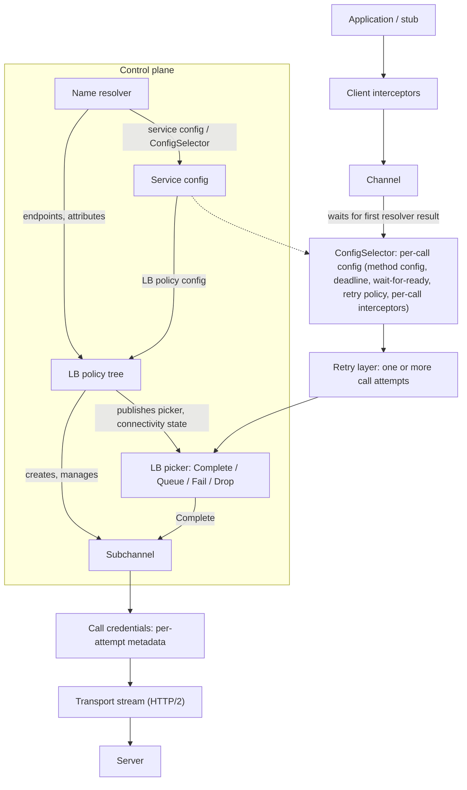
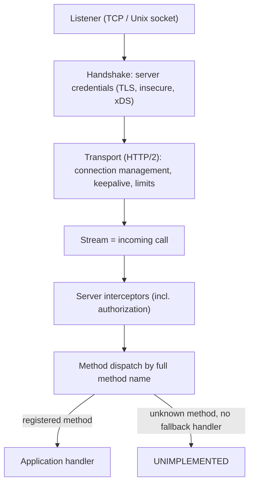

> [!WARNING]
> This document is part of a new, experimental
> [gRPC specification](../README.md). It was generated primarily by AI and has not
> yet been fully reviewed.

# 1. Architecture Overview

<!-- Sources: doc/PROTOCOL-HTTP2.md, doc/service_config.md, A6, A31, A54, A39, A36, A52; layout of this spec -->

This section is **informative** except where it uses RFC 2119 keywords. It
introduces the components of gRPC and how they relate to each other. The
normative definitions are in the sections it links to.

## 1. Services, Methods, and Stubs (Informative)

gRPC is a remote procedure call framework based on message passing. A
**service** is a named group of **methods**. Each method has a request message
type, a response message type, and a cardinality for each direction (one
message or a stream of messages). The method's **full method name** is the
service name and the method name joined by `/`, for example
`helloworld.Greeter/SayHello`. See
[Methods and Services](../02-rpc-semantics/README.md#2-methods-and-services).

Services are normally defined in an **interface definition language (IDL)**.
The usual IDL is Protocol Buffers, where a `service` definition declares
`rpc` methods and their message types. Code generators produce:

- **Client stubs**: typed objects that send RPCs to a method's full method
  name on a channel, serializing requests and deserializing responses with the
  method's codec.
- **Server bases or handler registrations**: typed interfaces that the
  application implements. They are registered with a server under the
  service's name.
- **Descriptors**: method names, types, and cardinalities. Tools such as
  [server reflection](../07-services/reflection.md) and
  [binary logging](../08-observability/binary-logging.md) use them.

gRPC itself treats messages as opaque byte sequences. Only the **codec**
(serializer) understands the message types; see
[Codecs and Content-Subtype](../02-rpc-semantics/README.md#17-codecs-and-content-subtype)
and the [Protocol Buffers mapping](../03-wire-protocol/protobuf.md). Generated
code is a convenience. Every implementation also lets applications send and
serve RPCs by full method name with application-supplied serialization
("generic" calls and handlers).

## 2. Layering

gRPC has three layers:

1. **RPC semantics**: the abstract call model that applications program
   against: methods, calls as two independent streams, metadata, deadlines,
   cancellation, and status. This layer does not depend on the transport. See
   [Core RPC Semantics](../02-rpc-semantics/README.md).
2. **Channel and server machinery**: how a client decides where and how to send
   each call (name resolution, service config, load balancing, retries,
   connection management, credentials), and how a server accepts connections
   and dispatches calls to handlers. See [Client Channel](../04-client-channel/README.md),
   [Server](../05-server/README.md), and [Security](../06-security/README.md).
3. **Wire protocol**: how calls are carried over a transport. The
   interoperable transport is HTTP/2. HTTP/3 is also defined. See
   [Wire Protocol](../03-wire-protocol/README.md).

## 3. Client Architecture

From the application's point of view, a **channel** is a virtual connection to
a **target**, a URI that names a logical service. The channel hides name
resolution, connection management, and load balancing. The application creates
a channel once and sends many RPCs on it. A channel may have zero, one, or many
transport connections at any time, and may send successive RPCs to different
servers. See [Channel](../04-client-channel/channel.md).

Inside the channel, components split into a **control plane** and a **data
plane**. Control-plane components (resolver, LB policy, and their
configuration) decide where and how RPCs go. The data plane is the processing
of each RPC.

### 3.1 Components

| Component | Role | Specified in |
|-----------|------|--------------|
| Client interceptors | Application-supplied code that wraps each call. It can observe or modify headers, messages, and status, or fail the call. | [Core RPC Semantics: Interceptors](../02-rpc-semantics/README.md#16-interceptors) |
| Channel | Owns the other components. Tracks connectivity state (`IDLE`, `CONNECTING`, `READY`, `TRANSIENT_FAILURE`, `SHUTDOWN`) and idleness. Queues calls that cannot proceed yet. | [Channel](../04-client-channel/channel.md) |
| Name resolver | Chosen by the target URI's scheme (for example `dns`, `unix`, `xds`). Produces a stream of results: endpoints (each with one or more addresses), attributes, and an optional service config. | [Name Resolution](../04-client-channel/name-resolution.md) |
| Service config | Per-target configuration published by the service owner, usually delivered by the resolver. Selects the LB policy and holds per-method settings: timeout, wait-for-ready, message size limits, retry or hedging policy. | [Service Config](../04-client-channel/service-config.md) |
| ConfigSelector | Chooses the per-call configuration at the start of each call. By default it looks up the method config in the service config. A resolver may supply its own ConfigSelector (the `xds` resolver does this for routing). The ConfigSelector can also attach per-call interceptors. | [Per-call Configuration and Call Flow](../04-client-channel/call-dispatch.md) |
| Retry layer | Turns one call into one or more **call attempts**, according to the retry or hedging policy and transparent-retry rules. Buffers outgoing messages for replay. | [Retries and Hedging](../04-client-channel/retries.md) |
| LB policy | A tree of policies (for example `pick_first`, `round_robin`, `weighted_round_robin`, `ring_hash`, or the xDS policy tree). It receives resolver results, creates and manages subchannels, sets the channel's connectivity state, and publishes a **picker**. | [Load Balancing](../04-client-channel/load-balancing.md) |
| Picker | Synchronously chooses a subchannel for each call attempt. The result is Complete (a subchannel), Queue, Fail (a status), or Drop (a status). | [Load Balancing](../04-client-channel/load-balancing.md) |
| Subchannel | A logical connection to one address. It manages connection attempts with backoff and has a connectivity state and a health state. | [Subchannels and Connections](../04-client-channel/subchannels.md), [Client-Side Health Checking](../04-client-channel/health-checking.md) |
| Transport | A connected transport, such as an HTTP/2 connection over TCP or a Unix domain socket, possibly through an [HTTP CONNECT proxy](../04-client-channel/proxy.md). It is secured by the channel credentials' handshake and carries call attempts as streams. | [HTTP/2 Transport Behavior](../03-wire-protocol/http2-transport.md), [Security](../06-security/README.md) |
| Channel credentials | Configure transport security (for example TLS or insecure) and perform the handshake for each connection. | [Security](../06-security/README.md), [TLS](../06-security/tls.md) |
| Call credentials | Produce per-call authentication metadata (for example OAuth2 or JWT tokens) for each call attempt, after a transport is chosen. | [Call Credentials](../06-security/call-credentials.md) |

### 3.2 Call Flow

In order:

1. The application starts a call on the channel. It supplies the full method
   name, and optionally a deadline, metadata, call credentials, compression
   settings, and wait-for-ready. Client interceptors registered on the channel
   see the call first. See [Core RPC Semantics: API Requirements](../02-rpc-semantics/README.md#18-api-requirements).
2. If the channel is `IDLE`, it starts name resolution and leaves `IDLE`. Calls
   wait until the channel has a resolver result with a usable service config.
3. The **ConfigSelector** picks the per-call configuration. The effective
   deadline is the earlier of the application's deadline and the configured
   timeout. Wait-for-ready and message limits are settled here, and the retry
   or hedging policy is chosen. Per-call interceptors supplied by the
   ConfigSelector (for example the behavior of xDS HTTP filters) are added to
   the call.
4. The **retry layer** creates a call attempt and replays buffered messages if
   it creates more attempts later.
5. For each attempt, the channel asks the current **picker** for a subchannel.
   A Queue result holds the attempt until the LB policy publishes a new picker.
   A Fail result fails the attempt unless the call is wait-for-ready. A Drop
   result fails the call. Status codes that come from the control plane are
   restricted; see [Core RPC Semantics: Status Codes from the Control Plane](../02-rpc-semantics/README.md#106-status-codes-from-the-control-plane).
6. **Call credentials** produce metadata for the attempt, using information
   about the chosen transport (such as its security level and authority).
7. The attempt is sent as a stream on the subchannel's connected transport.
8. The response status and trailers come back through the retry layer. The
   retry layer may start another attempt. Otherwise the call completes and
   interceptors and the application see the final status.

Instrumentation hooks observe the call at the call level and at the attempt
level; see [Instrumentation](../08-observability/instrumentation.md).

### 3.3 Connection Management

The control plane runs separately from individual calls:

- The resolver delivers new results whenever its data changes (watch-based
  resolvers) or when re-resolution is requested (polling resolvers).
- The channel applies each result. It keeps the previous valid service config
  when the new config is invalid, falls back to the default service config when
  none is returned, and creates or updates the LB policy chosen by the config.
  See [Service Config](../04-client-channel/service-config.md).
- The LB policy creates subchannels for the addresses it wants to use, asks them
  to connect, aggregates their connectivity states into the channel's state,
  requests re-resolution when connections fail, and publishes new pickers. See
  [Load Balancing](../04-client-channel/load-balancing.md).
- Subchannels connect with exponential backoff, maintain keepalive, and report
  connectivity and health state changes. See
  [Subchannels and Connections](../04-client-channel/subchannels.md) and
  [HTTP/2 Transport Behavior](../03-wire-protocol/http2-transport.md).
- After a configurable idle period with no RPCs, the channel returns to `IDLE`.
  It shuts down the LB policy and resolver and drops connections. See
  [Channel](../04-client-channel/channel.md).

## 4. Server Architecture

A **server** accepts connections on one or more listeners and dispatches
incoming calls to registered handlers. See [Server](../05-server/README.md).

1. A **listener** accepts transport connections on a bound address.
2. **Server credentials** perform the security handshake and produce the
   connection's authentication context (peer identity, security level). See
   [Security](../06-security/README.md).
3. The **transport** runs the wire protocol. It enforces connection-level
   limits (maximum concurrent streams, header size, keepalive policy) and
   connection lifetime policies (maximum age, maximum idle, graceful GOAWAY).
   See [HTTP/2 Transport Behavior](../03-wire-protocol/http2-transport.md) and [Server](../05-server/README.md).
4. Each new stream is an incoming call. The server reads the request headers:
   full method name, metadata, timeout (converted to a deadline), authority,
   and content-type.
5. **Server interceptors** run, nested as described in
   [Core RPC Semantics: Ordering](../02-rpc-semantics/README.md#163-ordering). They can reject the call with a
   status, modify metadata, or wrap the handler. Authorization policies are
   enforced at this point. See [Core RPC Semantics: Interceptors](../02-rpc-semantics/README.md#16-interceptors) and
   [Authorization](../06-security/authorization.md).
6. **Method dispatch** finds the handler registered for the full method name.
   If there is none, and the application has not registered a fallback
   handler, the server fails the call with `UNIMPLEMENTED`.
7. The **handler** receives the call (method, metadata, deadline, peer,
   authority, auth context), reads request messages, sends response headers,
   messages, and trailers with a status, and can detect cancellation.

## 5. Pluggability Points

gRPC behavior can be extended or replaced at these points. Each is specified
abstractly so that implementations from different sources are
interchangeable.

| Extension point | Selected by | Specified in |
|-----------------|-------------|--------------|
| Name resolvers | Target URI scheme; registry keyed by scheme | [Name Resolution](../04-client-channel/name-resolution.md) |
| LB policies | `loadBalancingConfig` in the service config; registry keyed by policy name | [Load Balancing](../04-client-channel/load-balancing.md) |
| Channel and server credentials | Application, at channel or server creation | [Security](../06-security/README.md) |
| Certificate providers | Credentials configuration (for example, xDS bootstrap `certificate_providers`) | [TLS](../06-security/tls.md) |
| Call credentials | Application, per channel or per call | [Call Credentials](../06-security/call-credentials.md) |
| Codecs | Method definition or per call; identified by content-subtype | [Core RPC Semantics: Codecs and Content-Subtype](../02-rpc-semantics/README.md#17-codecs-and-content-subtype) |
| Compressors | Registry keyed by `grpc-encoding` name; per channel, call, or message | [Core RPC Semantics: Compression](../02-rpc-semantics/README.md#13-compression) |
| Client and server interceptors | Application, per channel or server; also per call through the ConfigSelector | [Core RPC Semantics: Interceptors](../02-rpc-semantics/README.md#16-interceptors) |
| Instrumentation and observability plugins (call/attempt/server tracers, metrics recorders, tracing) | Application, globally or per channel or server | [Instrumentation Architecture](../08-observability/instrumentation.md), [Metrics Framework and OpenTelemetry Plugin](../08-observability/metrics-framework.md), [Tracing](../08-observability/tracing.md) |
| Audit loggers | Authorization policy configuration | [Authorization](../06-security/authorization.md) |
| xDS HTTP filters, LB policy types, cluster types | xDS configuration; registries keyed by extension type URL | [xDS HTTP Filters](../09-xds/http-filters.md), [xDS LB Policies](../09-xds/lb-policies.md) |

## 6. Where xDS Fits

xDS support is built from the general extension points above rather than being
a separate stack:

- **Client.** A target with the `xds` scheme selects the `xds` resolver. The
  resolver uses an **XdsClient** ([XdsClient](../09-xds/xds-client.md)), configured by
  the bootstrap ([Bootstrap](../09-xds/bootstrap.md)), to watch Listener,
  RouteConfiguration, Cluster, and endpoint resources. It returns:
  - a service config that selects the `xds_cluster_manager` LB policy and the
    xDS LB policy tree ([xDS LB Policies](../09-xds/lb-policies.md));
  - a ConfigSelector that matches each call against xDS routes, picks a
    cluster, and sets timeouts, retry policy, and hash policies
    ([Client Data Plane](../09-xds/client.md));
  - per-call behavior configured by **xDS HTTP filters** such as fault
    injection, RBAC, stateful session affinity, and GCP authentication
    ([xDS HTTP Filters](../09-xds/http-filters.md)). gRPC applies these per RPC, for example
    through interceptors.
- **Server.** An xDS-enabled server wraps a normal server. It uses the
  XdsClient to fetch the server Listener resource, chooses filter chains per
  connection, applies the xDS-configured security, and applies routing and xDS
  HTTP filters (such as RBAC) per call ([xDS-Enabled Servers](../09-xds/server.md)).
- **Security.** xDS channel and server credentials take their TLS
  configuration from xDS resources and certificate providers, falling back to
  application-supplied credentials ([xDS Security](../09-xds/security.md)).
- **Observability.** Load reports go to the control plane through LRS
  ([Load Reporting (LRS)](../09-xds/load-reporting.md)). The XdsClient's state is exposed through
  CSDS ([Client Status Discovery Service (CSDS)](../09-xds/csds.md)) and the [admin interface](../07-services/admin.md).

## 7. API Requirements

This section adds no API requirements of its own. The API requirements for
each component are stated in the section that specifies it, for example
[Core RPC Semantics: API Requirements](../02-rpc-semantics/README.md#18-api-requirements) for calls,
[Channel](../04-client-channel/channel.md) for channels, and
[Server: API Requirements](../05-server/README.md#7-api-requirements) for servers.
