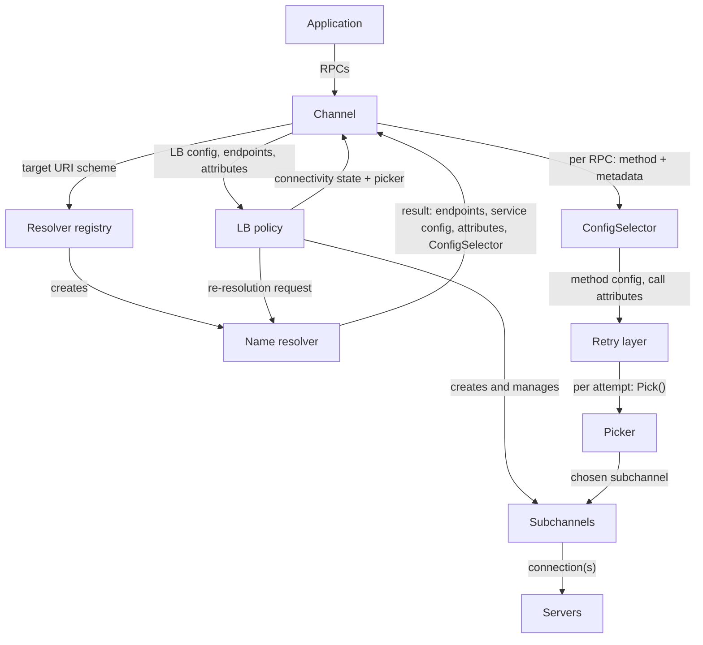

> [!WARNING]
> This document is part of a new, experimental
> [gRPC specification](../README.md). It was generated primarily by AI and has not
> yet been fully reviewed.

# 4.1 Client Channel Architecture

<!-- Sources: doc/load-balancing.md, doc/naming.md, doc/service_config.md, A31, A61 -->

## 1. Components

The client channel has these main components:

| Component | Responsibility | Specified in |
| --- | --- | --- |
| **Channel** | The application-facing object. It parses the target, owns the other components, reports connectivity state, manages idleness, and dispatches RPCs. | [Channel](02-channel.md) |
| **Name resolver** | Selected by the target URI scheme. It resolves the target into a list of endpoints (each with one or more addresses), an optional service config, attributes, and optionally a ConfigSelector. | [Name Resolution](03-name-resolution.md) |
| **Service config** | Configuration published by the service owner, usually delivered by the resolver. It selects and configures the LB policy and supplies per-method settings such as timeouts and retry policies. | [Service Config](04-service-config.md) |
| **ConfigSelector** | An internal per-RPC hook, supplied with each resolver result. It chooses the per-method configuration and per-call attributes for each RPC. | [Per-call Configuration and Call Flow](05-call-dispatch.md) |
| **Load balancing (LB) policy** | Creates and manages subchannels, sets the channel's connectivity state, and supplies a **picker** that chooses a subchannel for each RPC attempt. LB policies can form a tree. | [Load Balancing](06-load-balancing.md), [lb-policies/](lb-policies) |
| **Subchannel** | A potential or established connection (or a small set of connections) to one address. The channel implements it; the LB policy manages it. | [Subchannels and Connections](07-subchannels.md) |
| **Retry layer** | Sits between the channel's per-call configuration and the LB pick. It runs transparent retries, configurable retries, and hedging. Every attempt is load-balanced independently. | [Retries and Hedging](12-retries.md) |

Supporting mechanisms: [HTTP CONNECT proxy support](09-proxy.md),
[client-side health checking](10-health-checking.md), and
[client-side backend metrics (ORCA)](11-backend-metrics.md). The last two run
connection-scoped streams on subchannels, using the common mechanism in
[Subchannels and Connections: Connection-Scoped Watchers and Streams](07-subchannels.md#9-connection-scoped-watchers-and-streams).

## 2. Architecture

## 3. Connection Establishment Walkthrough

Here is what a channel does from creation to sending its first RPC with a
typical LB policy:

1. The application creates the channel with a target, channel credentials,
   and options. The channel parses the target, looks up the resolver factory
   for the URI scheme (falling back to `dns:///` when needed), and computes
   the default authority. The channel starts in `IDLE`. No name resolution
   or connection attempt happens yet. See [Channel](02-channel.md).
2. The application sends an RPC or asks the channel to connect. The channel
   leaves `IDLE`, creates the resolver, starts it, and reports `CONNECTING`.
   RPCs are queued until the first resolver result arrives.
3. The resolver returns a result: a list of endpoints and either a service
   config, a service config error, or no service config. It may also include
   attributes, a resolution note, and a ConfigSelector. See
   [Name Resolution](03-name-resolution.md).
4. The channel picks the service config to use (the resolver's config, the
   previously used config, or the default service config), selects the LB
   policy from it, and creates the LB policy or updates the existing one with
   the endpoints, the parsed LB config, the attributes, and the resolution
   note. See [Service Config](04-service-config.md).
5. The LB policy creates subchannels for the addresses it chooses to use and
   asks some or all of them to connect. It reports `CONNECTING` with a picker
   that queues picks. See [Load Balancing](06-load-balancing.md) and
   [Subchannels and Connections](07-subchannels.md).
6. After the LB policy update has been applied, the channel installs the new
   service config and ConfigSelector. It then re-processes the RPCs that were
   waiting for a resolver result. For each RPC, the ConfigSelector picks the
   method config, which sets the deadline, `wait_for_ready`, message size
   limits, and retry policy. The RPC then enters the retry layer, which
   starts an attempt and asks the current picker for a subchannel. See
   [Per-call Configuration and Call Flow](05-call-dispatch.md).
7. When a subchannel connects, the LB policy reports `READY` with a new
   picker. The channel re-runs the queued picks. Each completed pick yields a
   subchannel with a connection, and the attempt is started as a stream on
   that connection.
8. Later, when connections fail, the LB policy reconnects and may ask the
   resolver to re-resolve. When the channel has had no RPCs for the idle
   timeout, it returns to `IDLE` by shutting down the LB policy (and with it
   all subchannels) and the resolver.
