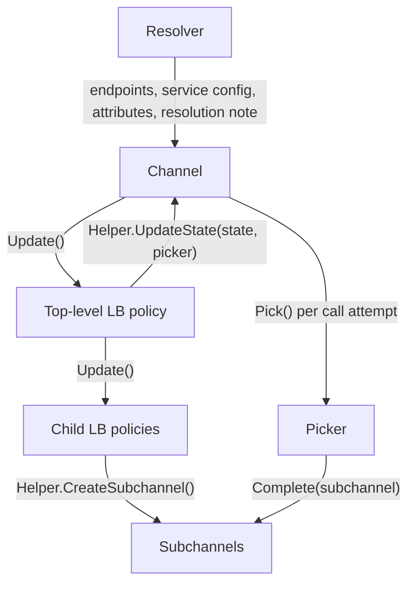

> [!WARNING]
> This document is part of a new, experimental
> [gRPC specification](../README.md). It was generated primarily by AI and has not
> yet been fully reviewed.

# 4.6 Load Balancing

<!-- Sources: doc/load-balancing.md, grpc-proto grpc/service_config/service_config.proto, A24, A51 (client side), A54, A56, A61, A62, A78, A81, A79, A88, A89, A108 -->

Load balancing in gRPC is performed per call, not per connection: even
when all calls come from a single client, each call is load-balanced
independently across the available servers. The component that makes
these decisions is the **load balancing (LB) policy**. This section
specifies the LB policy architecture: the internal plugin APIs between the
channel, LB policies, pickers, and subchannels; the rules that all
policies follow; and the composition of policies into trees. The
individual policies provided by gRPC are specified in the files under
[`lb-policies/`](#15-provided-lb-policies).

## 1. Overview

An LB policy is responsible for the following channel-level behavior:

- Deciding which [subchannels](07-subchannels.md) to create, based on the
  endpoints returned by the [resolver](03-name-resolution.md).
- Deciding when each subchannel attempts to connect or reconnect.
- Deciding when to request re-resolution from the resolver.
- Determining the channel's [connectivity state](02-channel.md).
- For each call attempt, deciding which subchannel the attempt is sent on.

The per-call decision is performance-sensitive, so it is split out into a
separate object called a **picker**, which the LB policy creates and hands
to the channel. The LB policy itself runs in the channel's *control
plane*; the picker runs in the *data plane*.

The channel creates the top-level LB policy from the
[service config](04-service-config.md) and passes it each resolver update.
An LB policy may in turn create child LB policies, forming a tree (see
[Policy Hierarchy](#9-policy-hierarchy)). Policies interact with their parent
through a [helper](#5-helper-api); the top-level policy's parent is the
channel.

### 1.1 Synchronization Model

All calls into an LB policy (update, exit-idle, reset-backoff, shutdown,
and subchannel state notifications) and all calls from the LB policy into
its helper MUST be serialized with respect to each other. This
spec calls this serialization domain the channel's *control plane*.
Timers owned by an LB policy SHOULD fire in the same serialization domain.

Pickers are invoked from the data plane, possibly concurrently from many
threads. A picker MUST be safe for concurrent use, MUST NOT block, and
MUST NOT call into the LB policy or helper directly. When a picker needs
the LB policy to take an action (for example, to trigger a connection
attempt), it MUST schedule that action to run in the control plane and
return without waiting for it.

## 2. LB Policy Registry and Configuration

> **Introduced by:** [gRFC A24: Load Balancing Policy Configuration](https://github.com/grpc/proposal/blob/master/A24-lb-policy-config.md)

LB policies are registered in a process-wide registry, keyed by policy
name. Only one policy can be registered for a given name. The registry
entry for a policy is a factory with two operations:

| Operation | Description |
| --- | --- |
| **ParseConfig(json)** | Parses and validates the policy's configuration from its JSON form and returns either a parsed config object or a validation error. Called during [service config](04-service-config.md) parsing (typically from the resolver), and by parent policies when parsing child-policy configs. |
| **CreatePolicy(helper)** | Creates a new instance of the policy. The helper is the object the new policy uses to communicate with its parent. |

An LB policy configuration is expressed as a `LoadBalancingConfig` list
(see `grpc/service_config/service_config.proto`). Each list element is a
JSON object with exactly one key, the policy name, whose value is that
policy's config. The same list form is used both for the service config's
`loadBalancingConfig` field and for every child-policy field inside a
policy config (for example, `childPolicy`). A list is resolved as follows:

1. Iterate over the list in order and select the first element whose
   policy name is present in the registry.
2. Call that policy's `ParseConfig()` on the element's value. If parsing
   fails, the whole list is invalid. Later list elements are not
   considered.
3. If no element names a registered policy, the list is invalid.

An invalid list makes the enclosing config invalid. For the top-level
list, this makes the service config invalid; see
[Service Config](04-service-config.md) for how the channel handles that,
and for how the channel chooses the top-level policy when the service
config specifies none (the default is `pick_first`).

Policy names that end in `_experimental` denote policies whose
configuration interface is not yet stable. Such names are marked
experimental wherever they appear in this spec.

## 3. Resolver Updates: Endpoints, Addresses, and Attributes

An update passed to an LB policy contains:

| Field | Description |
| --- | --- |
| Config | The policy's parsed config, produced by its factory's `ParseConfig()`. |
| Endpoints | Either an error status, or an ordered list of **endpoints**. Each endpoint has an ordered list of one or more **addresses** and a set of per-endpoint attributes. Addresses MAY also carry per-address attributes. |
| Attributes | Top-level attributes (key/value pairs) from the resolver, or as modified by a parent policy. |
| Resolution note | A human-readable string giving context about the resolution (for example, xDS errors that the resolver is tolerating). Included in error messages; see [Error Messages](#11-error-messages). |

The order of endpoints, and of addresses within an endpoint, can be
significant to an LB policy (for example, `pick_first` connects in order).

### 3.1 Well-Known Attributes

Attributes are the mechanism for passing information between the
resolver and LB policies, and from parent policies to their children. The
representation of attributes is implementation-defined. The following
attributes have defined semantics in this spec:

| Attribute | Level | Set by | Used by |
| --- | --- | --- | --- |
| Hierarchical path | Endpoint | xDS policies, or any parent that routes endpoints to named children | `priority`, `weighted_target` ([Hierarchical Address Paths](#94-hierarchical-address-paths)) |
| Endpoint weight | Endpoint | xDS (EDS) or a custom resolver | `ring_hash` |
| Endpoint hash key (`hash_key`) | Endpoint | xDS (EDS metadata) or a custom resolver | `ring_hash` |
| Locality name | Top-level (as passed to a child) | `weighted_target` | `weighted_round_robin` metrics label `grpc.lb.locality` |
| Backend service | Top-level | xDS | `weighted_round_robin` metrics label `grpc.lb.backend_service` |
| Hostname | Endpoint | xDS (EDS, logical DNS) | xDS authority rewriting ([Authority Override](#66-authority-override)) |
| Max connections per subchannel | Top-level, or per subchannel creation | Channel (from service config) or xDS | Subchannel ([Subchannels and Connections](07-subchannels.md)) |

### 3.2 Endpoint Identity

When a policy needs to match endpoints in a new update against endpoints
it already knows about (to retain per-endpoint state such as connections,
weights, request counts, or ejection state), it MUST identify an endpoint
by the **unordered set of its addresses**. An endpoint with addresses
`[A, B]` in one update is the same endpoint as one with addresses
`[B, A]` in the next. If an address is added to or removed from an
endpoint, the result is a different endpoint.

When an endpoint is retained but its address order changes, the policy
MUST pass the new order down to whatever child is handling that endpoint,
because order matters for connection establishment.

`ring_hash` and `outlier_detection` MUST ignore attributes when comparing
endpoints. For other policies, whether attributes are part of an
endpoint's identity is implementation-defined.

## 4. LB Policy API

An LB policy instance provides the following operations to its parent:

| Operation | Description |
| --- | --- |
| **Update(update) → status** | Delivers a new update ([Resolver Updates: Endpoints, Addresses, and Attributes](#3-resolver-updates-endpoints-addresses-and-attributes)). The policy creates, retains, or removes subchannels or children as needed and then reports its state and a picker through the helper. It returns OK if it accepted the update, or a non-OK status if it rejected it. |
| **ExitIdle()** | Asks the policy to leave IDLE and begin connecting. A no-op for policies that do not use IDLE. Parents forward it to children as appropriate. |
| **ResetBackoff()** | Asks the policy to reset connection backoff for all of its subchannels and to forward the request to its children, so that the next connection attempt is not delayed. Triggered by the channel API for resetting backoff ([Channel](02-channel.md)). |
| **Shutdown()** | Destroys the policy. The policy MUST release all of its subchannels and child policies and cancel its timers, and MUST NOT call its helper afterward. |

### 4.1 Update Status

A policy SHOULD reject an update (return non-OK, normally
`UNAVAILABLE`) when it cannot use it, for example when the endpoint list
is empty. The channel passes the top-level policy's status back to the
resolver, which for polling resolvers triggers re-resolution with backoff
(see [Name Resolution](03-name-resolution.md)). A parent policy SHOULD
combine its children's statuses into its own.

A policy that rejects an update because the endpoint list is empty MUST
still report TRANSIENT_FAILURE with a picker that fails calls (see
[Error Messages](#11-error-messages)).

### 4.2 Endpoint Errors

When the endpoints field of an update is an error:

- If the policy has no previously accepted endpoint list, it MUST report
  TRANSIENT_FAILURE with a picker that fails calls with that error (as
  status `UNAVAILABLE`, including the resolution note).
- Otherwise, it SHOULD keep using its previous endpoint list and
  connections. In particular, it SHOULD NOT close working connections or
  report TRANSIENT_FAILURE because of the error. If it is already in
  TRANSIENT_FAILURE, it MAY update its failing picker to include the new
  error.

### 4.3 Initial State

A newly created policy is considered to be in CONNECTING until it first
reports a state. A parent MUST treat a child that has not yet reported a
state as CONNECTING, with a picker that queues.

## 5. Helper API

When a parent creates an LB policy, it passes a helper object. The
helper provides at least:

| Operation | Description |
| --- | --- |
| **CreateSubchannel(address, attributes) → subchannel** | Creates a subchannel for a single address. Attributes can be address or endpoint attributes, and can include per-subchannel settings such as max connections per subchannel. See [Subchannels and Connections](07-subchannels.md). |
| **UpdateState(state, status, picker)** | Reports the policy's connectivity state and a new picker. `status` is the error associated with TRANSIENT_FAILURE, and is OK otherwise. Every call MUST provide a new picker, even if the state did not change. |
| **RequestReresolution()** | Asks the resolver to re-resolve. Polling resolvers re-resolve, subject to their own rate limiting. Watch-based resolvers ignore it. |

The helper also provides the following capabilities, which the provided
policies need:

- The channel target and default authority.
- Timer scheduling in the control plane, and a way to schedule work into
  the control plane from a picker ([Synchronization Model](#11-synchronization-model)).
- Access to the channel's metrics recorder, for policies that export
  metrics (see [Metric Catalog](../08-observability/04-metrics.md)).
- A way to add channel trace events (see
  [Channelz](../08-observability/06-channelz.md)).
- A way to create a channel to another target that uses the parent
  channel's channel credentials (including attached call credentials) and
  default authority, for policies that talk to a control-plane server
  (for example, the [`rls`](lb-policies/rls.md) control channel).

A parent policy gives each child a helper that the parent implements.
Through it, the parent can:

- Intercept `CreateSubchannel()` and wrap the returned subchannel (for
  example, `outlier_detection` wraps subchannels to control their health
  state, and `weighted_round_robin` intercepts subchannel creation to
  start backend-metric watches).
- Intercept `UpdateState()` to record the child's state and picker and
  compute its own aggregate state and picker.
- Forward or suppress `RequestReresolution()` (for example, `priority`
  can ignore re-resolution requests from some children).

A child policy MUST NOT need to know whether its helper belongs to the
channel or to a parent policy.

## 6. Picker API

The picker has a single operation, **Pick(args) → result**, which the
channel invokes synchronously for each call attempt.

### 6.1 Pick Arguments

| Argument | Description |
| --- | --- |
| Method | The full method path of the call (`/package.Service/Method`). |
| Request metadata | The call's initial metadata (read-only), as it will be sent on the wire, excluding headers that the transport adds. |
| Call attributes | Per-call values set by the [ConfigSelector](05-call-dispatch.md) or by interceptors, such as the xDS cluster name, the request hash used by `ring_hash`, the route's authority-rewrite setting, or the stateful session override address list. |
| Call attempt tracer access | A way for the picker to set per-call metric labels ([Picker-Supplied Metric Labels](#65-picker-supplied-metric-labels)). |
| Custom telemetry label | The call's custom per-call telemetry label, if the application set one (empty otherwise). **Experimental.** See [Instrumentation Architecture](../08-observability/02-instrumentation.md). |

### 6.2 Pick Results

| Result | Contents | Channel behavior |
| --- | --- | --- |
| **Complete** | A subchannel. Optionally: a call tracker ([Call-Completion Tracking](#64-call-completion-tracking)), an authority override ([Authority Override](#66-authority-override)), and request headers to add to the attempt's metadata (each replaces any existing value of that header; used by [`rls`](lb-policies/rls.md)). | The channel gets a connection from the subchannel and starts the attempt on it. If the subchannel has no connection, the channel treats the result as Queue (see [Subchannels and Connections](07-subchannels.md)). |
| **Queue** | — | The channel holds the call attempt and re-picks it with the next picker the policy reports. |
| **Fail** | A non-OK status. | If the call is [wait-for-ready](../02-rpc-semantics/README.md), the channel treats the result as Queue. Otherwise it fails the attempt with the status, which [configurable retries](12-retries.md) may then retry. Pick failures are not retried transparently. |
| **Drop** | A non-OK status. | The channel fails the call with the status even if it is wait-for-ready, and the call MUST NOT be retried. Used when a control plane tells the client to shed load, or when queuing the call could hold resources indefinitely (for example, the xDS [`cds`](../09-xds/lb-policies/cds.md) policy for a cluster that is in error). |

Before a Fail or Drop status is applied to a call, the channel MUST
apply the control-plane status-code restriction: if the code is one of
`OK`, `INVALID_ARGUMENT`, `NOT_FOUND`, `ALREADY_EXISTS`,
`FAILED_PRECONDITION`, `ABORTED`, `OUT_OF_RANGE`, or `DATA_LOSS`, the
channel rewrites it to `INTERNAL` and puts the original code and message
in the new message (see [2. Core RPC Semantics](../02-rpc-semantics/README.md)).
Retry-policy status matching happens after this rewrite.

Whenever the policy reports a new picker, the channel MUST re-pick every
queued call attempt with the new picker.

A picker's results normally track the reported state (Complete in READY,
Queue in IDLE or CONNECTING, Fail in TRANSIENT_FAILURE), but this is not
guaranteed. A policy that routes on per-call properties can report READY
and still fail an individual pick that it cannot route.

### 6.3 Triggering Work From a Picker

A picker that needs a connection attempt (for example, `pick_first` in
IDLE, or `ring_hash` choosing an IDLE endpoint) MUST schedule the
connection request in the control plane and return Queue. The control
plane then calls the subchannel's `RequestConnection()` or the child's
`ExitIdle()`.

### 6.4 Call-Completion Tracking

A Complete result can include a **call tracker**, which lets the policy
observe the outcome of the call attempt. The tracker is notified:

- When the attempt is started on a connection.
- When the attempt finishes, with:
  - The final status of the attempt.
  - Access to the trailing metadata.
  - The backend metrics from the `endpoint-load-metrics-bin` trailer, if
    present, parsed on demand. The trailer MUST be parsed at most once
    per attempt, however many trackers read it (see
    [Consuming Backend Metrics](#13-consuming-backend-metrics)).

If several policies in a tree each want to track the call, each parent
wraps its child's tracker, so every policy is notified.

The finish notification MUST be delivered exactly once for every
Complete result that is used for an attempt, whatever the outcome,
including failures generated locally by the subchannel or transport. If
a Complete result cannot be used because the subchannel has no
connection ([Subchannels and Connections](07-subchannels.md)), the policy MUST still be
able to undo any per-call accounting it did at pick time (for example,
an outstanding-request counter incremented in the picker). For example,
the channel can deliver a finish notification for the unused result, the
tracker can undo the accounting when it is discarded, or the policy can
defer its accounting until the attempt is started on a connection.

### 6.5 Picker-Supplied Metric Labels

> **Introduced by:** [gRFC A78: gRPC OTel Metrics for WRR, Pick First, and XdsClient](https://github.com/grpc/proposal/blob/master/A78-grpc-metrics-wrr-pf-xds.md)

A picker can set optional per-call metric labels on the call attempt's
tracer. Two labels are defined:

| Label | Meaning |
| --- | --- |
| `grpc.lb.locality` | The locality the attempt is routed to, in the form `{region="${REGION}", zone="${ZONE}", sub_zone="${SUB_ZONE}"}`, or empty if unknown. |
| `grpc.lb.backend_service` | The backend service the attempt is routed to (for xDS, the cluster name), or empty if not relevant. |

A picker that has a value for a label MUST set it on every pick for which
the value is available, whatever the pick's result, so that calls that end in
`DEADLINE_EXCEEDED` or `UNAVAILABLE` while queued are still labeled. If
a label is set on more than one pick for the same attempt, the value
from the last pick wins. The per-call metrics that carry these labels are
specified in [Metric Catalog](../08-observability/04-metrics.md).

### 6.6 Authority Override

> **Introduced by:** [gRFC A81: xDS Authority Rewriting](https://github.com/grpc/proposal/blob/master/A81-xds-authority-rewriting.md)

A Complete result can specify a value for the attempt's `:authority`
header. This override takes precedence over the default authority from
the resolver, the channel options, and per-address attributes. An
authority that the application set explicitly on the call takes
precedence over the override. The resulting `:authority` MUST be subject
to the channel credentials' secure-naming check; for TLS, this is a
per-call check that the authority matches the server certificate (see
[TLS](../06-security/02-tls.md)). xDS authority rewriting
uses this mechanism.

## 7. Subchannel Interface for LB Policies

The channel implements subchannels ([Subchannels and Connections](07-subchannels.md)).
The interface that LB policies see provides:

| Operation | Description |
| --- | --- |
| **Connectivity state watch** | Start or stop receiving the subchannel's raw [connectivity state](07-subchannels.md) (IDLE, CONNECTING, READY, TRANSIENT_FAILURE), plus the failure status in TRANSIENT_FAILURE. Policies normally start the watch when they create the subchannel and keep it until they release the subchannel. The watch can be part of subchannel creation. |
| **Health state watch** | Start or stop receiving the subchannel's [health state](#10-generic-health-reporting), which combines the connectivity state with all configured health signals. |
| **RequestConnection()** | Asks the subchannel to start a connection attempt. Has an effect only in IDLE; a no-op in any other state. |
| **ResetBackoff()** | Resets the subchannel's connection backoff. |
| **Backend metric OOB watch** | Registers or unregisters a watcher for out-of-band backend metric reports, with a requested reporting interval ([Client-Side Backend Metrics (ORCA)](11-backend-metrics.md)). This is one of the connection-scoped watchers specified in [Subchannels and Connections: Connection-Scoped Watchers and Streams](07-subchannels.md#9-connection-scoped-watchers-and-streams). |
| **Address** | Returns the subchannel's address. |
| **Release** | Releases the policy's reference to the subchannel. A subchannel with no remaining references is shut down. |

Watch notifications are delivered in the control plane.

A subchannel can report any state at any time, including immediately
after creation and in states that the policy did not cause (for
example, when subchannels are shared, see
[Subchannels and Connections](07-subchannels.md)). Policies MUST handle any state
transition at any time.

The subchannel's connection object is visible to the channel but not to
LB policies.

## 8. Connectivity State Aggregation

An LB policy decides what connectivity state to report. Most policies
aggregate the states of their subchannels or children, using these
**normal aggregation rules** (first match wins):

1. If any child is READY, report READY.
2. Otherwise, if any child is CONNECTING, report CONNECTING.
3. Otherwise, if any child is IDLE, report IDLE.
4. Otherwise (all children are TRANSIENT_FAILURE, or there are no
   children), report TRANSIENT_FAILURE.

Policies SHOULD use these rules unless they have a specific reason to
differ. Two standard variations apply to policies that keep every child
connected (`round_robin`, `weighted_round_robin`, `least_request`):

- **Sticky TRANSIENT_FAILURE.** A child that reported TRANSIENT_FAILURE
  is counted as TRANSIENT_FAILURE until it reports READY, even if it
  meanwhile reports CONNECTING or IDLE while retrying.
- **IDLE counts as CONNECTING.** Because these policies immediately ask
  an IDLE child to connect, an IDLE child is counted as CONNECTING.

Policies with other connection strategies define their own rules (for
example, [`ring_hash`](lb-policies/ring_hash.md)). The resulting channel
connectivity semantics are described in [Channel](02-channel.md).

## 9. Policy Hierarchy

### 9.1 Leaf, Parent, and Petiole Policies

- A **leaf policy** creates and manages subchannels directly.
- A **parent policy** delegates to one or more child LB policies.
- A **petiole policy** balances across endpoints by creating one child
  policy per endpoint.

`pick_first` is the **universal leaf policy**. It is the only provided
policy that manages subchannels directly. It implements address-level
connection logic, including Happy Eyeballs (see
[`pick_first` LB Policy](lb-policies/pick_first.md)). All other
provided policies that balance across endpoints are petiole policies:
`round_robin`, `weighted_round_robin`, `least_request`, and `ring_hash`.

A petiole policy:

1. Creates one `pick_first` child for each endpoint and gives it an update
   containing just that endpoint, with all of its addresses in order.
2. Enables the `pick_first` child's internal health-reporting option
   ([Generic Health Reporting](#10-generic-health-reporting)).
3. Uses each child's reported state as the state of that endpoint.
4. Picks by choosing an endpoint and delegating to that endpoint child's
   picker.
5. Forwards re-resolution requests from children to its own helper.

A petiole policy MUST make sure that failed picks still carry the
underlying connection error. For example, it can fail picks by
delegating to the picker of one of its TRANSIENT_FAILURE children (see
[Error Messages](#11-error-messages)).

### 9.2 Endpoint Retention Across Updates

When a petiole policy receives a new endpoint list, it MUST keep the
existing child (and that child's connections) for every endpoint that is
still present according to [Endpoint Identity](#32-endpoint-identity), and pass
it the endpoint's current address order. It creates children for new
endpoints and shuts down children for removed endpoints. Per-endpoint
state such as weights or outstanding request counts MUST be keyed the
same way, so that it is retained along with the endpoint.

An implementation MAY instead build a complete new set of children for
each update, if subchannel sharing ([Subchannels and Connections](07-subchannels.md))
guarantees that unchanged addresses reuse existing connections. In that
case, it SHOULD keep using the old set until the new set has reported
initial states, so that calls are not delayed. The behavior seen from
outside MUST match the retention behavior above.

### 9.3 Parents With Named Children

Some parent policies (`priority`, `weighted_target`, and xDS policies
such as `xds_cluster_manager`) have a map of named children in their
config. The name is the child's identity. On each config update, a child
whose name is still present gets an update with its new config. The
policy does not recreate the child unless the child's policy name
changed (see [Gracefully Switching LB Policies](#12-gracefully-switching-lb-policies)).

While a parent applies an update to its children, the children may
report new states synchronously. A parent MUST NOT compute or report an
aggregate state from a partially applied update. It MUST wait until it
has updated all children, and then compute and report its state once.

### 9.4 Hierarchical Address Paths

When a tree contains multi-child policies, each leaf needs a different
subset of the endpoints. To support this, each endpoint can carry a
**hierarchical path** attribute: a list of child names, one per level
of named-child policies below the point where the path is attached.

A policy that routes endpoints to named children by path:

1. Looks at the first element of each endpoint's path, and sends the
   endpoint to the child with that name.
2. Removes that first element before passing the endpoint down.
3. Ignores endpoints whose path is empty or names a child that is not
   in its config.

For example, with `priority` → {`child0`, `child1`} →
`weighted_target` → {localities} → `round_robin`:

| Endpoint | Path at `priority` | Path at `weighted_target` | Path at `round_robin` |
| --- | --- | --- | --- |
| 10.0.0.1:80 | `["child0", "localityA"]` | `["localityA"]` | `[]` |
| 10.0.0.2:80 | `["child0", "localityB"]` | `["localityB"]` | `[]` |
| 10.0.0.3:80 | `["child1", "localityC"]` | `["localityC"]` | `[]` |

## 10. Generic Health Reporting

> **Introduced by:** [gRFC A61: IPv4 and IPv6 Dualstack Backend Support](https://github.com/grpc/proposal/blob/master/A61-IPv4-IPv6-dualstack-backends.md)

Several mechanisms give a health signal for a connection, separate from
its connectivity: [client-side health checking](10-health-checking.md) and
[outlier detection](lb-policies/outlier_detection.md). These signals are
exposed through the subchannel's **health state watch**. The health state
is:

- The raw connectivity state, while that state is not READY.
- While the raw state is READY: READY if every configured health
  mechanism considers the subchannel healthy. Otherwise it is the state
  the mechanism reports, normally TRANSIENT_FAILURE with a status that
  describes the problem, or CONNECTING while the first health-check
  response is pending.

If no health mechanism is configured, the health state equals the raw
connectivity state. A mechanism can override the health state by
wrapping the subchannel's health watch (outlier detection does this).

Health signals MUST NOT affect connection management:

- `pick_first` makes all connection decisions from the raw connectivity
  state.
- `pick_first` has an **internal health-reporting option**. Petiole
  policies enable it on the `pick_first` children they create.
  Applications MUST NOT be able to enable it.
- When the option is enabled, once `pick_first` selects a READY
  subchannel, it starts a health watch on that subchannel. It reports the
  health state, not the raw state, to its parent.
- When the option is disabled (including whenever `pick_first` is the
  top-level policy), `pick_first` does not start a health watch.
  Health checking and outlier ejection then have no effect.

Unhealthy endpoints therefore show up to petiole policies as
TRANSIENT_FAILURE, so the petiole stops sending them traffic. The
connection stays open, so the endpoint can be used again as soon as it
becomes healthy.

## 11. Error Messages

When a policy fails picks because it cannot connect, the status MUST be
`UNAVAILABLE`, and the message MUST include:

1. The most recent connection failure seen by the policy, including the
   address and the subchannel's failure status. For example:
   `failed to connect to all addresses; last error: ipv4:127.0.0.1:443: Connection refused`.
2. The resolution note from the most recent update, if non-empty.

The same requirement applies to other failures the policy generates,
such as an empty endpoint list (for example,
`empty address list: <resolution note>`). Parent and petiole policies
MUST preserve these details when they surface failures from their
children. They MAY add context but MUST NOT replace the child's message
with a generic one.

## 12. Gracefully Switching LB Policies

When the service config changes, the channel can need a different
top-level policy. The channel MUST switch without unnecessarily delaying
calls:

1. On each update, the channel determines which policy to use from the
   new service config.
2. If the policy name is unchanged, the channel passes the update to the
   existing policy instance.
3. If the name changed, the channel creates a new policy instance and
   gives it the update. The old policy keeps running in the meantime.
4. If the channel's current state is not READY, the new policy replaces
   the old one immediately.
5. Otherwise, the channel keeps using the old policy's picker until either
   the new policy reports READY or TRANSIENT_FAILURE, or the old policy
   reports a state other than READY, whichever happens first. The new
   policy then replaces the old one, and the old one is shut down.

A parent policy whose child's policy name can change between updates
(for example, the `childPolicy` of `outlier_detection` or the `config` of
a `priority` child) MUST use the same procedure for that child.

## 13. Consuming Backend Metrics

> **Introduced by:** [gRFC A51: Custom Backend Metrics Support](https://github.com/grpc/proposal/blob/master/A51-custom-backend-metrics.md)

LB policies can consume backend metrics (ORCA load reports) sent by
servers, either per call, through the call tracker
([Call-Completion Tracking](#64-call-completion-tracking)), or out of band, by registering
an OOB backend metric watcher on a subchannel
([Subchannel Interface for LB Policies](#7-subchannel-interface-for-lb-policies)). Both modes are
specified in [Client-Side Backend Metrics](11-backend-metrics.md). The
out-of-band mode uses the connection-scoped watcher and stream mechanism
specified in [Subchannels and Connections: Connection-Scoped Watchers and Streams](07-subchannels.md#9-connection-scoped-watchers-and-streams).

## 14. API Requirements

- The public API MUST let applications implement custom LB policies
  against the LB policy, helper, picker, and subchannel interfaces in
  this section, and register them by name in the LB policy registry.
- The public API MUST let custom policies act as parent policies, using
  the registry to parse child-policy configs and create child policies.
  This includes delegating to the provided policies, such as
  `pick_first` as a per-endpoint leaf.
- A custom policy registered by name MUST be selectable through the
  service config's `loadBalancingConfig` field exactly like a provided
  policy, with its JSON config passed to its `ParseConfig()`.
- The channel API MUST provide a way for the application to specify the
  LB policy to use when the service config does not specify one. The
  `loadBalancingConfig` field of the default service config satisfies this
  requirement (see [Channel](02-channel.md) and
  [Service Config](04-service-config.md)).
- The channel API MUST provide a way to reset connection backoff
  ([LB Policy API](#4-lb-policy-api)).
- The API available to custom policies MUST include call-completion
  tracking with access to the final status, trailing metadata, and
  per-call backend metrics. It MUST also include OOB backend metric
  subscriptions, the generic health watch, and picker-supplied
  `:authority` overrides.
- The helper MUST give LB policies, including custom ones, access to the
  channel's metrics recorder (stats plugin group) for recording
  non-per-call metrics and registering gauge callbacks (see
  [Metrics Framework and OpenTelemetry Plugin](../08-observability/03-metrics-framework.md)).
- Applications MUST NOT be able to enable the `pick_first` internal
  health-reporting option except by delegating to `pick_first` from a
  policy acting as a petiole.
- The channel API MUST provide a way to set the cap on `ring_hash` ring
  size ([`ring_hash` LB Policy](lb-policies/ring_hash.md)), and to set
  the Happy Eyeballs Connection Attempt Delay
  ([`pick_first` LB Policy](lb-policies/pick_first.md)).

## 15. Provided LB Policies

Each provided policy is specified in its own document:

| Policy | Registered name | Kind |
| --- | --- | --- |
| [`pick_first`](lb-policies/pick_first.md) | `pick_first` | Leaf (default policy) |
| [`round_robin`](lb-policies/round_robin.md) | `round_robin` | Petiole |
| [`weighted_round_robin`](lb-policies/weighted_round_robin.md) | `weighted_round_robin` | Petiole |
| [`least_request`](lb-policies/least_request.md) | `least_request_experimental` (experimental) | Petiole |
| [`ring_hash`](lb-policies/ring_hash.md) | `ring_hash_experimental` (experimental) | Petiole |
| [`random_subsetting`](lb-policies/random_subsetting.md) | `random_subsetting_experimental` (experimental) | Parent (one child) |
| [`outlier_detection`](lb-policies/outlier_detection.md) | `outlier_detection_experimental` (experimental) | Parent (one child) |
| [`priority`](lb-policies/priority.md) | `priority_experimental` (experimental) | Parent (named children) |
| [`weighted_target`](lb-policies/weighted_target.md) | `weighted_target_experimental` (experimental) | Parent (named children) |
| [`rls`](lb-policies/rls.md) | `rls_experimental` (experimental) | Parent (one child per target) |

The xDS-specific policies (`cds`, `xds_cluster_impl`,
`xds_cluster_manager`, `xds_override_host`, and `xds_wrr_locality`), and
the conversion of xDS LB policy configuration into the configs above, are
specified in [xDS LB Policies](../09-xds/06-lb-policies.md).
