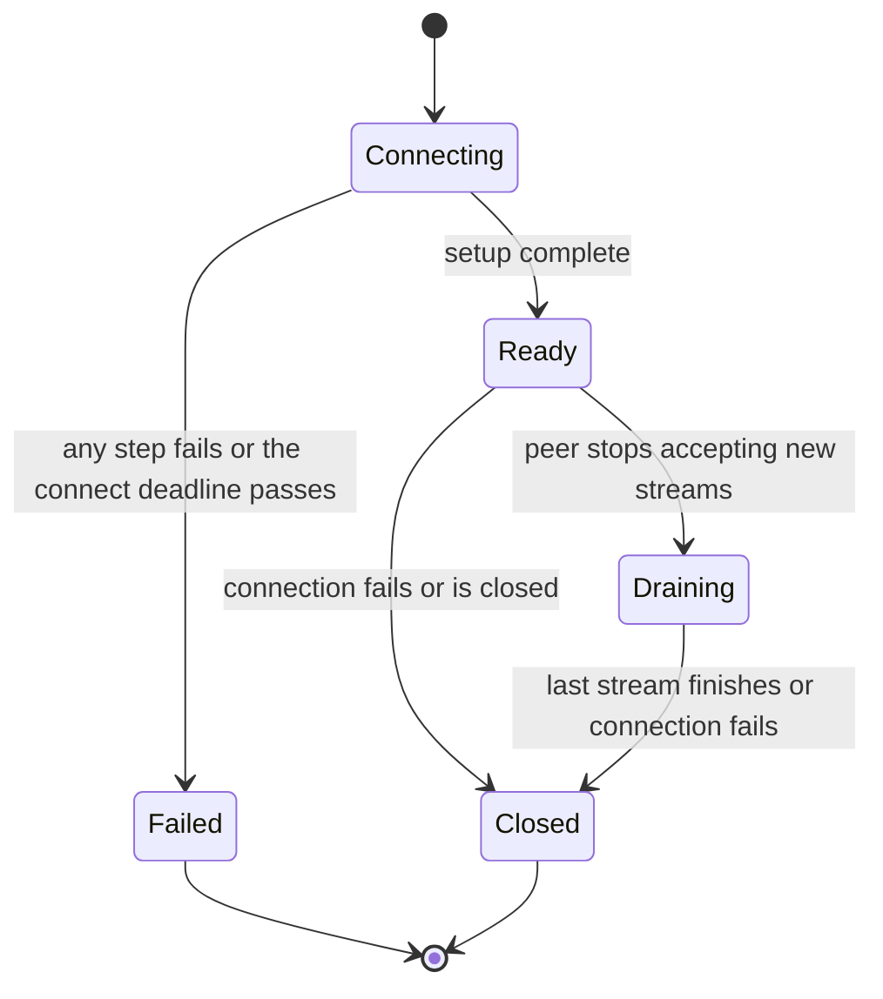

> [!WARNING]
> This document is part of a new, experimental
> [gRPC specification](../../README.md). It was generated primarily by AI and has not
> yet been fully reviewed.

# 4.8.1 Client Transport Model

<!-- Sources: A6, A8, A105, doc/keepalive.md, doc/PROTOCOL-HTTP2.md -->

This document specifies the abstract client transport: what the channel and
its subchannels expect of a connection, independent of the wire protocol. The
concrete transports are specified in
[HTTP/2 Client Transport](02-http2.md) and
[HTTP/3 Client Transport](03-http3.md). How each call is encoded on the wire
is specified in [Wire Protocol](../../03-wire-protocol/README.md).

## 1. Overview

- A **client transport** is one connection from a client to one server
  address. Each established connection of a subchannel is a transport
  instance (see [Subchannels and Connections](../07-subchannels.md)).
- The subchannel owns its transports. It starts a connection attempt when
  asked to connect or when connection scaling needs another connection,
  chooses a transport for each call attempt, and removes a transport from
  its list once the transport closes or starts draining.
- A transport carries call attempts as **streams**, one stream per call
  attempt ([Streams](#3-streams)).
- A transport reports these events to its subchannel: that it is ready, or
  that the connection attempt failed
  ([Connection Establishment](#2-connection-establishment)); the peer's
  current concurrent stream limit ([Stream Limits](#4-stream-limits)); that
  it can no longer be used for new streams, and, separately, that it has
  closed ([Draining and Closure](#5-draining-and-closure)).
- The transport does not decide when to connect or reconnect. Those
  decisions belong to the subchannel and the LB policy (see
  [Load Balancing](../06-load-balancing.md)).

## 2. Connection Establishment

A connection attempt goes through the steps in
[Subchannels and Connections: Connection Establishment](../07-subchannels.md#6-connection-establishment):
address mapping, transport-level connect, HTTP CONNECT if a proxy is used,
the security handshake of the channel credentials (see
[Security](../../06-security/README.md)), and finally the setup defined by
the transport's protocol (for example, the HTTP/2 connection preface and
SETTINGS exchange).

- The transport MUST NOT signal that it is ready for call attempts until
  its protocol setup is complete, as defined by each transport. For
  HTTP/2, that is when the server's initial SETTINGS frame has been
  received ([HTTP/2 Client Transport: Connection Establishment](02-http2.md#2-connection-establishment)).
- When the transport signals ready, the subchannel counts the connection as
  established: it reports READY if it was not already READY, and resets its
  connection backoff.
- Right after signaling ready, the transport reports the peer's initial
  concurrent stream limit ([Stream Limits](#4-stream-limits)).
- If any step fails, or the attempt's connect deadline (from
  [Connection Backoff](../07-subchannels.md#7-connection-backoff)) passes
  first, the attempt fails. The transport reports the failure to the
  subchannel with a status describing the cause. The subchannel then enters
  backoff, and its TRANSIENT_FAILURE state carries that status.

## 3. Streams

Each call attempt that the channel starts on a transport
([Per-call Configuration and Call Flow: Starting the Attempt on a Transport](../05-call-dispatch.md#36-starting-the-attempt-on-a-transport))
uses exactly one stream on that transport. Stream identifiers only have
meaning within one connection.

On a stream, the client can:

- send the request headers: the method, the authority, the deadline (as a
  timeout), and the request metadata;
- send request messages, then half-close;
- receive the response headers, response messages, and the trailers that
  carry the call's status;
- cancel the stream.

Each transport maps these operations to its protocol. The mappings are in
[gRPC over HTTP/2](../../03-wire-protocol/01-http2.md) and
[gRPC over HTTP/3](../../03-wire-protocol/03-http3.md). The call semantics
they implement are in [Core RPC Semantics](../../02-rpc-semantics/README.md).

- **Cancellation.** When the client cancels a call attempt, including when
  its deadline expires, the transport tells the peer that the stream is
  cancelled, unless the stream has already closed. The status the
  application sees is specified in
  [Core RPC Semantics: Cancellation](../../02-rpc-semantics/README.md#4-cancellation).
- **Failure.** If a stream ends without trailers because the connection
  failed or closed, the call attempt fails with `UNAVAILABLE`
  ([Closure](#52-closure)). A stream that the peer resets gets the status
  defined by the transport's error mapping.
- **Unprocessed attempts.** The transport reports when a failed call
  attempt produced no wire traffic, and when the peer is known not to have
  processed it (for example, the peer refused the stream, or it was above
  the peer's draining limit; see [Draining](#51-draining)). These are the
  cases that are eligible for transparent retry (see
  [Retries and Hedging: Transparent Retries](../12-retries.md#8-transparent-retries)).

## 4. Stream Limits

> **Introduced by:** [gRFC A105: MAX_CONCURRENT_STREAMS Connection Scaling](https://github.com/grpc/proposal/blob/master/A105-max_concurrent_streams-connection-scaling.md)

A peer can limit the number of streams a client has open at once on a
connection (for example, HTTP/2 `SETTINGS_MAX_CONCURRENT_STREAMS`). The
subchannel uses this limit to choose a connection for each call attempt and
to decide when to open more connections (see
[Subchannels and Connections: MAX_CONCURRENT_STREAMS Connection Scaling](../07-subchannels.md#8-max_concurrent_streams-connection-scaling)).

- The transport reports the peer's current limit to its subchannel once,
  right after it becomes ready, and again whenever the peer changes it. If
  the peer sets no limit, the limit is unlimited.
- Reports SHOULD be flow-controlled. The subchannel signals when it has
  processed each report, and the transport keeps at most one report in
  flight, sending the latest value once the previous report is processed.
  The subchannel can therefore see a change some time after the transport
  does.
- Call attempts that cannot be started because every connection is at its
  limit are queued in the subchannel, so the transport SHOULD NOT queue call
  attempts itself.
- A transport can still receive a call attempt for which it has no
  available stream, when the peer lowers its limit after the attempt was
  dispatched. The transport SHOULD then fail the attempt with `UNAVAILABLE`
  in a way that is eligible for transparent retry, rather than queue it. The
  retry MUST NOT prevent the subchannel from processing the transport's next
  limit report.

The HTTP/2 rules are in
[HTTP/2 Client Transport: Stream Limits](02-http2.md#4-stream-limits).

## 5. Draining and Closure

### 5.1 Draining

The peer can tell the client to stop creating streams on a connection while
it finishes the streams it accepted (HTTP/2 and HTTP/3 use GOAWAY). When
this happens:

1. The transport stops accepting new streams right away, and tells the
   subchannel that the connection can no longer be used for new call
   attempts. For connectivity-state purposes the subchannel counts the
   connection as closed from then on
   ([Subchannels and Connections: Connectivity States](../07-subchannels.md#2-connectivity-states)).
2. Streams that the peer will still process continue until they finish or
   the connection closes.
3. Streams that the peer indicates it did not process fail with
   `UNAVAILABLE` and are eligible for transparent retry.
4. Call attempts that raced with the draining signal (they picked this
   connection, but their stream was refused or never created) are failed or
   re-queued so that they are transparently retried on another connection.
5. The reason the peer gave SHOULD be kept as the disconnect reason, for
   logging, channelz, and metrics (see
   [Observability](../../08-observability/README.md)).

How the subchannel, LB policy, and channel react is specified in
[Subchannels and Connections](../07-subchannels.md) and
[Channel: Connection Loss and GOAWAY](../02-channel.md#9-connection-loss-and-goaway).

### 5.2 Closure

A connection closes when its last stream finishes after draining, when it
fails (a transport error, an unexpected close, or a failed liveness check;
see [Liveness](#6-liveness)), or when the client closes it (for example,
when the subchannel shuts down).

- Every stream still open on the connection fails with `UNAVAILABLE`. Call
  attempts that produced no wire traffic are eligible for transparent retry.
- The transport tells the subchannel that the connection has closed. This
  is a separate signal from the draining signal in [Draining](#51-draining).
  The subchannel removes the connection from its list, and the LB policy
  reacts to any resulting state change.

## 6. Liveness

> **Introduced by:** [gRFC A8: Client-side Keepalive](https://github.com/grpc/proposal/blob/master/A8-client-side-keepalive.md)

A transport uses **keepalive** to detect dead connections and to keep
connections from being closed as idle by intermediaries. Keepalive is a
per-hop connection mechanism. It is separate from service health checking
(see [Client-Side Health Checking](../10-health-checking.md)).

- The channel's keepalive settings (`KEEPALIVE_TIME`, `KEEPALIVE_TIMEOUT`,
  and `KEEPALIVE_WITHOUT_CALLS`) have the same meaning for every transport.
  Their defaults, rules, and algorithm are in
  [HTTP/2 Client Transport: Keepalive](02-http2.md#61-keepalive).
- Each transport defines how it probes the connection: HTTP/2 uses PING
  frames, and HTTP/3 can use QUIC PING frames or the QUIC idle timeout (see
  [HTTP/3 Client Transport: Liveness](03-http3.md#4-liveness)).
- When a liveness check fails, the transport closes the connection, and the
  calls on it fail with `UNAVAILABLE` ([Closure](#52-closure)).
- Servers limit how often clients may probe. A server that finds a client
  probing too often closes the connection, and the transport's protocol can
  carry a signal telling the client to back off (for HTTP/2, GOAWAY with
  `too_many_pings`).

## 7. Flow Control

The transport provides per-stream flow control with the semantics in
[Core RPC Semantics: Flow Control](../../02-rpc-semantics/README.md#5-flow-control):
a receiver can make the sender pause sending messages on a stream, so that
it does not have to buffer too much. The mechanism (windows, their sizes,
and when credit is returned) is defined by the transport's protocol. HTTP/2
flow control is specified in
[HTTP/2 Client Transport: Flow Control](02-http2.md#7-flow-control). HTTP/3
relies on QUIC flow control
([RFC 9000 §4](https://www.rfc-editor.org/rfc/rfc9000#section-4)).

## 8. API Requirements

Internal transport-to-subchannel API:

- The transport MUST provide a way to report that it is ready, or that the
  connection attempt failed, with a status
  ([Connection Establishment](#2-connection-establishment)).
- The transport MUST provide a way to start a stream for a call attempt
  ([Streams](#3-streams)).
- The transport MUST provide a way to report the peer's current concurrent
  stream limit to the subchannel, with a completion signal so updates can be
  flow-controlled ([Stream Limits](#4-stream-limits)).
- The transport MUST provide a way to tell the subchannel that the
  connection can no longer be used for new call attempts and, separately,
  that the connection has closed
  ([Draining and Closure](#5-draining-and-closure)).

Public API requirements for transport settings are in each transport's
document.
