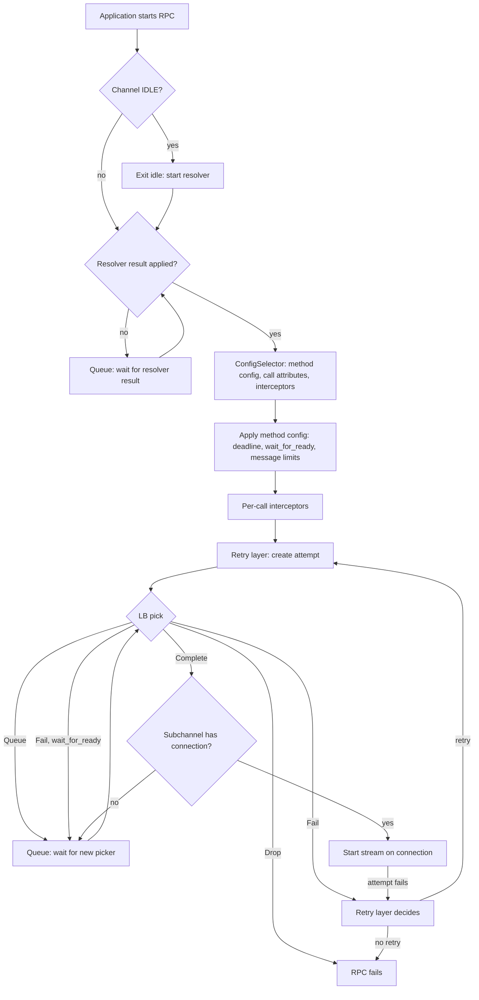

# Per-call Configuration and Call Flow

<!-- Sources: doc/wait-for-ready.md, doc/service_config.md, grpc-proto grpc/service_config/service_config.proto, A6, A31, A54, A81, A105 -->

This section specifies how the channel handles each RPC: from the moment the
application starts it until the RPC is running as a stream on a transport
connection. It defines the internal **ConfigSelector** that picks per-RPC
configuration, and it defines the order of the per-call stages: resolver
wait, configuration, interceptors, retries, LB pick, and transport.

## 1. Overview



## 2. ConfigSelector

The **ConfigSelector** is an internal component that computes the
configuration for each RPC. It is not part of the public API. The resolver
provides it in its result ([name-resolution.md](name-resolution.md)). If the
result does not include one, the channel uses the default ConfigSelector
([Default ConfigSelector](#23-default-configselector)).

### 2.1 Inputs and Outputs

The channel calls the ConfigSelector **exactly once per RPC**, after a
resolver result has been applied and before the retry layer. Retry and
hedging attempts reuse that result.

**Inputs:**

- The RPC's full method name (`/service/method`).
- The RPC's request metadata (headers) as provided by the application.

**Outputs:**

| Output | Description |
| --- | --- |
| **Status** | If it is not OK, the RPC fails immediately with this status, after the control plane status restriction ([Control Plane Status Restriction](#43-control-plane-status-restriction)). This is used when an RPC cannot be routed. None of the other outputs are used in that case. |
| **Method config** | The per-RPC settings defined by `MethodConfig` ([service-config.md](service-config.md)): timeout, `waitForReady`, message size limits, and retry or hedging policy. The ConfigSelector may build this config itself instead of taking it from the service config, for example from xDS route configuration. |
| **Call attributes** | Values that the channel passes to the LB policy's picker with every pick for this RPC. For example, the xDS ConfigSelector passes the chosen cluster name ([client.md](../09-xds/client.md)). |
| **Per-call interceptors** | Zero or more interceptors that the channel runs on this RPC after applying the method config and before the retry layer. For example, the xDS ConfigSelector uses them to apply the behavior of the chosen route's xDS HTTP filters ([http-filters.md](../09-xds/http-filters.md)). |
| **On-commit callback** | Optional. The channel invokes it exactly once, when the RPC is **committed**: the channel knows the RPC will make no more LB picks. That happens when the retry layer commits to one attempt (see [retries.md](retries.md)), or when the RPC ends without being committed. The xDS ConfigSelector uses it to release its reference to the chosen cluster. |

### 2.2 Lifecycle and Ordering

- The channel installs a new ConfigSelector together with the service config
  from the same resolver result
  ([name-resolution.md](name-resolution.md#3-channel-handling-of-resolver-results)).
- **Ordering guarantee:** the channel MUST pass the result's update to the LB
  policy, and the LB policy MUST have handled it and published its new
  picker, **before** the new ConfigSelector is used for any RPC. This means
  every call attribute the new ConfigSelector can produce, such as a newly
  added cluster, is already known to the picker that will see it. A picker
  that gets a call attribute it does not recognize (which this ordering
  prevents) fails the pick with `INTERNAL`.
- An RPC that has already run through a ConfigSelector keeps that
  ConfigSelector's outputs for the rest of its life, even after a newer
  ConfigSelector is installed. The channel MUST keep an old ConfigSelector,
  and anything its outputs refer to, alive while RPCs still use it.
- When the channel enters idleness, it discards its ConfigSelector together
  with the service config ([channel.md](channel.md#6-idle-timeout)).

### 2.3 Default ConfigSelector

The default ConfigSelector:

- Returns status OK.
- Returns the `MethodConfig` of the current service config that matches the
  RPC's full method name ([service-config.md](service-config.md#4-method-config-selection)),
  or no method config if nothing matches. It ignores metadata.
- Returns no call attributes, no per-call interceptors, and no on-commit
  callback.

## 3. Call Flow

### 3.1 Starting an RPC and Waiting for a Resolver Result

```
StartRpc(rpc):
  if (channel.state == SHUTDOWN):
    return rpc.Fail(UNAVAILABLE("channel shutdown"))  // code is language-specific (channel.md)
  channel.active_rpcs++          // cancels the idle timer (channel.md)
  if (channel.IsChannelLevelIdle()):
    channel.ExitIdle()           // creates and starts the resolver; CONNECTING
  rpc.start_time = Now()
  loop:
    if (channel.config_selector != null):
      return ApplyConfig(rpc)
    if (channel.resolver_failure != null &&      // TF: no valid service config
        rpc.app_wait_for_ready != true):
      return rpc.Fail(channel.resolver_failure)  // already restricted
    // Wake on: new resolver result applied, resolver failure,
    // deadline expiration, or cancellation.
    channel.resolver_queue.WaitFor(rpc)
```

- RPCs that arrive before the first resolver result is applied are queued in
  the **resolver queue**.
- When the channel applies a resolver result that installs a service config
  and ConfigSelector, it re-processes every RPC in the resolver queue.
- When the resolver reports a service config error and the channel has no
  valid config ([name-resolution.md](name-resolution.md#3-channel-handling-of-resolver-results)),
  the channel fails every queued RPC that does not have `wait_for_ready` set
  to true *by the application*. Queued RPCs that do have it stay queued. At
  this stage no method config exists, so the service config's `waitForReady`
  cannot apply.
- An RPC's deadline and cancellation apply while it waits in any queue. If
  the deadline expires, the RPC fails with `DEADLINE_EXCEEDED`. If the
  application cancels it, it fails with `CANCELLED`.

### 3.2 Applying the Method Config

```
ApplyConfig(rpc):
  sel = channel.config_selector.Select(rpc.method, rpc.metadata)
  if (!sel.status.ok()):
    return rpc.Fail(RestrictControlPlaneStatus(sel.status))
  mc = sel.method_config            // may be empty
  if (mc.timeout != unset):
    rpc.deadline = min(rpc.deadline, rpc.start_time + mc.timeout)
  if (rpc.app_wait_for_ready == unset):
    rpc.wait_for_ready = mc.wait_for_ready ?? false
  else:
    rpc.wait_for_ready = rpc.app_wait_for_ready
  rpc.max_send_bytes = Min(channel.max_send_bytes, mc.max_request_message_bytes)
  rpc.max_recv_bytes = Min(channel.max_recv_bytes, mc.max_response_message_bytes)
  rpc.retry_or_hedging_policy = mc.retry_policy or mc.hedging_policy (or none)
  rpc.call_attributes = sel.call_attributes
  rpc.on_commit = sel.on_commit
  RunInterceptors(sel.interceptors, rpc, next = RetryLayer)
```

- `Min` ignores unset values. If both are unset, the built-in default
  applies ([channel.md](channel.md#10-api-requirements)).
- The timeout counts from the time the application started the RPC, not
  from the time the config was applied. The new deadline is sent to the
  server like any other deadline (see [Core RPC Semantics](../02-rpc-semantics.md)).
- From here on, `wait_for_ready` is the effective value: the application's
  value if it set one, otherwise the method config's value, otherwise false.

### 3.3 Per-call Interceptors

The channel runs the ConfigSelector's per-call interceptors, in order, on the
RPC. They can inspect or change the RPC's metadata and messages, fail it, or
delay it. They run once per RPC, not once per attempt, and they run before the
retry layer. Interceptors added by the application wrap the channel and run
before any of this.

### 3.4 Retry Layer

The retry layer creates one or more **attempts** for the RPC, following the
RPC's retry or hedging policy and gRPC's transparent retry rules. It buffers
sent messages so they can be replayed, and it commits the RPC to a single
attempt when needed. Each attempt goes through the LB pick on its own, so it
may go to a different server than earlier attempts. The full behavior is in
[retries.md](retries.md).

### 3.5 LB Pick

For each attempt, the channel asks the LB policy's current **picker** for a
subchannel. The picker API is specified in
[load-balancing.md](load-balancing.md). Its inputs include the method name,
the attempt's request metadata, and the RPC's call attributes.

```
PickLoop(attempt):
  loop:
    result = channel.current_picker.Pick(attempt.PickArgs())
    switch (result.type):
      case COMPLETE:
        conn = result.subchannel.GetConnectedTransport()   // internal API
        if (conn == null):
          break                        // lost connection race: wait for next picker
        return StartOnTransport(attempt, conn, result)
      case QUEUE:
        break                          // wait for next picker
      case FAIL:
        status = RestrictControlPlaneStatus(result.status)
        if (attempt.rpc.wait_for_ready):
          break                        // wait for next picker
        return attempt.Fail(status)    // retry layer may retry (retries.md)
      case DROP:
        status = RestrictControlPlaneStatus(result.status)
        return attempt.rpc.FailWithoutRetry(status)
    // Wake on: new picker, deadline expiration, or cancellation.
    channel.pick_queue.WaitForNewPicker(attempt)
```

Pick results:

| Result | Channel behavior |
| --- | --- |
| **Complete** | The picker returned a subchannel, and optionally a call tracker that observes the attempt's outcome and an `:authority` override (see [load-balancing.md](load-balancing.md)). The channel gets the subchannel's connected transport through an internal subchannel API that LB policies cannot use. If the subchannel has no connection (the picker is stale and the subchannel's connection has just been lost), the channel queues the pick and retries it with the next picker. |
| **Queue** | The LB policy cannot decide yet, for example because it is still connecting. The attempt is queued. |
| **Fail** | The LB policy cannot serve the attempt, typically because it is in `TRANSIENT_FAILURE`. If the RPC's effective `wait_for_ready` is true, the attempt is queued. Otherwise the attempt fails with the given status, and the retry layer may retry it under the RPC's retry policy. Transparent retry never applies to pick failures. |
| **Drop** | The LB policy deliberately rejects the RPC, for example for control-plane-directed load shedding. The RPC fails with the given status **even if `wait_for_ready` is true**, and it is not retried, neither by the retry policy nor transparently. |

**Re-picking.** Each time the LB policy publishes a new picker, the channel
re-runs `Pick()` with the new picker for every queued pick. The picker MUST
NOT block. A picker that returns Queue relies on the LB policy publishing a
new picker later. A picker returned in `IDLE` state normally asks the LB
policy to exit idle (from outside the pick's synchronization context) and
returns Queue.

### 3.6 Starting the Attempt on a Transport

After the pick completes with a connected subchannel:

1. The channel applies the attempt's final authority
   ([channel.md](channel.md#32-authority-overrides)) and runs the call
   credentials for the attempt (see [Call Credentials](../06-security/call-credentials.md)).
   Call credentials run per attempt, after the pick, because they may depend
   on the chosen connection's security level and authority. A call
   credentials failure fails the attempt, after the control plane status
   restriction ([Control Plane Status Restriction](#43-control-plane-status-restriction)).
2. The channel starts a stream on the connection and sends the request
   headers and messages as the RPC produces them (see
   [gRPC over HTTP/2](../03-wire-protocol/http2.md)). If the subchannel holds several
   connections, or every connection is at its `MAX_CONCURRENT_STREAMS`
   limit, the subchannel picks or waits for a connection with stream
   capacity (see [subchannels.md](subchannels.md)).
3. If the attempt fails before any of it reaches the server, or reaches the
   server without being processed by the server application, the retry layer
   retries it transparently ([retries.md](retries.md)). Otherwise the
   attempt's outcome goes to the retry layer, which either starts another
   attempt or completes the RPC with that outcome.
4. When the attempt completes, the channel notifies the pick's call tracker
   (if any) with the attempt's final status, trailing metadata, and backend
   metrics ([load-balancing.md](load-balancing.md)).

When the RPC completes, the channel decrements its active RPC count. When the
count reaches zero, the idle timer starts ([channel.md](channel.md#6-idle-timeout)).

## 4. Status Handling

### 4.1 Failures Before a Config Is Available

An RPC that fails while waiting for a resolver result gets the resolver's
service config error status after the restriction in
[Control Plane Status Restriction](#43-control-plane-status-restriction). An RPC that fails because
of its deadline gets `DEADLINE_EXCEEDED`, and one that fails because of
channel shutdown gets the shutdown status described in
[Channel Shutdown](channel.md#7-channel-shutdown) (typically `UNAVAILABLE`).

### 4.2 Pick Failures

LB policies SHOULD use `UNAVAILABLE` for Fail and Drop results, unless they
have a specific reason to use something else. The status message SHOULD say
why the pick failed, and MUST include the resolution note from the most
recent resolver result (see [load-balancing.md](load-balancing.md)).

### 4.3 Control Plane Status Restriction

Control plane components (resolvers, LB policies, ConfigSelectors, and call
credentials) MUST NOT be able to fail RPCs with status codes that are
reserved for applications or that make no sense for a control plane failure.
The channel enforces this at each point where a control plane status reaches
an RPC:

- applying a service config error from the resolver;
- applying a failed ConfigSelector result;
- applying a Fail or Drop pick result;
- a call credentials failure.

At each of those points, if the status code is one of `OK`,
`INVALID_ARGUMENT`, `NOT_FOUND`, `ALREADY_EXISTS`, `FAILED_PRECONDITION`,
`ABORTED`, `OUT_OF_RANGE`, or `DATA_LOSS`, the channel MUST replace it with
status code `INTERNAL`. The new status message MUST make clear that a bug
occurred and MUST include the original code and message. The replacement
code is always `INTERNAL`. Implementations MUST NOT use a different code.

Interceptors, including per-call interceptors from the ConfigSelector, are
not restricted. They can legitimately fail RPCs with any status, as fault
injection does.

The retry layer matches status codes against `retryableStatusCodes` and
`nonFatalStatusCodes` only **after** this rewrite (see
[retries.md](retries.md)). A rewritten pick failure therefore has code
`INTERNAL` when the retry policy sees it.

## 5. API Requirements

- The call API MUST let the application set, per RPC, a deadline,
  `wait_for_ready` (keeping "explicitly false" distinct from "unset"), and
  request metadata. All of these are available to the ConfigSelector and the
  picker as described above.
- The call API MUST let the application set the authority per RPC
  ([channel.md](channel.md#32-authority-overrides)).
- The ConfigSelector is internal. gRPC MUST NOT require applications or
  custom resolvers to provide one. Custom resolvers always get the default
  ConfigSelector.
- The internal resolver result MUST be able to carry a ConfigSelector, and the
  channel MUST provide the ordering guarantee in
  [Lifecycle and Ordering](#22-lifecycle-and-ordering).
- The picker API MUST give pickers the method name, the request metadata,
  and the call attributes from the ConfigSelector
  ([load-balancing.md](load-balancing.md)).
