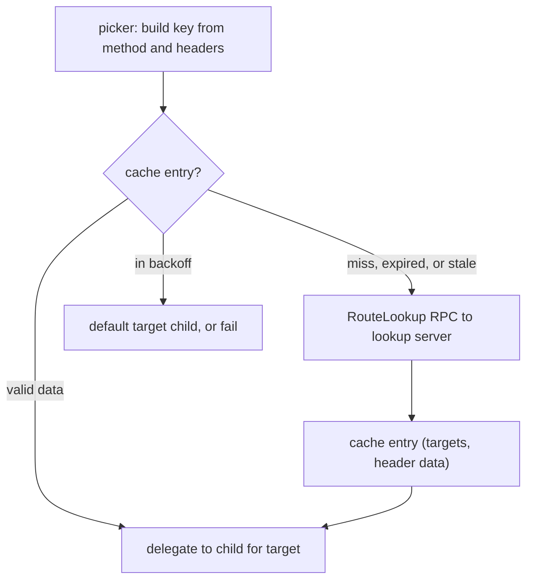

> [!WARNING]
> This document is part of a new, experimental
> [gRPC specification](../../README.md). It was generated primarily by AI and has not
> yet been fully reviewed.

# `rls` LB Policy

<!-- Sources: grpc-proto grpc/lookup/v1/rls.proto, grpc/lookup/v1/rls_config.proto, grpc/service_config/service_config.proto (RlsLoadBalancingPolicyConfig), A74 (dynamic cluster subscriptions), A108 (custom per-call label), implementations (no gRFC defines RLS) -->

> **Experimental:** The policy is registered as `rls_experimental`. Its
> name, configuration, and metrics are not yet stable.

## 1. Overview

`rls` (Route Lookup Service) is a parent policy (see
[Policy Hierarchy](../05-load-balancing.md#9-policy-hierarchy)) that chooses
a **target** for each RPC by asking an external lookup server. For each
RPC it builds a key from the RPC's method and request headers, looks the
key up in a local cache, and, on a cache miss, sends a `RouteLookup` RPC
to the lookup server. The server answers with an ordered list of targets.
The policy keeps one child policy per target and delegates the pick to
the child for the chosen target.

The child policy is configured generically: the policy inserts the target
name into a configured field of the child's config. With xDS, the RLS
cluster specifier plugin configures `cds` as the child, so each target is
an xDS cluster name (see
[RouteConfiguration](../../09-xds/03-resources/03-route-configuration.md) and
[Client Data Plane](../../09-xds/04-client.md)). The policy is not
xDS-specific; it can also be selected through `loadBalancingConfig` in a
service config.



Registered name: `rls_experimental`.

## 2. Configuration

Proto: `RlsLoadBalancingPolicyConfig` in
`grpc/service_config/service_config.proto`. The `routeLookupConfig` field
is a `RouteLookupConfig` from `grpc/lookup/v1/rls_config.proto`, in its
proto3 JSON form.

```json
{
  "rls_experimental": {
    "routeLookupConfig": {
      "grpcKeybuilders": [ {
        "names": [ { "service": "example.Service", "method": "Get" } ],
        "headers": [ {
          "key": "user",
          "names": [ "x-user-id", "x-user" ],
          "requiredMatch": false
        } ],
        "extraKeys": { "host": "host", "service": "svc", "method": "mth" },
        "constantKeys": { "builder": "get" }
      } ],
      "httpKeybuilders": [],
      "lookupService": "dns:///lookup.example.com",
      "lookupServiceTimeout": "2s",
      "maxAge": "300s",
      "staleAge": "240s",
      "cacheSizeBytes": "1048576",
      "validTargets": [],
      "defaultTarget": "default-target"
    },
    "routeLookupChannelServiceConfig": { "loadBalancingConfig": [ { "round_robin": {} } ] },
    "childPolicy": [ { "cds_experimental": { "isDynamic": true } } ],
    "childPolicyConfigTargetFieldName": "cluster"
  }
}
```

| Field | Type | Required | Default | Description |
| --- | --- | --- | --- | --- |
| `routeLookupConfig` | object | Yes | — | The route lookup config (`RouteLookupConfig`). |
| `routeLookupConfig.grpcKeybuilders` | list of object | Yes | — | MUST be non-empty. Each `GrpcKeyBuilder` says how to build the request key for a set of methods ([Key Building](#36-key-building)). |
| `routeLookupConfig.grpcKeybuilders[].names` | list of object | Yes | — | MUST be non-empty. The methods this key builder applies to. |
| `routeLookupConfig.grpcKeybuilders[].names[].service` | string | Yes | — | MUST be non-empty. The fully-qualified service name, including the package. |
| `routeLookupConfig.grpcKeybuilders[].names[].method` | string | No | `""` | The method name. Empty means every method of the service. |
| `routeLookupConfig.grpcKeybuilders[].headers` | list of object | No | empty list | List of `NameMatcher`, each producing one key from request headers. |
| `routeLookupConfig.grpcKeybuilders[].headers[].key` | string | Yes | — | MUST be non-empty. The key name. |
| `routeLookupConfig.grpcKeybuilders[].headers[].names` | list of string | No | empty list | An ordered list of header names. A `NameMatcher` with an empty `names` list never produces a value. |
| `routeLookupConfig.grpcKeybuilders[].headers[].requiredMatch` | bool | No | `false` | MUST NOT be true for gRPC; if true, the config is invalid. |
| `routeLookupConfig.grpcKeybuilders[].extraKeys` | object | No | — | Key names under which the RPC's host, service, and method are added. |
| `routeLookupConfig.grpcKeybuilders[].extraKeys.host` | string | No | `""` | Key name for the RPC's host. An empty or absent key name means that value is not added. |
| `routeLookupConfig.grpcKeybuilders[].extraKeys.service` | string | No | `""` | Key name for the RPC's service. An empty or absent key name means that value is not added. |
| `routeLookupConfig.grpcKeybuilders[].extraKeys.method` | string | No | `""` | Key name for the RPC's method. An empty or absent key name means that value is not added. |
| `routeLookupConfig.grpcKeybuilders[].constantKeys` | map of string → string | No | empty map | Map of key to value, added to every key built by this builder. A key MUST be non-empty. |
| `routeLookupConfig.httpKeybuilders` | list of object | No | — | Ignored. |
| `routeLookupConfig.lookupService` | string | Yes | — | MUST be non-empty, and MUST be a valid target URI for a gRPC channel whose scheme has a registered resolver ([Name Resolution](../02-name-resolution.md)). The target of the control channel ([Control Channel](#37-control-channel)). |
| `routeLookupConfig.lookupServiceTimeout` | `Duration` | No | `10s` | Deadline of each `RouteLookup` RPC. Zero or unset means the default. A negative value makes the config invalid. |
| `routeLookupConfig.maxAge` | `Duration` | No | 5 minutes | How long a successful response stays usable. Zero or unset means the default. If `staleAge` is not set, values above 5 minutes are clamped to 5 minutes. If `staleAge` is set, `maxAge` is not clamped. A negative value makes the config invalid. |
| `routeLookupConfig.staleAge` | `Duration` | No | 5 minutes | Age after which a still-valid response is refreshed in the background. Values above 5 minutes are clamped to 5 minutes. After clamping, if `staleAge` is greater than `maxAge`, `staleAge` is set to `maxAge`. A negative value makes the config invalid. |
| `routeLookupConfig.cacheSizeBytes` | int64 | Yes | — | MUST be greater than 0; otherwise the config is invalid. Values above 5,242,880 (5 MiB) are clamped to 5,242,880. The cache's size limit ([Cache](#38-cache)). |
| `routeLookupConfig.validTargets` | list of string | No | — | Ignored. |
| `routeLookupConfig.defaultTarget` | string | No | `""` (no default target) | An empty value means no default target. The target used when a lookup fails or is throttled ([Picker Implementation](#4-picker-implementation)). |
| `routeLookupChannelServiceConfig` | object | No | — | If present, it MUST be a valid service config (`ServiceConfig`, in JSON form); otherwise the RLS config is invalid. It is the service config of the control channel ([Control Channel](#37-control-channel)). |
| `childPolicy` | `LoadBalancingConfig list` | Yes | — | The child policy for each target. Validated as described in [Validation](#21-validation). |
| `childPolicyConfigTargetFieldName` | string | Yes | — | MUST be non-empty. The name of the field in the child's config that receives the target name ([Child Policies](#51-child-policies)). |

<!-- REVIEW(divergence) [RLS-1]: duration and size edge cases differ. lookupServiceTimeout: Java rejects zero and negative; Go treats zero as the default and accepts negative; C++ keeps an explicit zero (immediate deadline). maxAge zero: Go treats it as unset (5 min), as the proto comment says; C++ and Java keep it as zero. Negative maxAge/staleAge are rejected by none. cacheSizeBytes: all three reject 0 (the proto comment says "omitted or zero → client default"); the cap is 5 MiB in C++ and Java but 40 MiB in Go (maxCacheSize = 5*1024*1024*8). Spec says: zero = unset/default for the durations (proto3 semantics; xDS-generated JSON omits zero values), negatives invalid, cacheSizeBytes > 0 required, 5 MiB cap. The proto comment on cache_size_bytes should be updated to match. -->

Unknown fields are ignored at every level.

### 2.1 Validation

Any violation of the rules in the table above, or of the following rules,
makes the config invalid. An invalid config is rejected as specified in
[LB Policy Registry and Configuration](../05-load-balancing.md#2-lb-policy-registry-and-configuration).

- Negative `maxAge` or `staleAge` values make the config invalid.
- If `staleAge` is set, `maxAge` MUST also be set.
- `childPolicy`: each entry MUST be an object with exactly one field (the
  policy name) whose value is an object. The first entry whose policy is
  registered is selected, as for any `loadBalancingConfig` list
  ([Load Balancing](../05-load-balancing.md)). If none is registered, the
  config is invalid. The selected entry is validated at parse time with
  `childPolicyConfigTargetFieldName` set to a placeholder string (the
  `defaultTarget`, if set, MAY be used as the placeholder). If the
  selected child policy rejects that config, the RLS config is invalid.
- Across all key builders, each method path MUST appear at most once. A
  `Name` with service `S` and method `M` stands for the path `/S/M`; a
  `Name` with an empty method stands for `/S/`. Two `Name`s that stand for
  the same path are duplicates.
- Within one key builder, every key MUST be unique across the `headers`
  keys, the `constantKeys` keys, and the non-empty `extraKeys` values.

<!-- REVIEW(divergence) [RLS-2]: key builder validation differs. Empty grpcKeybuilders: Java, Go reject; C++ accepts. Empty Name.service: Java, Go reject; C++ accepts. requiredMatch: Java and Go reject only true; C++ rejects the field's presence. Empty NameMatcher.names: C++ rejects (and rejects empty entries); Java and Go accept. Empty extraKeys value: Go treats as unset (proto comment); C++ rejects an explicit ""; Java uses "" as a key name. Key uniqueness: C++ checks headers, constant keys, and extra keys; Go misses duplicates among the extra keys themselves; Java's check never compares extra keys (a collision throws at pick time) and also wrongly rejects the literal keys "host", "service", "method". Empty header/constant keys: C++, Java reject; Go rejects only by accident. Go also rejects a method containing "/". Spec says: majority in each case, as written above. -->

### 2.2 Other Inputs

- The endpoints, resolution note, and attributes of each update. The
  policy does not use them itself; it passes them to every child
  ([Child Policies](#51-child-policies)). With xDS, this includes the
  `XdsConfig` attribute that `cds` children read.
- The parent channel's default authority, used as the host value in key
  building ([Key Building](#36-key-building)) and as the default authority
  of the control channel ([Control Channel](#37-control-channel)).
- The parent channel's target, used as the `grpc.target` metric label
  ([Metrics](#6-metrics)).
- The helper's ability to create a channel that uses the parent channel's
  channel credentials (including attached call credentials) and default
  authority, used to create the control channel
  ([Helper API](../05-load-balancing.md#5-helper-api)).

## 3. LB Policy Implementation

The policy implements the generic
[LB Policy API](../05-load-balancing.md#4-lb-policy-api) as follows.

### 3.1 State

- The current config.
- The control channel and its throttler
  ([Control Channel](#37-control-channel),
  [Adaptive Throttling](#310-adaptive-throttling)).
- The cache and the set of lookups in progress ([Cache](#38-cache)).
- The children, at most one per target, reference-counted, and the
  default target's child ([Child Policies](#51-child-policies)).

### 3.2 Update

On each update, the policy:

1. Applies the new config: creates the control channel on the first
   config, or a new one when `lookupService` changes
   ([Control Channel](#37-control-channel)); resizes the cache if
   `cacheSizeBytes` changed, without otherwise flushing it
   ([Cache](#38-cache)); and creates the `defaultTarget` child when a
   config sets it ([Child Policies](#51-child-policies)).
2. Passes the update to every child
   ([Child Policies](#51-child-policies)). A child that rejects an update
   causes the policy to request re-resolution.
3. Reports a new picker once after the update, with no intermediate
   pickers ([Connectivity State](#311-connectivity-state)).

The policy returns a status that combines the children's statuses.

### 3.3 ExitIdle

Forwarded to every child.

### 3.4 ResetBackoff

Resets the control channel's connection backoff, takes every cache entry
out of backoff, forwards the call to every child, and reports a new
picker.

### 3.5 Shutdown

Cancels pending lookups and timers, shuts down the control channel, and
destroys the cache and all children.

### 3.6 Key Building

For each RPC, the picker builds a **key map** (string to string) from the
RPC's method path `/S/M` and its request metadata:

```
build_key_map(path, metadata):
  kb = key_builders["/S/M"]                  // exact service and method
  if kb == none: kb = key_builders["/S/"]    // service-wide builder
  if kb == none: return {}                   // empty key map
  key_map = {}
  for matcher in kb.headers:
    for name in matcher.names (in order):
      if metadata has header `name`:         // case-insensitive
        key_map[matcher.key] = all values of `name`, joined with ","
        break
  key_map += kb.constantKeys
  if kb.extraKeys.host   != "": key_map[kb.extraKeys.host]   = channel default authority
  if kb.extraKeys.service != "": key_map[kb.extraKeys.service] = S
  if kb.extraKeys.method != "": key_map[kb.extraKeys.method]  = M
  return key_map
```

- A header that is absent adds no key. An empty key map is valid. A
  lookup is still made for it, and the lookup server is expected to answer
  with a default route.
- The host value is the parent channel's default authority
  ([Channel](../01-channel.md)).
- Header values are taken from the request metadata as the picker sees it
  ([Pick Arguments](../05-load-balancing.md#61-pick-arguments)).

<!-- REVIEW(divergence) [RLS-3]: header values and host value. Multiple values for a header: C++ and Go join them with ","; Java uses only the last value. "-bin" header names: Go uses the raw value; Java throws at pick time; C++ is unclear. Host value: C++ uses the channel's default authority; Java uses that authority with any port removed; Go uses the endpoint part of the channel's target URI. Spec says: join with ","; host = default authority (C++), since the authority is what the server sees. "-bin" handling is left unspecified. -->

### 3.7 Control Channel

The policy sends `RouteLookup` RPCs on its own **control channel**:

- Target: `lookupService`.
- Credentials: the parent channel's channel credentials, including any
  call credentials attached to them. The control channel's default
  authority is the parent channel's default authority, so the credentials
  see the same authority as on the parent channel.
- Service config: if `routeLookupChannelServiceConfig` is set, the control
  channel uses it as its default service config and ignores service
  configs from its resolver. Otherwise the control channel uses the normal
  service config rules.
- The control channel is internal; it is not visible to the application
  except as a channelz child of the parent channel.

The control channel is created on the first config. When an update changes
`lookupService`, a new control channel is created for new lookups. Lookups
already in flight MAY finish on the old channel. The cache is kept.

**Backoff reset on reconnect.** The policy watches the control channel's
connectivity state. When the channel becomes READY after having been in
TRANSIENT_FAILURE, every cache entry leaves backoff (its backoff time is
cleared and its backoff timer cancelled) and the policy reports a new
picker. Lookups that failed because the lookup server was unreachable
are therefore retried as soon as it is reachable again.

#### `RouteLookup` RPC

Method: `/grpc.lookup.v1.RouteLookupService/RouteLookup`, unary
(`grpc/lookup/v1/rls.proto`), with deadline `now + lookupServiceTimeout`.

`RouteLookupRequest`:

| Field | Value |
| --- | --- |
| `target_type` | `"grpc"` |
| `key_map` | The key map ([Key Building](#36-key-building)). |
| `reason` | `REASON_MISS` when there is no valid data for the key; `REASON_STALE` for a background refresh of stale data. |
| `stale_header_data` | For `REASON_STALE`: the `header_data` of the stale response, if non-empty. Otherwise unset. |
| `extensions` | Not set. |

`RouteLookupResponse`:

| Field | Handling |
| --- | --- |
| `targets` | Ordered list of targets, best first. An empty list is a **failed** lookup. |
| `header_data` | Stored with the targets. Sent on RPCs routed with this response ([Picker Implementation](#4-picker-implementation)). |
| `extensions` | Ignored. |

A lookup **fails** if the RPC ends with a non-OK status, if the response
cannot be parsed, or if `targets` is empty.

### 3.8 Cache

The cache maps a key map to an **entry**. Keys are compared by exact
equality of the whole map. An entry holds:

| Field | Meaning |
| --- | --- |
| targets, child references | The targets of the last successful response, with a reference to the child policy of each ([Child Policies](#51-child-policies)). |
| `header_data` | From the last successful response. |
| data expiration time | Last success + `maxAge`. The data is **valid** before this time. |
| stale time | Last success + `staleAge`. Valid data is **stale** after this time. |
| status | The status of the last failed lookup, or OK. |
| backoff state | Exponential backoff state ([Backoff](#39-backoff)). |
| backoff time | The entry is **in backoff** before this time. |
| backoff expiration time | Last failure + 2 × the backoff delay. |
| minimum eviction time | Entry creation (or last success) + 5 seconds. |

Lookups in progress are tracked separately from the cache, at most one
per key. A key with a lookup in progress is **pending**.

**Updating an entry.** When a lookup completes, the entry for its key is
created if needed and becomes most recently used.

- On success: the targets, child references, and `header_data` are
  replaced; the data expiration and stale times are set from now; the
  status becomes OK; the backoff state is reset; the entry leaves backoff.
- On failure: the status is stored and the entry enters backoff. Any valid
  data in the entry is kept and stays usable until its data expiration
  time. A failed background refresh therefore does not interrupt RPCs that
  use valid stale data.

**Size and eviction.** Each entry has an estimated size in bytes, computed
from the key and the entry's data; the exact estimate is
implementation-defined. When the total size exceeds `cacheSizeBytes`
(after an entry is added, or after `cacheSizeBytes` decreases), entries
are evicted in least-recently-used order until the total fits. An entry
whose minimum eviction time has not passed is not evicted; eviction stops
at the first such entry, so the cache MAY stay over its limit for up to 5
seconds. A cache hit by the picker makes the entry most recently used.

**Periodic cleanup.** Once a minute, the policy removes every entry whose
data expiration time and backoff expiration time have both passed (and
whose minimum eviction time has passed).

Removing an entry (by eviction or cleanup) releases its child references
and cancels its backoff timer. If an entry with a running backoff timer is
removed, the policy reports a new picker.

**Config updates.** A change to `cacheSizeBytes` resizes the cache, which
may evict entries. Other config changes (including key builders,
`maxAge`, and `staleAge`) do not flush the cache; the new values apply to
responses received afterwards.

<!-- REVIEW(divergence) [RLS-4]: cache key and entry handling. Go includes the RPC's method path in the cache key in addition to the key map; C++ and Java use the key map only. Java keeps either data or a backoff record per key, so a failed stale refresh replaces still-valid data with a backoff entry (C++ and Go keep the data). Java applies no config change other than lookupService (which rebuilds the whole cache and control channel); C++ and Go resize the cache on cacheSizeBytes changes and keep it otherwise. Go never releases child references when entries are evicted or cleaned up. Spec says: C++ and Go behavior. -->

### 3.9 Backoff

A failed lookup puts its entry into backoff. The backoff parameters are
the standard connection backoff parameters: initial delay 1 second,
multiplier 1.6, jitter 0.2, maximum delay 120 seconds (see
[Connection Backoff](../06-subchannels.md#7-connection-backoff)).

```
on lookup failure for entry e:
  e.status = failure status
  delay = e.backoff_state.next_delay()     // reuses the state of earlier failures
  e.backoff_time = now + delay
  e.backoff_expiration_time = now + 2 × delay
  start timer(delay): report a new picker   // re-picks queued RPCs
```

The backoff state survives across lookups for the same key: the lookup
started after a backoff period carries the entry's backoff state, so
consecutive failures back off exponentially. A successful lookup resets
it. While an entry is in backoff, no lookup is sent for its key. After the
backoff time passes, the entry stays in the cache (until it is cleaned up)
and the next pick for the key starts a new lookup.

### 3.10 Adaptive Throttling

The policy throttles its own lookups when the lookup server rejects many
of them. The throttler keeps counts over a sliding window of the last 30
seconds:

- `requests`: lookups completed, plus lookups throttled by the client;
- `accepts`: lookups that completed successfully.

```
should_throttle():
  drop counts older than 30 seconds
  p = (requests - 2 × accepts) / (requests + 8)     // no throttling if p <= 0
  throttle = uniform_random[0, 1) < p
  if throttle: requests += 1                        // counted as not accepted
  return throttle

on lookup completion: requests += 1; if success: accepts += 1
```

A throttled lookup is not sent and creates no cache entry and no backoff.
The pick that wanted it uses the default target if one exists, or fails
with UNAVAILABLE. If the throttled lookup was a background refresh of
valid data, the pick keeps using the data. The throttler belongs to the
control channel; a new control channel starts with empty counts.

<!-- REVIEW(divergence) [RLS-7]: throttling. C++: as specified, except that a throttled background refresh is still sent (rls.cc Picker::Pick falls through to StartRlsCall when the entry has valid data). Java: same formula and window (50 slots), but a throttled lookup creates a backoff entry with RESOURCE_EXHAUSTED, and a throttled refresh therefore replaces valid data. Go: same formula, but backend responses are never recorded (RegisterBackendResponse is never called), so it never throttles. Spec says: C++ formula and window, no request and no backoff for throttled lookups (C++/Go structure), and no request for a throttled refresh. -->

### 3.11 Connectivity State

The policy reports the aggregate of its children's recorded states:

- no children: IDLE;
- else READY if any child is READY;
- else CONNECTING if any child is CONNECTING;
- else IDLE if any child is IDLE;
- else TRANSIENT_FAILURE, with status UNAVAILABLE.

The reported picker is always the RLS picker
([Picker Implementation](#4-picker-implementation)), in every state. RPCs whose target is healthy can succeed even while the aggregate
state is TRANSIENT_FAILURE, and RPCs that need a lookup can start while
the aggregate state is IDLE.

The policy reports a new picker when a child reports a new state or
picker, when a lookup completes, when a backoff timer fires, and after
each config update. While a config update is being passed to the children,
it SHOULD NOT report intermediate pickers.

<!-- REVIEW(divergence) [RLS-5]: child and aggregate state. With no children, C++ and Go report IDLE; Java stays at its initial CONNECTING. If a child config fails to parse, C++ and Go put that child in TRANSIENT_FAILURE; Java passes a null config to the child (an NPE for cds). Go does not pass a resolver update to its children when the RLS config is unchanged (UpdateClientConnState returns early). That would leave cds children with an old XdsConfig; this was not verified by test. Spec says: C++ behavior. -->

## 4. Picker Implementation

The picker is created with the current config, the cache, and the default
target's child (if any). Cache and pending-lookup state are shared with the
policy and read under the policy's lock.

```
pick(rpc):
  key = build_key_map(rpc.path, rpc.metadata)
  e = cache.find(key)                         // marks e most recently used
  if not pending(key) and (e == none or
        (e.stale_time < now and e.backoff_time <= now)):
    has_valid_data = e != none and e.data_expiration_time > now
    if throttler.should_throttle():
      if not has_valid_data:
        return default_or_fail(UNAVAILABLE, "RLS request throttled")
      // throttled background refresh: no lookup; keep using the data
    else:
      start lookup(key, reason = has_valid_data ? STALE : MISS,
                   stale_header_data = has_valid_data ? e.header_data : "",
                   backoff_state = e?.backoff_state)
  if e != none:
    if e.data_expiration_time > now:
      return pick_from_entry(e, rpc)
    if e.backoff_time > now:
      return default_or_fail(UNAVAILABLE,
                             "RLS request failed: " + e.status)
  return QUEUE                                 // lookup pending

pick_from_entry(e, rpc):
  // first target whose child is not in TRANSIENT_FAILURE, else the last target
  child = first c in e.children with c.state != TRANSIENT_FAILURE,
          or e.children[last]
  result = child.picker.pick(rpc)
  if result is Complete and e.header_data != "":
    add header "x-google-rls-data: <e.header_data>" to the attempt's metadata
  return result

default_or_fail(code, message):
  if default child exists: return default_child.picker.pick(rpc)
  return FAIL(status(code, message))
```

- A lookup in progress makes picks for its key queue, even when a default
  target exists. A pick never waits for a lookup when the entry has valid
  data: background refreshes do not delay RPCs.
- Failed picks use the Fail result, not Drop, so wait-for-ready RPCs keep
  waiting ([Pick Results](../05-load-balancing.md#62-pick-results)). The
  failure message includes the status of the failed lookup.
- `x-google-rls-data` is added through the pick result's metadata
  additions ([Pick Results](../05-load-balancing.md#62-pick-results)),
  replacing any value the RPC already has for that header.

<!-- REVIEW(divergence) [RLS-6]: picker details. When every target's child is in TRANSIENT_FAILURE, C++ and Go use the last target; Java uses the first. Go adds x-google-rls-data even when header_data is empty; C++ and Java only when non-empty. Go returns the backoff failure as a status error, which its channel treats as a drop (wait-for-ready RPCs fail); C++ and Java use a normal pick failure. Messages differ: "RLS request failed: <status>" (C++), "Unable to retrieve RLS targets from RLS server <lookupService>.  RLS server returned: <code>: <desc>" (Java), "most recent error from RLS server: <err>" (Go). Spec says: majority behavior, and the message only has to include the lookup status. -->

## 5. Children and Subchannels

### 5.1 Child Policies

The policy keeps at most one child policy per target, shared by all cache
entries that list the target and by the default target. Children are
reference-counted: a child is created when a first reference is taken
(a successful response lists a new target, or a config sets a new
`defaultTarget`) and destroyed when its last reference is released.

The child for target `T` is configured with the selected `childPolicy`
entry, with the field named `childPolicyConfigTargetFieldName` set to the
string `T` (added, or replaced if present). If that config is invalid for
the child policy, the child is not created; it is treated as being in
TRANSIENT_FAILURE, and picks delegated to it fail with UNAVAILABLE and the
parse error.

Each child receives the parent's endpoints, resolution note, and
attributes on every update, and every update from the parent is passed to
all children, even when the RLS config itself did not change. (With xDS,
this is how `cds` children receive the `XdsConfig` attribute.) If the
endpoints field is an error, the error is forwarded to every child.

The child for `defaultTarget` is created as soon as a config sets
`defaultTarget`, before any lookup.

`ExitIdle()` and `ResetBackoff()` are forwarded to every child, and
`Shutdown()` destroys all children ([ExitIdle](#33-exitidle),
[ResetBackoff](#34-resetbackoff), [Shutdown](#35-shutdown)).

### 5.2 Calls From Children

The policy handles calls from its children through the
[Helper API](../05-load-balancing.md#5-helper-api) it provides to them:

- `UpdateState(state, status, picker)`: Records the child's state and
  picker (see below), recomputes the aggregate state, and reports a new
  RLS picker ([Connectivity State](#311-connectivity-state),
  [Picker Implementation](#4-picker-implementation)).
- `RequestReresolution()`: Forwarded to the policy's own helper.
- `CreateSubchannel(address, attributes)`: Passed through to the policy's
  own helper unchanged.

**Child state.** Each child's latest connectivity state and picker are
recorded. A child that has not reported a picker yet uses a picker that
queues. A child that reported TRANSIENT_FAILURE is treated as being in
TRANSIENT_FAILURE until it reports READY (later CONNECTING or IDLE reports
update its picker but not its recorded state).

### 5.3 Subchannels

Not applicable: the policy does not create or watch subchannels; its
children do. (The policy watches the connectivity state of its control
channel; see [Control Channel](#37-control-channel).)

## 6. Metrics

The policy records the following metrics through the channel's metrics
recorder ([Metric Catalog](../../08-observability/03-metrics.md)). All are
off by default.

> **Experimental:** All RLS metrics are experimental.

| Name | Type | Unit | Labels | Optional labels | Description |
| --- | --- | --- | --- | --- | --- |
| `grpc.lb.rls.cache_entries` | Gauge (int) | `{entry}` | `grpc.target`, `grpc.lb.rls.server_target`, `grpc.lb.rls.instance_uuid` | | Number of entries in the cache. |
| `grpc.lb.rls.cache_size` | Gauge (int) | `By` | `grpc.target`, `grpc.lb.rls.server_target`, `grpc.lb.rls.instance_uuid` | | Estimated size of the cache ([Cache](#38-cache)). |
| `grpc.lb.rls.default_target_picks` | Counter (int) | `{pick}` | `grpc.target`, `grpc.lb.rls.server_target`, `grpc.lb.rls.data_plane_target`, `grpc.lb.pick_result` | `grpc.client.call.custom` | Picks sent to the default target. |
| `grpc.lb.rls.target_picks` | Counter (int) | `{pick}` | `grpc.target`, `grpc.lb.rls.server_target`, `grpc.lb.rls.data_plane_target`, `grpc.lb.pick_result` | `grpc.client.call.custom` | Picks sent to a target from a cache entry. A pick sent to the default target because a lookup returned it counts here, not in `default_target_picks`. |
| `grpc.lb.rls.failed_picks` | Counter (int) | `{pick}` | `grpc.target`, `grpc.lb.rls.server_target` | `grpc.client.call.custom` | Picks failed because the lookup failed or was throttled and there is no default target. |

Label values:

| Label | Value |
| --- | --- |
| `grpc.target` | The parent channel's target. |
| `grpc.lb.rls.server_target` | `lookupService`. |
| `grpc.lb.rls.data_plane_target` | The target the pick was delegated to. |
| `grpc.lb.pick_result` | `complete`, `fail`, or `drop`: the child's pick result. Picks that queue are not counted. |
| `grpc.lb.rls.instance_uuid` | A random UUID generated per policy instance, so that gauges from several instances on one channel can be told apart. |
| `grpc.client.call.custom` | The call's custom telemetry label ([Pick Arguments](../05-load-balancing.md#61-pick-arguments)). |

## 7. API Requirements

- gRPC MUST register this policy under the name `rls_experimental`, so
  that it can be selected through `loadBalancingConfig` in a service
  config and through the xDS RLS cluster specifier plugin.
- The LB policy helper MUST let the policy create the control channel with
  the parent channel's credentials (including attached call credentials)
  and default authority ([Helper API](../05-load-balancing.md#5-helper-api)).
- The pick result MUST let the policy add request headers to the call
  attempt ([Pick Results](../05-load-balancing.md#62-pick-results)).
