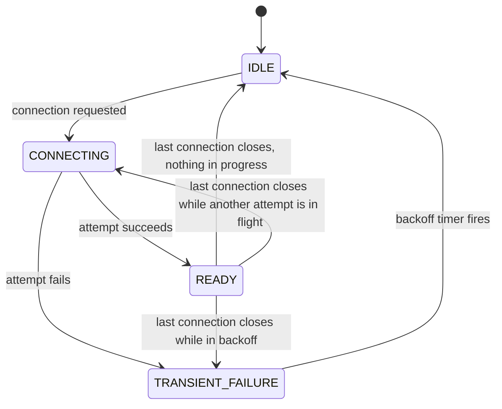

> [!WARNING]
> This document is part of a new, experimental
> [gRPC specification](../README.md). It was generated primarily by AI and has not
> yet been fully reviewed.

# 4.6 Subchannels and Connections

<!-- Sources: doc/connection-backoff.md, A61, A105, grpc/service_config/service_config.proto (ConnectionScaling), A17, A51 -->

A **subchannel** represents a potential or established connection to a
single server address. The channel implements subchannels. LB policies
decide when to create them and when to connect them (see
[load-balancing.md](load-balancing.md)). This section specifies the
subchannel model, its connectivity states, how connections are
established and retried, and how a subchannel scales to multiple
connections when servers limit concurrent streams.

## 1. Subchannel Model

- A subchannel has exactly **one address**. The address never changes
  during the subchannel's lifetime.
- A subchannel is created with an address, address attributes, and the
  channel's options. These form the subchannel's **identity**.
- The max-connections-per-subchannel setting
  ([MAX_CONCURRENT_STREAMS Connection Scaling](#8-max_concurrent_streams-connection-scaling)) is **not**
  part of its identity. It can change during the subchannel's lifetime
  without recreating the subchannel.
- Connection backoff state ([Connection Backoff](#7-connection-backoff)) is kept per
  subchannel, so backoff is per address.
- LB policies hold references to subchannels. When the last reference is
  released, the subchannel is shut down: in-flight connection attempts are
  cancelled, and its connections are closed once calls on them finish.

## 2. Connectivity States

| State | Meaning |
| --- | --- |
| **IDLE** | No connection and no attempt in progress. This is the initial state. The subchannel connects only when asked (`RequestConnection()`) or when connection scaling needs another connection. |
| **CONNECTING** | No established connection, and a connection attempt is in progress. |
| **READY** | At least one connection is established. Calls can be sent. |
| **TRANSIENT_FAILURE** | No established connection, and the subchannel is in backoff after a failed attempt. No attempt can start in this state. The state carries the status of the failure. |

The state is derived as follows (first match wins):

1. If at least one connection is established, report READY.
2. Otherwise, if a connection attempt is in flight, report CONNECTING.
3. Otherwise, if the subchannel is in backoff after a failed attempt,
   report TRANSIENT_FAILURE.
4. Otherwise, report IDLE.



The transitions from READY to CONNECTING and from READY to
TRANSIENT_FAILURE happen only when a subchannel has (or was creating)
more than one connection ([MAX_CONCURRENT_STREAMS Connection Scaling](#8-max_concurrent_streams-connection-scaling)).
LB policies MUST handle them (see
[lb-policies/pick_first.md](lb-policies/pick_first.md)).

When backoff ends, the subchannel goes to IDLE. It does not reconnect on
its own. The LB policy decides whether to request a new attempt. The
exception is connection scaling ([MAX_CONCURRENT_STREAMS Connection Scaling](#8-max_concurrent_streams-connection-scaling)):
a subchannel that still has a connection and has queued calls starts a
new attempt by itself when backoff ends.

A connection that receives a GOAWAY is no longer used for new calls. For
state purposes, it counts as closed once it receives the GOAWAY. Calls
already in flight on it continue until they finish.

## 3. Health State

Besides its raw connectivity state, a subchannel exposes a **health
state** through the generic health watch. The health state takes into
account [client-side health checking](health-checking.md) and anything
that wraps the watch, such as
[outlier detection](lb-policies/outlier_detection.md). It can be
TRANSIENT_FAILURE or CONNECTING while the raw state is READY. See
[load-balancing.md](load-balancing.md) for its semantics and consumers.

## 4. Subchannel Sharing

An implementation MAY keep a **subchannel pool**: a map from subchannel
identity to subchannel. If an LB policy asks to create a subchannel whose
identity matches an existing one, it gets a new reference to the existing
subchannel. A pool MAY be shared by several channels, which reduces the
number of connections to the same server.

When subchannels are shared:

- A subchannel can be in any state, and change state at any time,
  regardless of what a given LB policy requested. For example, another
  channel may have requested a connection. LB policies MUST NOT assume a
  new subchannel is IDLE, or that only they cause transitions.
- When a policy releases a subchannel, a connection attempt that another
  user still wants continues.
- If users of a shared subchannel set different
  max-connections-per-subchannel values, the subchannel MUST use the
  largest value currently set by any of them.

## 5. Getting a Connection for a Pick

When a picker returns Complete with a subchannel, the channel asks the
subchannel for a connection to start the call attempt on. This interface
is visible to the channel, not to LB policies. There are three possible
outcomes:

1. **Connection returned.** The channel starts a stream on it.
2. **No connection.** The subchannel has no established connection. This
   happens when the subchannel lost its connection after the picker
   chose it, and before the LB policy reported a new picker. The channel
   MUST treat the pick as Queue, and re-pick when the LB policy reports
   its next picker. The LB policy will see the subchannel's state change
   and report a new picker.
3. **Queued in the subchannel.** The subchannel has connections, but none
   has an available stream. The subchannel queues the call attempt itself
   and starts it when a stream becomes available
   ([Picking a Connection](#84-picking-a-connection)). For example, the subchannel
   can return a placeholder connection that queues calls in the
   subchannel.

## 6. Connection Establishment

A connection attempt for a subchannel goes through these steps, in
order. A failure at any step fails the attempt:

1. **Address mapping.** A [proxy mapper](proxy.md) can replace the
   target address with a proxy's address, and set an HTTP CONNECT target.
2. **Transport connect.** Open the transport-level connection (for
   example TCP, or a Unix domain socket) to the address.
3. **HTTP CONNECT** (only if a CONNECT target is set). Send the CONNECT
   request and wait for a successful response (see [proxy.md](proxy.md)).
4. **Security handshake.** Run the channel credentials' handshake. For
   example, TLS with ALPN `h2` and SNI/hostname verification against the
   channel's authority (see [../06-security/README.md](../06-security/README.md)).
5. **HTTP/2 setup.** Send the HTTP/2 client connection preface and the
   client's SETTINGS frame. Wait for the server's initial SETTINGS
   frame (see [../03-wire-protocol/http2-transport.md](../03-wire-protocol/http2-transport.md)).

The attempt **succeeds** when the server's initial SETTINGS frame is
received. Then the connection is established, the subchannel becomes
READY (if it was not already), and its backoff state is reset.

The whole attempt is bounded by the connect deadline from the backoff
algorithm ([Connection Backoff](#7-connection-backoff)). If the deadline passes
first, the attempt fails.

## 7. Connection Backoff

Connection attempts are spaced out with exponential backoff and jitter.
The backoff dictates the minimum time between the **starts** of
consecutive attempts. If an attempt takes as long as the current backoff
delay or longer, the next attempt can start as soon as it fails.

| Parameter | Value |
| --- | --- |
| `INITIAL_BACKOFF` | 1 second |
| `MULTIPLIER` | 1.6 |
| `JITTER` | 0.2 |
| `MAX_BACKOFF` | 120 seconds |
| `MIN_CONNECT_TIMEOUT` | 20 seconds |

```
ConnectWithBackoff():
  current_backoff = INITIAL_BACKOFF
  current_deadline = now() + INITIAL_BACKOFF
  while TryConnect(Max(current_deadline, now() + MIN_CONNECT_TIMEOUT)) != SUCCESS:
    SleepUntil(current_deadline)           # subchannel is TRANSIENT_FAILURE
    current_backoff = Min(current_backoff * MULTIPLIER, MAX_BACKOFF)
    current_deadline = now() + current_backoff +
        UniformRandom(-JITTER * current_backoff, JITTER * current_backoff)
```

In the subchannel state model, this loop is driven by the LB policy:

- After a failed attempt, the subchannel reports TRANSIENT_FAILURE until
  `current_deadline`, and then reports IDLE.
- The next `RequestConnection()` starts the next attempt, with the
  advanced backoff.
- The backoff state is reset to `INITIAL_BACKOFF` when an attempt
  succeeds, that is, when the server's initial SETTINGS frame is
  received.
- The backoff state is also reset by `ResetBackoff()`, which the channel
  API can trigger (see [load-balancing.md](load-balancing.md)). If the
  subchannel is in TRANSIENT_FAILURE at that time, it ends the backoff
  immediately and reports IDLE.

These parameters MAY be configurable through channel options. Any other
algorithm MUST make backoffs started at the same time disperse, and MUST
NOT attempt connections substantially more often than this algorithm.

## 8. MAX_CONCURRENT_STREAMS Connection Scaling

A server can limit the streams a client opens on a connection with the
HTTP/2 `SETTINGS_MAX_CONCURRENT_STREAMS` setting. Connection scaling lets
a subchannel open more connections to the same address when all of its
existing connections are at that limit, up to
`max_connections_per_subchannel`.

### 8.1 Configuration

The value of `max_connections_per_subchannel` for a subchannel comes from
one of two places:

- **Service config:**
  `connectionScaling.maxConnectionsPerSubchannel` (proto
  `ServiceConfig.ConnectionScaling.max_connections_per_subchannel`, a
  `google.protobuf.UInt32Value`, in
  `grpc/service_config/service_config.proto`). It applies to all
  subchannels in the channel. See [service-config.md](service-config.md).

  ```json
  { "connectionScaling": { "maxConnectionsPerSubchannel": 4 } }
  ```

- **xDS:** a per-cluster value set by the `xds_cluster_impl` policy when
  it creates subchannels. This overrides the service config value for
  those subchannels. See
  [../09-xds/resources/cluster.md](../09-xds/resources/cluster.md).

Rules:

- If unset, the value is **1**, which means no scaling.
- The channel enforces a **cap**, 10 by default, which the application
  can change with a channel option. Values above the cap are reduced to
  the cap. The subchannel itself applies the cap, so it covers every
  source of the setting.
- The value can change with every resolver update. The channel MUST
  deliver new values to existing subchannels without recreating them.
  Lowering the value never closes connections. The subchannel scales down
  only as connections close on their own.
- With a value of 1, a subchannel behaves exactly as without this
  feature, and SHOULD add no per-call overhead.

### 8.2 Transport Reporting

The transport reports the peer's `MAX_CONCURRENT_STREAMS` to the
subchannel:

- Once, immediately after receiving the peer's initial SETTINGS frame.
- Again whenever a later SETTINGS frame changes the value.

Implementations SHOULD flow-control these reports. For example, the
transport can keep at most one report in flight. It sends the next one,
if the value changed, only after the subchannel acknowledges the previous
one.

### 8.3 Connection Management

For each established connection, the subchannel keeps:

- The peer's `MAX_CONCURRENT_STREAMS`.
- The number of calls in flight on it.

Connections are kept in a list ordered by establishment time, oldest
first. The subchannel has at most **one** connection attempt in flight at
a time.

A new connection attempt is started when all of the following are true:

- One or more calls are queued in the subchannel.
- No established connection has an available stream (calls in flight ≥
  `MAX_CONCURRENT_STREAMS` on every connection).
- The number of established connections is less than
  `max_connections_per_subchannel`.
- No attempt is in flight, and the subchannel is not in backoff.

The subchannel never closes an established connection itself. A
connection that closes for any reason is removed from the list. To
reclaim idle connections, servers can use MAX_CONNECTION_IDLE (see
[../03-wire-protocol/http2-transport.md](../03-wire-protocol/http2-transport.md)).

All connection attempts share the subchannel's single backoff state. A
failed attempt puts the subchannel in backoff, even if it has other
connections, and the next attempt waits for the backoff. A successful
attempt resets the backoff.

If the last established connection closes while calls are queued in the
subchannel, the subchannel fails all queued calls with `UNAVAILABLE`.
These calls produced no wire traffic, so they are eligible for
transparent retry (see [retries.md](retries.md)).

### 8.4 Picking a Connection

To choose a connection for a call attempt (first match wins):

1. Go through the established connections from oldest to newest. Use the
   first one whose calls in flight are fewer than its
   `MAX_CONCURRENT_STREAMS`.
2. If the number of connections equals `max_connections_per_subchannel`,
   queue the call.
3. If the subchannel is in backoff, queue the call.
4. Otherwise, start a new connection attempt if none is in flight, and
   queue the call.

Choosing a connection and incrementing its in-flight count MUST be atomic
with respect to other calls, so that two concurrent calls cannot both
take the last available stream. The queue MUST be roughly fair (FIFO).

```python
def ChooseConnection(self):
  for connection in self.connections:              # oldest first
    if connection.rpcs_in_flight < connection.max_concurrent_streams:
      connection.rpcs_in_flight += 1
      return connection
  if (len(self.connections) < self.max_connections_per_subchannel and
      self.connection_attempt is None and self.pending_backoff_timer is None):
    self.StartConnectionAttempt()
  return None

def GetConnection(self):                           # called by the channel
  if len(self.connections) == 0:
    return None                                    # channel queues the pick
  connection = self.ChooseConnection()
  if connection is None:
    return FakeConnectionThatQueuesRpcs()          # queue in subchannel
  return connection

def RetryRpcsFromQueue(self):
  while self.queue:
    connection = self.ChooseConnection()
    if connection is None:
      break                                        # stop at first that can't go
    connection.SendRpc(self.queue.pop_front())

def StartConnectionAttempt(self):
  if self.backoff_state is None:
    self.backoff_state = BackoffState()
  self.connection_attempt = ConnectionAttempt()

def OnConnectionAttemptSucceeded(self, new_connection):
  self.connection_attempt = None
  self.connections.append(new_connection)
  self.pending_backoff_timer = None
  self.backoff_state = None
  self.RetryRpcsFromQueue()

def OnConnectionAttemptFailed(self):
  self.connection_attempt = None
  self.pending_backoff_timer = Timer(self.backoff_state.NextBackoffDelay())

def OnBackoffTimer(self):
  self.pending_backoff_timer = None
  self.RetryRpcsFromQueue()

def OnConnectionFailed(self, failed_connection):
  self.connections.remove(failed_connection)
  if len(self.connections) == 0:
    for rpc in self.queue:
      rpc.Fail(UNAVAILABLE)                        # eligible for transparent retry
    self.queue = []
  else:
    self.RetryRpcsFromQueue()

def OnConnectionReportsNewMaxConcurrentStreams(self, connection, value):
  connection.max_concurrent_streams = value
  self.RetryRpcsFromQueue()

def OnRpcComplete(self, connection):
  connection.rpcs_in_flight -= 1
  self.RetryRpcsFromQueue()

def OnMaxConnectionsPerSubchannelChanged(self, value):
  self.max_connections_per_subchannel = value
  self.RetryRpcsFromQueue()
```

The queue is reprocessed, from oldest to newest, stopping at the first
call that cannot be dispatched, when:

- A connection attempt succeeds.
- The backoff timer fires.
- A connection closes while others remain.
- A connection reports a new `MAX_CONCURRENT_STREAMS`.
- A call on one of the connections completes.
- `max_connections_per_subchannel` changes.

Reprocessing can start a new connection attempt even when no call can be
dispatched yet.

Because queueing happens in the subchannel, transports do not need to
queue calls that exceed `MAX_CONCURRENT_STREAMS`. A transport can still
receive such a call if the server lowers the limit after the call was
dispatched. Transports SHOULD fail such calls in a way that is eligible
for transparent retry, rather than queue them. The retry MUST NOT
prevent the subchannel from processing the transport's next
`MAX_CONCURRENT_STREAMS` report.

### 8.5 Interaction With Other Features

- **Circuit breaking.** Per-cluster in-flight call counters MUST be
  incremented in the picker, and decremented when the call ends, whether
  or not it was ever sent on a connection (see
  [../09-xds/lb-policies.md](../09-xds/lb-policies.md)).
- **Channelz.** Subchannels expose `max_connections_per_subchannel`.
  Sockets expose the peer's `MAX_CONCURRENT_STREAMS` and whether a GOAWAY
  was received. See [../08-observability/channelz.md](../08-observability/channelz.md).

## 9. Connection-Scoped Watchers and Streams

Some features need data that the client obtains by running a gRPC call on
the connection of a particular subchannel, rather than on a channel. Two
such features are defined in this specification:

| Feature | Watcher | Stream method | Feature-specific behavior |
| --- | --- | --- | --- |
| [Client-side health checking](health-checking.md) | Health watcher (via the generic health watch) | `/grpc.health.v1.Health/Watch` | [Client-Side Health Checking](health-checking.md) |
| [Out-of-band backend metrics](backend-metrics.md) | Out-of-band (OOB) backend metric watcher | `/xds.service.orca.v3.OpenRcaService/StreamCoreMetrics` | [Retries and Hedging](backend-metrics.md) |

This section specifies the mechanism shared by both. The feature-specific
sections specify the request contents, how responses are interpreted, and
any behavior that differs from the common rules below.

### 9.1 Watchers and Producers

- An LB policy obtains this kind of data by registering a **watcher** on a
  subchannel. A watcher has a kind (for example, health or OOB backend
  metrics) and kind-specific parameters (for example, a requested
  reporting interval). The policy can unregister the watcher at any time.
  Releasing the subchannel unregisters all watchers the policy registered
  on it.
- A policy can register watchers on subchannels it did not create. In
  particular, a parent policy can register watchers on subchannels its
  descendants create, by intercepting `CreateSubchannel()` in the helper
  it gives them (see [load-balancing.md](load-balancing.md)). The
  descendants do not need to know about the watchers.
- For each subchannel, the client keeps at most one **producer** per kind
  and per set of parameters that cannot be combined. All watchers of that
  kind on the subchannel share it. The producer combines the parameters
  of its watchers where the feature allows it (for example, OOB backend
  metrics use the smallest requested interval). Where parameters cannot be
  combined (for example, two different health-check service names on a
  subchannel shared by two channels), there is a separate producer, and a
  separate stream, for each distinct value.
- A producer exists only while at least one watcher uses it.
- Each result the producer obtains is delivered to every watcher that uses
  it. Results are delivered in the control plane (see
  [load-balancing.md](load-balancing.md)), serialized with the
  subchannel's connectivity notifications.

### 9.2 Stream Lifecycle

A producer runs at most one stream at a time. The client MUST manage it as
follows:

1. **When the stream runs.** The stream runs only while the producer has
   at least one watcher and the subchannel has a connection in READY
   state. The client starts it as soon as both are true: when a connection
   becomes READY while watchers exist, or when the first watcher registers
   while a connection is READY.
2. **Which connection.** The stream is sent directly on the subchannel's
   connection. It bypasses name resolution, the ConfigSelector, per-call
   interceptors, the retry layer, and load balancing. If the subchannel has
   more than one connection
   ([MAX_CONCURRENT_STREAMS Connection Scaling](#8-max_concurrent_streams-connection-scaling)), the stream
   is assigned to a connection the same way as any other call on the
   subchannel: the oldest connection that has an available stream. If
   that connection stops being usable, the stream is restarted on another
   connection, if any.
3. **Call properties.** The stream does not wait for any other call on
   the subchannel, and other calls do not wait for it. If the channel has
   call credentials, the stream carries them. The stream is not
   wait-for-ready and has no deadline.
4. **Idleness.** The stream MUST NOT count as application activity for the
   channel's idle timeout (see [channel.md](channel.md)).
5. **Stream usage.** The stream uses one HTTP/2 stream on its connection,
   and counts toward the server's `MAX_CONCURRENT_STREAMS`. It can keep a
   connection from looking idle to the server's `MAX_CONNECTION_IDLE`
   logic.
6. **`UNIMPLEMENTED`.** If the stream ends with `UNIMPLEMENTED`, the
   client MUST NOT start it again on that connection. It records a channel
   trace event ([../08-observability/channelz.md](../08-observability/channelz.md))
   and logs an error. Each feature specifies what its watchers see in this
   case.
7. **Other failures.** If the stream ends with any other status, the
   client starts it again with exponential backoff, using the default
   values of `INITIAL_BACKOFF`, `MULTIPLIER`, `JITTER`, and `MAX_BACKOFF`
   from [Connection Backoff](#7-connection-backoff) (1 second, 1.6, 0.2, 120 seconds).
   These values are fixed; channel settings that change the connection
   backoff do not affect them. The backoff is
   reset whenever a response message is received: the next attempt after
   a stream that received at least one message starts immediately, and
   later attempts back off again.
8. **Parameter changes.** If the producer's combined parameters change
   (for example, the smallest requested interval changes), the client
   cancels the stream and starts a new one with the new parameters,
   without backoff. A parameter change MUST NOT require reconnecting,
   recreating subchannels, or recreating LB policies.
9. **Cancellation.** The client cancels the stream, without waiting for a
   final status, when its connection receives a GOAWAY or is closed, when
   the last watcher unregisters, when the feature is disabled by a
   configuration change, or when the subchannel shuts down.

## 10. API Requirements

- The channel API MUST provide a way to set the cap on
  `max_connections_per_subchannel` (default 10).
- The channel API MUST provide a way to reset the connection backoff of
  all of the channel's subchannels.
- The internal subchannel API exposed to LB policies MUST provide the
  operations listed in [load-balancing.md](load-balancing.md):
  connectivity watch, health watch, connection request, backoff reset,
  OOB backend metric watch, and release.
- The internal subchannel API MUST let LB policies at any level of the
  policy tree register and unregister connection-scoped watchers
  ([Connection-Scoped Watchers and Streams](#9-connection-scoped-watchers-and-streams)) on any subchannel
  they hold, including subchannels created by their descendants.
- When subchannels are shared between channels
  ([Subchannel Sharing](#4-subchannel-sharing)), the channel API MUST provide a way to
  give a channel its own private subchannel pool.

