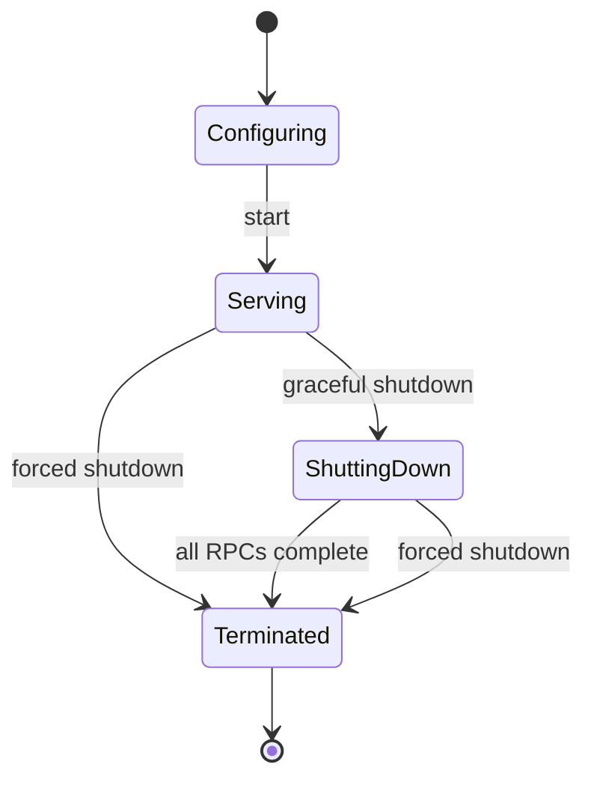

> [!WARNING]
> This document is part of a new, experimental
> [gRPC specification](../README.md). It was generated primarily by AI and has not
> yet been fully reviewed.

# 5.1 Server Behavior

<!-- Sources: doc/PROTOCOL-HTTP2.md, doc/statuscodes.md, doc/compression.md, doc/server_side_auth.md, doc/keepalive.md, A6, A9, A51 -->

## 1. Server Lifecycle

A server moves through the following states:



### 1.1 Configuration

Before the server starts, the application configures it:

1. **Service registration.** The application registers zero or more services,
   each with a handler for each of its methods. Each method is registered under
   its full method name. Registering two handlers for the same full method name
   is an error. The server MUST report this error to the application, either
   at registration time or at start time, and MUST NOT silently choose one of
   the handlers.
2. **Unknown-method handler.** The application MAY register a single generic
   handler that receives RPCs whose full method name matches no registered
   method (see [Method Dispatch](#22-method-dispatch)). This lets the application
   implement proxies and dynamic services. A generic handler receives the full
   method name, the request metadata, and the request messages as uncompressed,
   unparsed byte sequences.
3. **Listening addresses.** The application adds one or more listening
   addresses. Each address has its own **server credentials**, for example
   insecure, TLS (see [TLS credentials](../06-security/02-tls.md)), or xDS-provided
   credentials (see [xDS security](../09-xds/09-security.md)). Different
   addresses on the same server MAY use different credentials.
4. **Server options.** These include limits ([Limits](#24-limits)), connection
   management and keepalive settings
   ([HTTP/2 Server Transport](02-transports/02-http2.md)), interceptors
   ([Server Interceptors](#4-server-interceptors)), compression settings, and instrumentation
   (see [Instrumentation architecture](../08-observability/02-instrumentation.md)).

### 1.2 Binding and Start

When the server binds a listening address, it creates a listener for it. A TCP
address MAY use port `0`. The operating system then picks an unused
(ephemeral) port. The server MUST report the port it actually bound to the
application, because a client cannot connect otherwise. If an address resolves
to more than one local address, as `localhost` or a wildcard host can, the
server binds all of them. When port `0` is used, the server SHOULD bind the same
port number on all of them.

If any listening address fails to bind, the server MUST report the failure to
the application. Binding happens at the latest when the server starts. A server
that has been started accepts connections on all of its listeners and dispatches
RPCs to registered handlers. Services MUST be registered before the server
starts. The set of registered services is fixed once the server has started.

A server that is xDS-enabled can be "started" while not yet serving on a
listener, because it waits for xDS configuration. That behavior is specified in
[xDS-enabled servers](../09-xds/08-server.md).

### 1.3 Graceful Shutdown

Graceful shutdown lets in-flight RPCs finish while the server stops taking new
work:

1. The server stops accepting new connections. It closes all of its listeners.
2. On every open connection, the server begins HTTP/2 graceful connection
   termination with `GOAWAY`
   ([RFC 9113 §6.8](https://www.rfc-editor.org/rfc/rfc9113#section-6.8)). The
   server SHOULD use the two-`GOAWAY` sequence that RFC 9113 §6.8 describes.
   The gRPC details are in [GOAWAY](../03-wire-protocol/01-http2.md#92-goaway).
3. Streams that the final `GOAWAY` excludes are not processed. A client treats
   those RPCs as never having reached the server and MAY retry them
   transparently.
4. RPCs that were already accepted continue normally. The server waits for
   them to complete.
5. When a connection has no RPCs left, the server closes it. When every
   connection has closed, the server is **terminated**. Whether termination
   also waits for handlers to return is covered in
   [Waiting for Handlers](#waiting-for-handlers).

Graceful shutdown MAY take an unbounded amount of time, for example when a
long-lived streaming RPC never ends. An application that needs a bound combines
graceful shutdown with a later forced shutdown.

### 1.4 Forced Shutdown

Forced shutdown terminates the server right away:

1. The server closes all listeners (if graceful shutdown has not already done
   so).
2. Every in-flight RPC is **cancelled**. Handlers observe the cancellation as
   described in [Cancellation](#26-cancellation). The server SHOULD signal the
   cancellation to clients (for example, with `RST_STREAM`), and then closes
   every connection.
3. The server is terminated once all connections are closed.

Handlers MAY keep running after cancellation. Anything they send after
cancellation is discarded.

### Waiting for Handlers

Whether the server waits for running handlers to return before it reports
termination, after either a graceful or a forced shutdown, is
implementation-defined. Each implementation SHOULD follow the norms of its
language and runtime for resources owned by a server: where handlers are
treated as resources consumed by the server, shutdown SHOULD wait for them to
return. An implementation MAY make this behavior configurable. Either way,
termination is not reported before all connections are closed. This choice
does not affect what clients observe on the wire.

## 2. Request Handling

### 2.1 Request Validation

When a new stream arrives, the server validates the request headers before it
dispatches the RPC. The full grammar is in [gRPC over HTTP/2](../03-wire-protocol/01-http2.md).

| Condition | Server behavior |
| --- | --- |
| `content-type` does not begin with `application/grpc` | The server SHOULD respond with HTTP status `415 (Unsupported Media Type)` and MUST NOT dispatch the RPC. This keeps non-gRPC HTTP/2 clients from reading a gRPC error response (HTTP 200) as success. |
| `content-type` begins with `application/grpc` but names a content-subtype the server has no codec for | The server MAY fail the RPC with `UNIMPLEMENTED` (a gRPC status in Trailers-Only, not HTTP 415) without dispatching it. Otherwise it dispatches the RPC using the method's default codec. See [Core RPC Semantics: Codecs and Content-Subtype](../02-rpc-semantics/README.md#17-codecs-and-content-subtype). |
| `:method` is not `POST` | The request is not a valid gRPC request. The server MUST NOT dispatch it. |
| Request headers larger than the server's header list size limit ([Limits](#24-limits)) | The server MUST NOT dispatch the RPC. It SHOULD fail the RPC with a gRPC status of `RESOURCE_EXHAUSTED` (for example, in a Trailers-Only response), so the client learns why the RPC failed. If it cannot send a status, it MAY instead reset the stream. |
| `grpc-encoding` names a compression algorithm the server does not support | The server fails the RPC with `UNIMPLEMENTED`. Its response MAY include `grpc-accept-encoding` listing the algorithms the server accepts. If it does, that list MUST NOT contain the rejected algorithm. See [Compression](#34-compression). |
| `grpc-timeout` present | The value sets the RPC deadline. See [Deadlines](#25-deadlines). |

Early failures in this table that do not use an HTTP error status are reported
with a Trailers-Only response ([Trailers-Only Responses](#32-trailers-only-responses)).

### 2.2 Method Dispatch

The server looks up the handler by the full method name in `:path`. The match
is **exact and case-sensitive**:

```
lookup(path):
  if path is in registered methods:
    return registered handler
  if an unknown-method handler is registered:
    return unknown-method handler
  fail RPC with status UNIMPLEMENTED
```

* An unknown service and an unknown method within a known service both produce
  `UNIMPLEMENTED`. The server SHOULD include the full method name in the status
  message.
* The `UNIMPLEMENTED` failure is reported without invoking any application code
  (other than server interceptors, see [Server Interceptors](#4-server-interceptors)). It SHOULD
  use a Trailers-Only response.
* A `:path` not of the form `/<service>/<method>` cannot match a registered
  method. It goes to the unknown-method handler if there is one, and otherwise
  fails with `UNIMPLEMENTED`.

The `:authority` header is not used for dispatch by default. It is made
available to handlers (see [Call Context Available to Handlers](#27-call-context-available-to-handlers)), and
mechanisms such as xDS routing (see [xDS-Enabled Servers](../09-xds/08-server.md)) MAY use it.

### 2.3 Request Cardinality

The server enforces each method's request cardinality, as declared by its
registration:

* For unary and server-streaming methods, the client must send exactly one
  request message before half-close. If the client half-closes with zero
  messages or sends a second message, the server fails the RPC with
  `INTERNAL`.
* Messages that cannot be deserialized fail the RPC with `INTERNAL`.

### 2.4 Limits

| Limit | Default | Behavior when exceeded |
| --- | --- | --- |
| Maximum request header list size | implementation-defined; implementations SHOULD provide a safe default | The RPC is rejected ([Request Validation](#21-request-validation)). The server SHOULD advertise the limit with HTTP/2 `SETTINGS_MAX_HEADER_LIST_SIZE`. Size is computed as in RFC 9113 §6.5.2, with binary values counted after base64 encoding. |
| Maximum receive (request) message size | 4 MiB (4194304 bytes) | The RPC fails with `RESOURCE_EXHAUSTED`. The handler observes cancellation. The limit applies to both the size as framed (the length prefix, checked before reading the message) and the size after decompression ([Core RPC Semantics: Message Size Limits](../02-rpc-semantics/README.md#12-message-size-limits)). |
| Maximum send (response) message size | unlimited | The send fails and the RPC completes with `RESOURCE_EXHAUSTED`. |
| Maximum concurrent streams per connection | unlimited | The server advertises the limit with `SETTINGS_MAX_CONCURRENT_STREAMS`. Streams above the limit are refused with `RST_STREAM(REFUSED_STREAM)`, and the client sees them as unprocessed (`UNAVAILABLE`, eligible for transparent retry). See [HTTP/2 Server Transport: Stream Limits](02-transports/02-http2.md#4-stream-limits). |

If the server runs out of resources for other reasons (for example, a
flow-control or memory limit), it MAY fail RPCs with `RESOURCE_EXHAUSTED`.

### 2.5 Deadlines

When a request carries `grpc-timeout`, the server computes the RPC deadline as
the time the request headers arrive plus the timeout. Without `grpc-timeout`,
the RPC has no deadline (infinite timeout).

When the deadline passes before the RPC completes, the server:

1. Cancels the RPC, so the handler observes cancellation
   ([Cancellation](#26-cancellation)) and outgoing RPCs that propagate the deadline
   or cancellation are cancelled too.
2. MAY send Trailers with status `DEADLINE_EXCEEDED`, if it has not already
   sent Trailers, followed by `RST_STREAM(NO_ERROR)` if the request stream is
   still open. If it does not send Trailers, it MUST reset the stream with
   `RST_STREAM(CANCEL)`, if the stream is not already closed (see
   [gRPC over HTTP/2: Deadline expiry and cancellation](../03-wire-protocol/01-http2.md#84-deadline-expiry-and-cancellation)).

The client's deadline races with the server's. A client that sees a
cancellation after its own deadline has passed reports `DEADLINE_EXCEEDED`, so
either signal gives the same client-visible outcome.

The deadline MUST be visible to handlers ([Call Context Available to Handlers](#27-call-context-available-to-handlers)).

### 2.6 Cancellation

An RPC on the server is **cancelled** when any of the following happens:

* The client cancels the RPC (`RST_STREAM(CANCEL)` or any other `RST_STREAM`
  from the client).
* The RPC deadline passes.
* The connection fails or closes before the RPC completes, for example after a
  keepalive timeout. Open RPCs on a failed connection are cancelled.
* The server is shut down forcibly.
* gRPC fails the RPC on its own initiative (for example, because a received
  message exceeds the size limit).

Cancellation is an abrupt end to the call. Buffered inbound and outbound data
is discarded, and the handler cannot send further messages or a status. On the
server, cancellation is a distinct state, not a status code. gRPC MUST let the
handler find out that the RPC was cancelled, both by polling and by
notification. Any API call that sends on a cancelled RPC fails or is ignored.
The server MAY have sent Trailers to the client (for example
`RESOURCE_EXHAUSTED` or `DEADLINE_EXCEEDED`) while still reporting the RPC to
the handler as cancelled.

From the server's point of view, a call is complete only when its Trailers have
actually been sent. A handler that has *requested* to send a status can still
observe cancellation if the RPC is cancelled before the Trailers go out.

### 2.7 Call Context Available to Handlers

For each RPC, the server gives the handler a call context with at least:

* The full method name.
* The request metadata (custom metadata from Request-Headers). This includes
  keys that gRPC defines for application use, such as
  `grpc-previous-rpc-attempts` (see [Retries](../04-client-channel/12-retries.md)).
* The value of `:authority`.
* The deadline, if any, and the cancellation state ([Cancellation](#26-cancellation)).
* **Peer information**: the remote address of the connection, as reported by
  the transport.
* The **AuthContext** of the connection: the transport security type and the
  authenticated peer identity properties (for example, from the client
  certificate), as specified in [Security](../06-security/README.md). The
  AuthContext is the only trustworthy source of peer identity. Handlers MUST
  NOT use other call properties (such as metadata or the peer address) for
  authentication.
* For per-call backend metrics, a per-call metric recorder when that feature is
  enabled (see [Backend Metrics (ORCA)](../07-services/03-orca.md)).

## 3. Response Semantics

### 3.1 Response Headers

The server SHOULD send Response-Headers **lazily** ([Core RPC Semantics: Server Response Headers](../02-rpc-semantics/README.md#33-server-response-headers)).
It delays them until one of the following happens:

* The handler sends its first response message.
* The handler explicitly asks to send response headers (with or without custom
  metadata).

The handler MAY set custom response-header metadata any time before the
headers are sent. Once they are sent, the handler can no longer change them.
Lazy headers matter for retries: a client cannot retry after it has received
Response-Headers (see [Retries and Hedging](../04-client-channel/12-retries.md)).

Response-Headers contain `:status 200`, `content-type`, `grpc-encoding` if
response messages may be compressed, `grpc-accept-encoding` (the algorithms the
server accepts), and custom metadata.

### 3.2 Trailers-Only Responses

If the RPC completes before Response-Headers have been sent and no response
message has been sent, the server SHOULD send a **Trailers-Only** response: a
single HEADERS frame with `END_STREAM`, carrying `:status 200`, `content-type`,
the status, and trailer metadata. This applies whatever the status is,
including `OK` for a streaming RPC that sends no response messages. It covers
every failure detected before the handler runs (unknown method, unsupported
compression, early validation failures), and every handler that fails before
sending anything.

### 3.3 Status and Trailers

Every RPC that completes normally ends with Trailers carrying `grpc-status`,
an optional `grpc-message`, an optional `grpc-status-details-bin` (non-OK only),
and custom trailer metadata. The status is sent even when it is `OK`. Encodings
are in [gRPC over HTTP/2](../03-wire-protocol/01-http2.md).

* Only the server application decides on an `OK` status. The server library
  MUST NOT invent an `OK` status.
* A unary or client-streaming RPC that ends with `OK` MUST carry exactly one
  response message. If a handler of such a method completes with `OK` without
  sending a response message, or attempts to send a second response message,
  the server library SHOULD fail the RPC by sending Trailers with status
  `INTERNAL`, rather than sending `OK` or resetting the stream. Independently,
  the client MUST fail such a call with `INTERNAL` if it ends with `OK` and
  zero or more than one response message (see
  [Core RPC Semantics: Unary Calls](../02-rpc-semantics/README.md#6-unary-calls)).
* If a handler ends abnormally (for example, by throwing an exception) instead
  of providing a status, the server sends `UNKNOWN`.
* `grpc-status-details-bin`, if present, MUST match `grpc-status` and
  `grpc-message` (see [Rich Error Details](../02-rpc-semantics/README.md#105-rich-error-details)).
  The server library MAY check this but is not required to.
* A server MAY ask a client not to retry, or to retry after a delay, by setting
  the `grpc-retry-pushback-ms` trailer (see [Retries and Hedging](../04-client-channel/12-retries.md)).
* When a server is shutting down and refuses an RPC at the application level,
  it uses `UNAVAILABLE`.

If the server sends Trailers before the client has half-closed, any request
messages and half-close not yet processed are discarded. The server MAY reset
the remaining request stream (for example, with `RST_STREAM(NO_ERROR)` after
the Trailers, as RFC 9113 §8.1 allows).

### 3.4 Compression

* The server MAY compress response messages with any algorithm listed in the
  client's `grpc-accept-encoding`, independent of the request's encoding. The
  server announces its choice in `grpc-encoding` in Response-Headers.
* If the application asks for an algorithm the client did not advertise, the
  server MUST send the message uncompressed.
* Compression levels (for example low, medium, high) MAY be configured on the
  server. They map to concrete algorithms that the client is known to support.
* The application MUST be able to set the compression for an RPC, and to turn
  compression off for individual messages. When it turns compression off, the
  next message MUST be sent uncompressed.
* If a request message uses an unsupported algorithm, the RPC fails with
  `UNIMPLEMENTED` ([Request Validation](#21-request-validation)). If the server accepts an
  algorithm it did not advertise, it MUST include it in `grpc-accept-encoding`
  in its response.
* A request message with the Compressed-Flag set but no `grpc-encoding` (or
  `grpc-encoding: identity`) fails with `INTERNAL`. A message that cannot be
  decompressed with a supported algorithm fails with `INTERNAL`.
* `deflate` means the zlib format (RFC 1950) with deflate compression (RFC
  1951). Raw deflate data MUST NOT be sent.

## 4. Server Interceptors

A server interceptor wraps the processing of each RPC. Interceptors are
configured on the server and run in a defined order for every RPC, including
RPCs that the unknown-method handler serves. An interceptor can:

* Inspect and modify request metadata before the handler sees it.
* Observe, modify, or replace request and response messages.
* Set and modify response headers and trailers, and the status.
* Fail the RPC before or after the handler runs (for example, for
  authorization; see [Authorization](../06-security/04-authorization.md)).
* Observe cancellation and completion.
* Attach per-call data to the call context so that handlers can use it.

Interceptors are nested: on the request path, each interceptor sees the call
before the interceptors inside it, and on the response path it sees outgoing
operations after them. How registration order maps to nesting is
implementation-defined (see [Core RPC Semantics: Ordering](../02-rpc-semantics/README.md#163-ordering)).
gRPC's own per-call server
behaviors, such as authorization, xDS HTTP filters on servers, and per-call
backend metrics, are applied per RPC in the same position as interceptors. The
spec does not prescribe how they are implemented.

## 5. Connection Management

> **Introduced by:** [gRFC A9: Server-side Connection Management](https://github.com/grpc/proposal/blob/master/A9-server-side-conn-mgt.md)

A server manages its connections independently of RPCs. The
transport-independent model is in
[Server Transport Model: Connection Management](02-transports/01-transport-model.md#6-connection-management)
and [Server Transport Model: Liveness and Enforcement](02-transports/01-transport-model.md#7-liveness-and-enforcement).
The behaviors below are specified for HTTP/2 in
[HTTP/2 Server Transport: Connection Management](02-transports/02-http2.md#6-connection-management)
and [HTTP/2 Server Transport: Liveness and Enforcement](02-transports/02-http2.md#7-liveness-and-enforcement),
and apply to HTTP/3 as described in
[HTTP/3 Server Transport](02-transports/03-http3.md):

* `MAX_CONNECTION_IDLE` (default infinite): the server gracefully closes a
  connection that has had no outstanding RPCs for this long, with `GOAWAY`
  (`NO_ERROR`, debug data `max_idle`).
* `MAX_CONNECTION_AGE` (default infinite, ±10% jitter per connection) and
  `MAX_CONNECTION_AGE_GRACE` (default infinite): the server gracefully closes
  old connections (`GOAWAY` `NO_ERROR`, debug data `max_age`). It then waits up
  to the grace period for outstanding RPCs before closing the connection.
* Server keepalive, `KEEPALIVE_TIME` (default 2 hours) and `KEEPALIVE_TIMEOUT`
  (default 20 seconds): the server pings regardless of outstanding RPCs. If a
  ping is not acknowledged in time, the server closes the connection and
  cancels its RPCs.
* Keepalive **enforcement**: the server limits how often clients may ping
  (default minimum interval 5 minutes while there are active calls, and
  2 hours when there are none unless `PERMIT_KEEPALIVE_WITHOUT_CALLS` is set).
  A client that pings too often gets `GOAWAY` (`ENHANCE_YOUR_CALM`, debug data
  `too_many_pings`).

## 6. Related Server Features

* Per-call and out-of-band backend metric reporting:
  [Backend Metrics (ORCA)](../07-services/03-orca.md).
* Standard services hosted on a server (health, reflection, admin):
  [Standard Services and Admin Interface](../07-services/README.md).
* xDS-enabled servers (xDS-provided listeners, routing, security, serving
  modes): [xDS-enabled servers](../09-xds/08-server.md).
* Server instrumentation and channelz:
  [Instrumentation Architecture](../08-observability/02-instrumentation.md), [Channelz](../08-observability/06-channelz.md).

## 7. API Requirements

The server API MUST provide a way to:

1. **Create and configure** a server, with options set before start:
   * Add listening addresses, each with its own server credentials.
   * Register services (from generated code or defined at runtime) and a
     generic unknown-method handler.
   * Set limits: maximum receive message size, maximum send message size,
     maximum request header list size, and maximum concurrent streams per
     connection.
   * Set connection management and keepalive parameters, including keepalive
     enforcement ([Connection Management](#5-connection-management)).
   * Install server interceptors.
   * Configure compression (the set of supported algorithms and the default
     response compression or level).
   * Configure instrumentation (for example, metrics and tracing plugins, see
     [Observability](../08-observability/README.md)).
2. **Start** the server, getting an error if any listening address fails to
   bind, and get the actual bound port of every listening address (needed when
   port `0` is used).
3. **Shut down gracefully** ([Graceful Shutdown](#13-graceful-shutdown)), **shut down
   forcibly** ([Forced Shutdown](#14-forced-shutdown)), and **wait for termination**. It
   MUST also be possible to start a graceful shutdown and later turn it into a
   forced one (for example, after a timeout).
4. Give handlers a **call context** ([Call Context Available to Handlers](#27-call-context-available-to-handlers))
   with: the method name, request metadata, authority, deadline, cancellation
   state and cancellation notification, peer address, and AuthContext.
5. Let handlers **send response headers** explicitly, with metadata, or have
   them sent implicitly with the first message. Let handlers **send response
   messages** (respecting flow control) and **complete the RPC** with a status
   (code, message, optional details) and trailer metadata.
6. Let handlers **read request messages** and detect half-close.
7. Let handlers set the **response compression** algorithm or level for the
   RPC, and turn compression off for individual messages.
8. Let generic handlers and interceptors work with **raw (serialized) messages**
   and the full method name.
