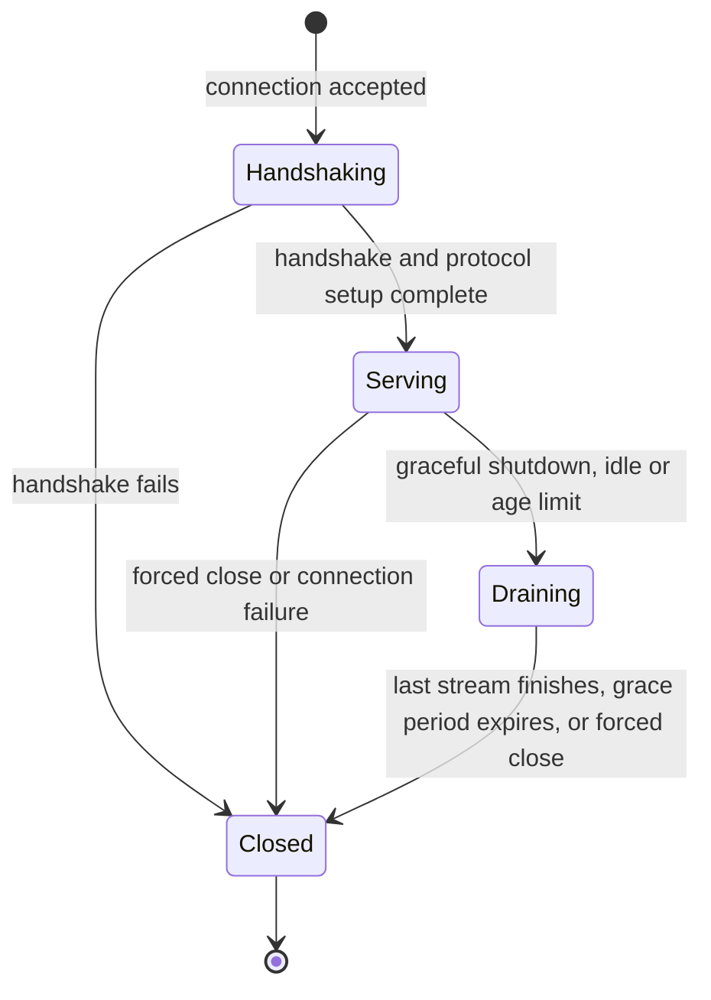

> [!WARNING]
> This document is part of a new, experimental
> [gRPC specification](../../README.md). It was generated primarily by AI and has not
> yet been fully reviewed.

# 5.2.1 Server Transport Model

<!-- Sources: A9, doc/keepalive.md, doc/PROTOCOL-HTTP2.md -->

This document specifies the abstract server transport: what the server
expects of the connections it accepts, independent of the wire protocol. The
concrete transports are specified in
[HTTP/2 Server Transport](02-http2.md) and
[HTTP/3 Server Transport](03-http3.md). How each call is encoded on the wire
is specified in [Wire Protocol](../../03-wire-protocol/README.md). How the
server dispatches and runs calls is specified in
[Server Behavior](../01-server.md).

## 1. Overview

- The server has a **listener** for each listening address it binds (see
  [Server Behavior: Binding and Start](../01-server.md#12-binding-and-start)).
  Each listener accepts connections and secures them with the address's
  server credentials.
- Each accepted connection is a **server transport** instance.
- The transport delivers each new stream from the client to the server as an
  incoming call, which the server validates and dispatches
  ([Server Behavior: Request Handling](../01-server.md#2-request-handling)).
- The transport enforces connection-level limits
  ([Stream Limits](#4-stream-limits),
  [Liveness and Enforcement](#7-liveness-and-enforcement)) and connection
  lifetime policies ([Connection Management](#6-connection-management)), and
  it drains or closes connections when the server or those policies ask it
  to ([Graceful Shutdown and Draining](#5-graceful-shutdown-and-draining)).

## 2. Listening and Connection Establishment

- When a listener accepts a connection, the server runs the security
  handshake of the listening address's server credentials (see
  [Security](../../06-security/README.md)). The handshake produces the
  connection's AuthContext, which the transport makes available to every
  call on the connection.
- After the handshake, the transport runs the setup defined by its protocol
  (for example, the HTTP/2 connection preface and SETTINGS exchange). Calls
  are delivered to the server only after setup completes.
- A connection whose handshake or setup fails carries no calls.
- When the server shuts down, it stops accepting new connections and closes
  its listeners ([Server Behavior: Graceful Shutdown](../01-server.md#13-graceful-shutdown)).

## 3. Streams

Each stream the client opens is one incoming call.

- The transport delivers to the server the call's request headers (the
  method, the authority, the timeout, and the request metadata), its request
  messages, and its half-close. With each call, it also provides the
  connection's peer address and AuthContext
  ([Server Behavior: Call Context Available to Handlers](../01-server.md#27-call-context-available-to-handlers)).
- The server sends response headers, response messages, and trailers carrying
  the status on the stream, or resets the stream.
- The call is **cancelled** when the client resets the stream or when the
  connection fails or closes before the call completes
  ([Server Behavior: Cancellation](../01-server.md#26-cancellation)).

Each transport maps these operations to its protocol. The mappings are in
[gRPC over HTTP/2](../../03-wire-protocol/01-http2.md) and
[gRPC over HTTP/3](../../03-wire-protocol/03-http3.md).

## 4. Stream Limits

A server MAY limit the number of streams a client has open at once on a
connection, and MAY change the limit during the connection. By default there
is no limit ([Server Behavior: Limits](../01-server.md#24-limits)). The
transport advertises the limit to the client using its protocol (for example,
HTTP/2 `SETTINGS_MAX_CONCURRENT_STREAMS`). Streams that the client opens
above the limit are refused, and the client treats them as unprocessed
(`UNAVAILABLE`, eligible for transparent retry). Clients use the limit to
decide when to open more connections (see
[Client Transport Model: Stream Limits](../../04-client-channel/08-transports/01-transport-model.md#4-stream-limits)).

The HTTP/2 rules are in
[HTTP/2 Server Transport: Stream Limits](02-http2.md#4-stream-limits).

## 5. Graceful Shutdown and Draining

**Draining** a connection means that the transport:

1. tells the client to stop creating streams on the connection;
2. tells the client which streams it accepted, so the client can treat the
   others as unprocessed and retry them transparently;
3. lets the accepted streams run to completion; and
4. closes the connection when no streams remain.

The transport drains a connection when the server shuts down gracefully
([Server Behavior: Graceful Shutdown](../01-server.md#13-graceful-shutdown)),
and when the connection reaches its idle or age limit
([Connection Management](#6-connection-management)). The concrete signal is
defined by each transport (HTTP/2 and HTTP/3 use a two-phase GOAWAY).

A **forced close** closes the connection without waiting for its streams.
Every call still open on it is cancelled. Forced close happens on forced
server shutdown
([Server Behavior: Forced Shutdown](../01-server.md#14-forced-shutdown)), when
a draining connection's grace period expires, when a liveness check fails,
and when the client violates the server's ping policy
([Liveness and Enforcement](#7-liveness-and-enforcement)). Clients see calls
that fail this way as `UNAVAILABLE`.

## 6. Connection Management

> **Introduced by:** [gRFC A9: Server-side Connection Management](https://github.com/grpc/proposal/blob/master/A9-server-side-conn-mgt.md)

A server manages its connections independently of calls, using three
settings: `MAX_CONNECTION_IDLE`, `MAX_CONNECTION_AGE`, and
`MAX_CONNECTION_AGE_GRACE`. They have the same meaning for every transport:

- Reaching `MAX_CONNECTION_IDLE` (the connection has had no outstanding calls
  for that long) starts draining the connection.
- Reaching `MAX_CONNECTION_AGE` (the connection has existed that long, with
  per-connection jitter) starts draining the connection.
- `MAX_CONNECTION_AGE_GRACE` bounds how long the accepted calls of a
  connection drained for age may continue before the connection is forcibly
  closed.

Their defaults, rules, and procedure are in
[HTTP/2 Server Transport: Connection Management](02-http2.md#6-connection-management).

## 7. Liveness and Enforcement

> **Introduced by:** [gRFC A9: Server-side Connection Management](https://github.com/grpc/proposal/blob/master/A9-server-side-conn-mgt.md)

- **Server keepalive.** The transport probes the connection to detect dead
  clients, whether or not the connection has outstanding calls. If a probe is
  not answered in time, the transport closes the connection and cancels its
  calls. The settings (`KEEPALIVE_TIME` and `KEEPALIVE_TIMEOUT`) have the same
  meaning for every transport.
- **Ping enforcement.** The transport limits how often the client may send
  liveness probes. A client that exceeds the limit is told why, where the
  protocol allows it, and its connection is closed.

Each transport defines how it probes: HTTP/2 uses PING frames
([HTTP/2 Server Transport: Liveness and Enforcement](02-http2.md#7-liveness-and-enforcement)),
and HTTP/3 can use QUIC PING frames or the QUIC idle timeout
([HTTP/3 Server Transport: Liveness and Enforcement](03-http3.md#5-liveness-and-enforcement)).

## 8. Flow Control

The transport provides per-stream flow control with the semantics in
[Core RPC Semantics: Flow Control](../../02-rpc-semantics/README.md#5-flow-control):
a receiver can make the sender pause sending messages on a stream, so that
it does not have to buffer too much. The mechanism is defined by the
transport's protocol. HTTP/2 flow control is specified in
[HTTP/2 Server Transport: Flow Control](02-http2.md#8-flow-control). HTTP/3
relies on QUIC flow control.

## 9. API Requirements

The public server API for transport settings is specified in
[Server Behavior: API Requirements](../01-server.md#7-api-requirements) and
in each transport's document.

Internal server-transport API:

- The transport MUST provide a way to deliver each incoming call to the
  server, with its request headers, messages, and half-close, and with the
  connection's peer address and AuthContext ([Streams](#3-streams)).
- The transport MUST provide a way for the server to send response headers,
  messages, and trailers on a call, and to reset it.
- The transport MUST provide a way to tell the server that a call was
  cancelled ([Streams](#3-streams)).
- The transport MUST provide a way for the server to drain a connection and
  to forcibly close it
  ([Graceful Shutdown and Draining](#5-graceful-shutdown-and-draining)).
