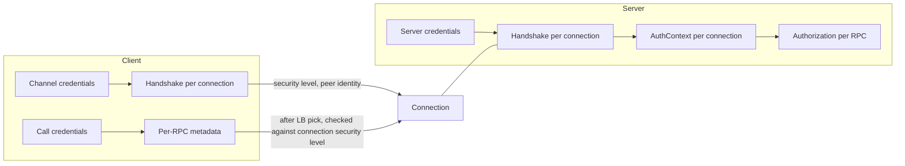

# Security

<!-- Sources: doc/server_side_auth.md, doc/ssl-performance.md (informative), doc/security_audit.md (skimmed), L62, A29 (programming API), A54, A81, A83, A87, A120, include/grpc/grpc_security_constants.h -->

This section defines gRPC's security model: how connections are secured
(channel and server credentials), how per-RPC credentials are attached (call
credentials), how the strength of a connection is described (security levels),
and how authentication results are exposed to the server application
(AuthContext).

Subsections:

| Section | Contents |
|---------|----------|
| [TLS](tls.md) | TLS credentials: versions, ALPN, SNI, hostname and per-RPC authority verification, mTLS, certificate providers, custom verification, CRLs, SPIFFE, private key offloading, key exchange groups |
| [Call Credentials](call-credentials.md) | Call credential behavior; access token, GCP service account identity JWT, and JWT token file credentials |
| [Authorization](authorization.md) | RBAC engine, gRPC authorization policy, audit logging |

xDS-managed security (xDS channel and server credentials, certificate provider
instances in the bootstrap, SAN matching configured by the control plane) is
specified in [xDS Security](../09-xds/security.md).

## 1. Security Model

gRPC separates security into two layers:

1. **Transport security.** Each connection is secured, or not, by the
   *channel credentials* (client side) or *server credentials* (server side)
   that were used to create the channel or server listening port. Transport
   security runs a handshake when a connection is established. The handshake
   authenticates the peer and, for TLS, negotiates encryption. Its result is a
   per-connection *security level* ([Security Levels](#5-security-levels)) and a per-connection
   *AuthContext* ([AuthContext and Peer Identity](#6-authcontext-and-peer-identity)).
2. **Per-RPC credentials.** *Call credentials* ([Call Credentials](#3-call-credentials) and
   [Call Credentials](call-credentials.md)) produce metadata, typically bearer tokens, that
   is attached to individual RPCs. Call credentials are applied after a
   connection has been chosen for the RPC, so gRPC can check that the
   connection is secure enough to carry them.

Authorization is a server-side decision made per RPC. It uses the AuthContext
and the request (method, metadata). See [Authorization](authorization.md).

On the server, the AuthContext is the only reliable source of
authentication information for an RPC. Application code MUST NOT
make authentication decisions from other call or connection properties, such
as the `:authority` header or client-supplied metadata, unless a component
that validated those properties has recorded the result in the AuthContext.



## 2. Channel and Server Credentials

*Channel credentials* configure transport security for every connection a
channel makes. *Server credentials* configure transport security for every
connection accepted on a server listening port. Credentials are immutable
once created. One credentials object MAY be used by many channels or servers.

gRPC defines the following transport credential types:

| Type | Client | Server | Security level | Description |
|------|--------|--------|----------------|-------------|
| Insecure | Yes | Yes | `NONE` | Plaintext. No handshake, no peer authentication. |
| TLS | Yes | Yes | `PRIVACY_AND_INTEGRITY` | TLS 1.2+ with optional mutual authentication. See [TLS](tls.md). |
| xDS | Yes | Yes | Depends on configuration | Uses security configuration from the xDS control plane, or the *fallback credentials* if the control plane supplies none. See [xDS Security](../09-xds/security.md). |
| Composite | Yes | No | Same as the wrapped channel credentials | Channel credentials combined with call credentials ([Composite Credentials](#4-composite-credentials)). |

Rules:

- The credentials used by a channel determine the security of *all*
  connections the channel creates, including connections that the LB policy
  creates to any address.
- A channel MUST NOT silently downgrade to weaker security. If a handshake
  fails, the connection attempt fails, and the subchannel follows its normal
  backoff behavior (see [Subchannels](../04-client-channel/subchannels.md)).
- Insecure credentials produce an AuthContext whose
  `transport_security_type` is `insecure` and whose `security_level` is
  `NONE`. Such an AuthContext has no peer identity.
- xDS credentials take *fallback credentials*. The fallback credentials are
  used when xDS is not in use for the channel or server, or when the control
  plane provides no security configuration. Fallback credentials are never
  used because of an error. An error in xDS-provided security configuration
  fails the connection.

## 3. Call Credentials

*Call credentials* compute metadata to attach to an RPC. They can be attached
in two ways:

1. **Per channel**, by combining channel credentials and call credentials into
   composite channel credentials ([Composite Credentials](#4-composite-credentials)). The call credentials then apply
   to every RPC on the channel.
2. **Per call**, through a call option. The call credentials then apply only to
   that RPC.

If an RPC has both channel-level and per-call call credentials, both apply.
Channel-level call credentials run first, then per-call call credentials. The
metadata from both is attached to the RPC. If both produce the same key, all
values are sent. The per-call call credentials do not replace the channel-level
ones.

Each call credential declares the minimum security level of the connection
that may carry it ([Security Levels](#5-security-levels)). Detailed behavior, including invocation
timing, inputs, error handling, and the built-in types, is in
[Call Credentials](call-credentials.md).

## 4. Composite Credentials

- **Composite channel credentials** combine one channel credentials object
  with one call credentials object. The result is channel credentials. It
  secures connections like the wrapped channel credentials and applies the
  call credentials to every RPC.
- **Composite call credentials** combine two or more call credentials into
  one call credentials object. When invoked, it invokes each component in
  order and combines all metadata they return. If any component fails, the
  composite fails with that component's status, and the RPC fails as described
  in [Call Credentials](call-credentials.md). The minimum security level of a composite
  call credential is the highest minimum security level of its components.

Composite channel credentials can be built from composite call credentials.
Composing composite channel credentials with more call credentials MUST give
the same result as composing the call credentials first.

## 5. Security Levels

Each connection has an immutable security level. The connection's credentials
and handshake set it. The levels, in increasing order, are:

| Level | Meaning |
|-------|---------|
| `NONE` | No protection. The peer is not authenticated. |
| `INTEGRITY_ONLY` | Data integrity is protected and the peer is authenticated. Data is not confidential. |
| `PRIVACY_AND_INTEGRITY` | Data is confidential and integrity-protected, and the peer is authenticated. |

TLS connections have level `PRIVACY_AND_INTEGRITY`. Insecure connections have
level `NONE`.

### 5.1 Call Credential Minimum Security Level

Every call credential has a minimum security level. The minimum security level
is a property of the call credential type. Each type defines it. It is not a
per-RPC choice.

- All built-in call credentials that carry bearer tokens (access token, GCP
  service account identity, JWT token file) require `PRIVACY_AND_INTEGRITY`.
- Application-defined call credentials MUST be able to declare their minimum
  level. If they do not, the default is `PRIVACY_AND_INTEGRITY`.
- A composite call credential's minimum level is the highest level among its
  components.

Before applying call credentials to an RPC, the client compares the connection
chosen for the RPC with the call credential's minimum level. If the
connection's level is lower, the call credentials MUST NOT be invoked and
their metadata MUST NOT be sent. The RPC fails with status `UNAUTHENTICATED`
and a message saying that the connection's security level is too low for the
call credentials. For example, call credentials that require privacy are never
sent on an insecure connection.

## 6. AuthContext and Peer Identity

### 6.1 Model

An **AuthContext** is created for each connection on both client and server. It
records what the handshake learned about the peer. Every RPC on the connection
can reach it: on the server through the server call, on the client through
the call after the response headers arrive.

An AuthContext contains:

- A multi-map of **auth properties**. Each property has a name (a string) and
  a value (bytes, which are usually UTF-8 text). One name MAY appear more than
  once. Order is preserved.
- A **peer identity property name**. This is the name of the properties
  that together make up the authenticated identity of the peer. The **peer
  identity** is the list of values of all properties with that name. If the
  peer is not authenticated, there is no peer identity property name and the
  peer identity is empty.

The AuthContext is per connection, so every RPC on a connection sees the same
contents. The AuthContext is read-only for application code. A server MAY
offer a server-side authentication hook that runs before the handler and adds
properties from call metadata (for example, after validating a token) or
rejects the call. Any change such a hook makes to the per-connection
AuthContext is visible to all later RPCs on the same connection. Hooks that
need per-RPC results SHOULD store them in per-call state.

### 6.2 Standard Properties

The transport credentials populate the following property names. They are
part of the public API. Implementations MUST use these names when they expose
the information.

| Property name | Set by | Value |
|---------------|--------|-------|
| `transport_security_type` | All credentials | The kind of transport security: `insecure`, `ssl` or `tls`. `ssl` and `tls` both mean a TLS connection. |
| `security_level` | All credentials | The connection's security level ([Security Levels](#5-security-levels)). |
| `x509_common_name` | TLS | Subject CN of the peer leaf certificate. |
| `x509_subject` | TLS | Full subject distinguished name of the peer leaf certificate, in RFC 2253 format. |
| `x509_subject_alternative_name` | TLS | One property per DNS, URI, email, or IP-address SAN entry of the peer leaf certificate. IP addresses use their canonical text form. |
| `peer_dns` | TLS | One property per DNS SAN. |
| `peer_uri` | TLS | One property per URI SAN. |
| `peer_email` | TLS | One property per email SAN. |
| `peer_ip` | TLS | One property per IP-address SAN. |
| `peer_spiffe_id` | TLS | The peer's SPIFFE ID. Present only if the leaf certificate has exactly one URI SAN and that URI is a valid SPIFFE ID. |
| `x509_pem_cert` | TLS | The peer leaf certificate, PEM-encoded. |
| `x509_pem_cert_chain` | TLS | The peer certificate chain, PEM-encoded. |
| `ssl_session_reused` | TLS | `true` if the TLS session was resumed, otherwise `false`. |
| `ssl_negotiated_key_exchange_group` | TLS | Name of the key exchange group negotiated in the handshake, for example `X25519MLKEM768`. See [TLS](tls.md). |
| `ssl_tls_version` | TLS | Negotiated TLS protocol version. |
| `ssl_requested_server_name` | TLS (server side) | The SNI the client sent, if any. |

The representation of the `security_level` value is implementation-defined.
An implementation MAY expose it as a typed value instead of a string
property, and the string encoding, if any, is not fixed. The value is never
sent over the wire, so this does not affect interoperability.

Peer identity for TLS:

- If the peer certificate has at least one SAN entry, the peer identity
  property name is `x509_subject_alternative_name`.
- Otherwise, if the certificate has a subject CN, the peer identity property
  name is `x509_common_name`.
- If the peer sent no certificate (for example, a TLS server that did not
  request a client certificate), there is no peer identity.

Example: an mTLS connection seen by the server.

```
transport_security_type        = "tls"
security_level                 = PRIVACY_AND_INTEGRITY
x509_common_name               = "*.test.google.com"
x509_subject                   = "CN=*.test.google.com,O=Example,C=US"
x509_pem_cert                  = "-----BEGIN CERTIFICATE-----\n..."
x509_subject_alternative_name  = "*.test.google.fr"
x509_subject_alternative_name  = "waterzooi.test.google.be"
x509_subject_alternative_name  = "192.168.1.3"
peer_dns                       = "*.test.google.fr"
peer_dns                       = "waterzooi.test.google.be"
peer_ip                        = "192.168.1.3"
ssl_session_reused             = "false"
ssl_negotiated_key_exchange_group = "X25519MLKEM768"

peer_identity_property_name    = "x509_subject_alternative_name"
```

## 7. Authority and Authority Override

Each RPC has an authority (`:authority`). By default it is the channel's
default authority, which comes from the target URI (see
[Channel](../04-client-channel/channel.md)). The authority matters to
security in two ways:

1. **Connection level.** With TLS, the client uses the channel's default
   authority, minus any port, as the name it expects in the server's
   certificate (hostname verification). By default it also uses that name as
   the SNI. See [TLS](tls.md).
2. **RPC level.** The authority sent on an RPC can differ from the one the
   connection was verified against. This happens when the application
   overrides the authority for a call, or when xDS authority rewriting is in
   effect (see [Client](../09-xds/client.md)).

Override mechanisms:

| Mechanism | Scope | Affects TLS name check? |
|-----------|-------|-------------------------|
| Channel default-authority option | All RPCs and all connections on the channel | Yes. The overridden authority becomes the expected server name and the default SNI. |
| TLS server-name / SNI override option on TLS credentials | Connections made with those credentials | Yes. Changes the name used for SNI or verification, as defined in [TLS](tls.md). |
| Per-call authority override | One RPC | No change to the connection. The RPC's authority is checked against the server certificate per RPC (see below). |
| xDS authority rewriting | One RPC | Same as the per-call override. |

When an RPC's authority differs from the name its connection was verified
against, the channel credentials decide whether the RPC may use that
connection. TLS credentials by default check per RPC that the server
certificate covers the RPC's authority, and fail the RPC otherwise. See
[TLS](tls.md). Credentials that do no hostname verification (insecure
credentials, or xDS credentials that use control-plane SAN matching instead)
do no per-RPC check. A per-call authority override takes precedence over xDS
authority rewriting.

## 8. API Requirements

- The channel API MUST provide a way to create a channel with given channel
  credentials. Insecure, TLS, xDS, and composite channel credentials MUST be
  available.
- The server API MUST provide a way to bind each listening port to server
  credentials. Insecure, TLS, and xDS server credentials MUST be available.
- The credentials API MUST provide a way to create composite channel
  credentials from channel credentials and call credentials, and composite
  call credentials from two or more call credentials.
- The call API MUST provide a way to attach call credentials to one RPC.
- The call credentials API MUST let application-defined call credentials
  declare their minimum security level.
- The server call API MUST give the handler (and server interceptors) read
  access to the call's AuthContext: iterate all properties, look up properties
  by name, get the peer identity property name, get the peer identity, and
  check whether the peer is authenticated.
- The client call API MUST give access to the AuthContext of the connection
  an RPC used, once response headers have been received.
- The channel API MUST provide a way to override the channel's default
  authority.
- The call API MUST provide a way to override the authority of one RPC. The
  override is subject to the channel credentials' per-RPC authority check
  ([Authority and Authority Override](#7-authority-and-authority-override)).
