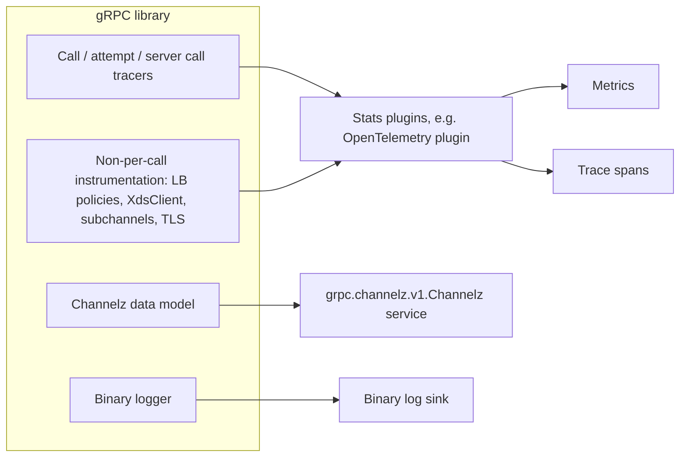

> [!WARNING]
> This document is part of a new, experimental
> [gRPC specification](../README.md). It was generated primarily by AI and has not
> yet been fully reviewed.

# 8.1 Overview and Common Principles

<!-- Sources: A3, A14, A16, A45, A66, A72, A78, A79, A88, A89, A94, A96, A105, A108, A118, doc/binary-logging.md -->

## 1. Overview

gRPC provides five complementary observability mechanisms:

| Mechanism | What it exposes | Granularity | Consumer | Section |
| --- | --- | --- | --- | --- |
| Instrumentation (call tracers) | Lifecycle events of every call, attempt, and server call | Per call / per attempt | Stats and tracing plugins | [Instrumentation Architecture](02-instrumentation.md) |
| Metrics | Aggregated numeric measurements (counters, histograms, gauges) | Per call and non-per-call | Metrics back ends, via a stats plugin such as the OpenTelemetry plugin | [Metrics Framework and OpenTelemetry Plugin](03-metrics-framework.md), [Metric Catalog](04-metrics.md) |
| Tracing | Distributed trace spans and events, with context propagated in metadata | Per call / per attempt | Tracing back ends, via the OpenTelemetry plugin | [Tracing](05-tracing.md) |
| Channelz | Live snapshot of channels, subchannels, servers, and sockets, plus a bounded log of recent channel events | Per entity | Operators and debugging tools, via the Channelz service | [Channelz](06-channelz.md) |
| Binary logging | Full or truncated record of the headers, messages, and trailers of selected RPCs | Per RPC event | Offline analysis, replay, and troubleshooting | [Binary Logging](07-binary-logging.md) |

The relationships between these mechanisms are as follows:

- **Call tracers** ([Instrumentation Architecture](02-instrumentation.md)) are the low-level hook through
  which per-call events reach plugins. Both the per-call metrics and tracing
  are built on call tracers.
- The **metrics framework** ([Metrics Framework and OpenTelemetry Plugin](03-metrics-framework.md)) defines how gRPC
  components and third-party plugins declare metric instruments, how stats
  plugins are registered and scoped to channels and servers, and the
  requirements for the OpenTelemetry plugin. The **metric catalog**
  ([Metric Catalog](04-metrics.md)) lists every metric that gRPC defines.
- **Tracing** ([Tracing](05-tracing.md)) defines the spans, attributes, and events
  that gRPC produces through OpenTelemetry, and how trace context is
  propagated between client and server.
- **Channelz** ([Channelz](06-channelz.md)) is a queryable, introspective view of the
  runtime entity graph. It is typically exposed through the admin interface
  (see [Admin interface](../07-services/04-admin.md)).
- **Binary logging** ([Binary Logging](07-binary-logging.md)) records the content of RPCs
  in a defined protobuf format.

## 2. Common Principles

1. Observability features MUST NOT change the semantics of RPCs. A failure
   inside a plugin, a sink, or a Channelz query MUST NOT fail the RPCs being
   observed.
2. All observability mechanisms are off or no-op unless the application
   configures them. The exception is Channelz data collection, which is on by
   default so that the data is available when the Channelz service is later
   exposed (see [Channelz](06-channelz.md)).
3. Labels and attribute values are kept to low cardinality by default. Values
   that may have unbounded cardinality, such as generic method names, are
   replaced with a fixed placeholder unless the application explicitly opts in
   (see [Metrics Framework and OpenTelemetry Plugin](03-metrics-framework.md)).
4. Features marked **Experimental** in this section may change or be removed.
   Experimental metrics are always off by default.
