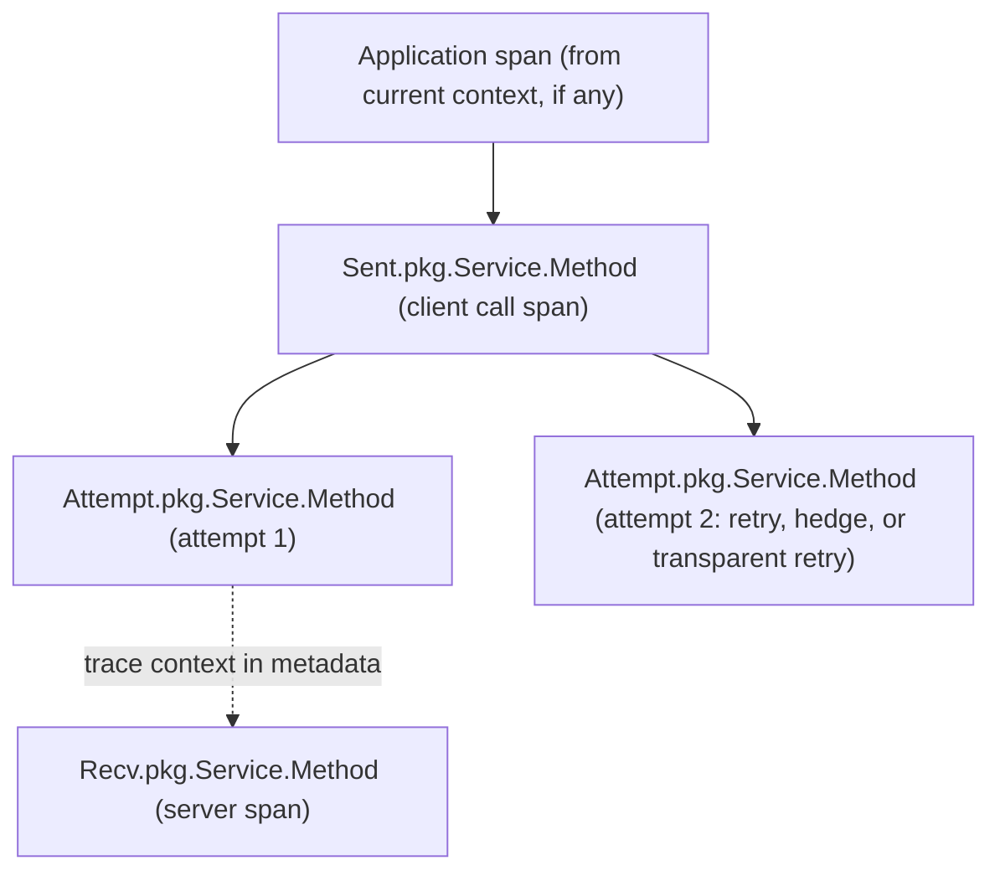

> [!WARNING]
> This document is part of a new, experimental
> [gRPC specification](../README.md). It was generated primarily by AI and has not
> yet been fully reviewed.

# 8.5 Tracing

<!-- Sources: A72, A45 (attempt span concepts), A66 -->

> **Introduced by:** [gRFC A72: OpenTelemetry Tracing](https://github.com/grpc/proposal/blob/master/A72-open-telemetry-tracing.md)

This section specifies the distributed-tracing information that gRPC produces
through its OpenTelemetry plugin (see [Metrics Framework and OpenTelemetry Plugin](03-metrics-framework.md)), and how
trace context is propagated between client and server in metadata. Tracing is
implemented on top of the call tracers in [Instrumentation Architecture](02-instrumentation.md).

Tracing is enabled by configuring the OpenTelemetry plugin with a
TracerProvider. If no TracerProvider is configured, no spans are created and
no trace context is propagated by gRPC.

## 1. Span Structure

On the client, gRPC records per-call information on a **call span** and
per-attempt information on an **attempt span** for each attempt. On the
server, there is a single **server span** per call.



| Span | Name | Parent | Created at | Ended at |
| --- | --- | --- | --- | --- |
| Client call span | `Sent.<service>.<method>` | The span in the context that is current when the application starts the call, if any | Call created (C1) | Call ended (C5) |
| Client attempt span | `Attempt.<service>.<method>` | The client call span | Attempt created (C3) | Attempt ended (AT6) |
| Server span | `Recv.<service>.<method>` | The remote span context extracted from the incoming metadata, if valid | Initial metadata received (S1) | Trailers or status sent (S4) |

`<service>` is the fully-qualified service name, and `<method>` is the method
name. For the method `/helloworld.Greeter/SayHello`, the client call span is
named `Sent.helloworld.Greeter.SayHello`.

An attempt span is created for every attempt, including transparent retries
and hedged attempts.

## 2. Client Call Span

- If the call had to wait for name resolution, add an event named
  **`Delayed name resolution complete`** when the wait ends.
- When the call ends, set the span status as described in [Span Status](#5-span-status), then end the
  span.

## 3. Client Attempt Span

**Attributes** (set when the span is created):

| Key | Type | Value |
| --- | --- | --- |
| `previous-rpc-attempts` | int | Number of attempts that preceded this one on the same call, not counting transparent retries. |
| `transparent-retry` | bool | Whether this attempt is a transparent retry. |

**Events:**

- **`Delayed LB pick complete`**: added when the stream is created on a
  transport, if the attempt's first LB pick was queued.
- **Outbound and inbound message events** ([Message Events](#4-message-events)).

When the attempt ends, set the span status as described in [Span Status](#5-span-status), then end the
span.

## 4. Message Events

Message events are recorded on the client attempt span and on the server span.
They are not recorded on the client call span.

### 4.1 Outbound Messages

For each message sent, add an event named **`Outbound message`** with these
attributes:

| Key | Type | Value |
| --- | --- | --- |
| `sequence-number` | int | Index of the message among messages sent on this attempt (client) or call (server). Starts at 0 and increases by 1 for each message. |
| `message-size` | int | The message size before compression. Total message bytes, excluding gRPC and transport framing and excluding encryption. |
| `message-size-compressed` | int | Present only if the message was compressed: the compressed size. |

### 4.2 Inbound Messages

For each message received, add an event named **`Inbound message`** with these
attributes:

| Key | Type | Value |
| --- | --- | --- |
| `sequence-number` | int | Index of the message among messages received on this attempt (client) or call (server). Starts at 0 and increases by 1 for each message. |
| `message-size` | int | The decompressed size if the message was compressed. Otherwise, the size on the wire. |
| `message-size-compressed` | int | Present only if the message was compressed: the compressed size. |

### 4.3 Split Compressed-Size Events

gRPC SHOULD report both sizes on a single event. If both sizes are not known
at the same point, gRPC MAY instead split the compressed size into a separate
event. In that case it MUST use exactly these names, attributes, and
orderings:

| Direction | Separate event name | Attributes | Order |
| --- | --- | --- | --- |
| Outbound | `Outbound message compressed` | `sequence-number`, `message-size-compressed` | MUST come **after** the corresponding `Outbound message` event. That event then omits `message-size-compressed`. |
| Inbound | `Inbound compressed message` | `sequence-number`, `message-size-compressed` | MUST come **before** the corresponding `Inbound message` event. That event then omits `message-size-compressed`. |

Example, with compression and a single event:

```
Outbound message  {sequence-number=0, message-size=7854, message-size-compressed=5493}
Inbound message   {sequence-number=0, message-size=7854, message-size-compressed=5493}
```

Example, with compression and split events:

```
Outbound message             {sequence-number=0, message-size=7854}
Outbound message compressed  {sequence-number=0, message-size-compressed=5493}
Inbound compressed message   {sequence-number=0, message-size-compressed=5493}
Inbound message              {sequence-number=0, message-size=7854}
```

Event timestamps on size events show only relative ordering. They are not
precise measurements of when compression or decompression happened.

## 5. Span Status

When a span ends:

- gRPC status `OK` → span status **OK**.
- Any other gRPC status → span status **ERROR**, with a description made of
  the status code name followed by the status message, e.g.
  `UNAVAILABLE, unable to resolve host`.

The same mapping applies to client call spans, client attempt spans, and server
spans.

## 6. Context Propagation

### 6.1 Propagator Model

gRPC propagates trace context with the OpenTelemetry **TextMapPropagator**
API, using the call's metadata as the carrier. The application configures the
propagator on the OpenTelemetry plugin. It may be a composite of several
propagators, for example W3C Trace Context together with the `grpc-trace-bin`
propagator in [The `grpc-trace-bin` Propagator and Format](#7-the-grpc-trace-bin-propagator-and-format). Client and server may be configured with different
propagators. This lets deployments move from one propagation format to
another:

1. configure servers to accept both the old and the new propagators;
2. configure clients to send only the new propagators;
3. remove the old propagator from the servers.

- **Client (inject).** When an attempt's stream is created (AT3), gRPC injects
  the context of the **attempt span** into the outgoing initial metadata using
  the configured propagator.
- **Server (extract).** When initial metadata is received (S1), gRPC extracts
  a span context with the configured propagator and uses it as the parent of
  the server span.

### 6.2 Metadata Carrier

gRPC MUST implement the TextMap getter and setter (carrier) over metadata as
follows:

| Key | Setter (inject) | Getter (extract) |
| --- | --- | --- |
| `grpc-trace-bin` | The propagator supplies the value as a base64 string. gRPC base64-decodes it and stores the raw bytes as binary metadata. | gRPC reads the binary metadata value and returns it base64-encoded. |
| Any other key ending in `-bin` | Not supported. gRPC MUST NOT add the entry, and SHOULD log an error. | Not supported. gRPC returns no value, and SHOULD log an error. |
| Any other key | Stored as ASCII metadata. | Returns the ASCII metadata value. |

An implementation MAY provide an optimized path in which the `grpc-trace-bin`
propagator passes raw bytes directly to and from the carrier, avoiding the
base64 round trip. The result on the wire MUST be the same.

At most one `grpc-trace-bin` entry is sent per RPC.

## 7. The `grpc-trace-bin` Propagator and Format

gRPC MUST provide a TextMapPropagator that encodes the span context in the
`grpc-trace-bin` metadata key. The value is a 29-byte binary structure:

| Offset | Length | Value |
| --- | --- | --- |
| 0 | 1 | Version: `0` |
| 1 | 1 | Field ID: `0` (trace ID) |
| 2 | 16 | Trace ID |
| 18 | 1 | Field ID: `1` (span ID) |
| 19 | 8 | Span ID |
| 27 | 1 | Field ID: `2` (trace options) |
| 28 | 1 | Trace options (trace flags). Bit 0 is *sampled*. |

**Inject.** If the span context in the given context is not valid, the
propagator MUST NOT set the key. Otherwise it sets `grpc-trace-bin` to the
29-byte encoding, base64-encoded when passed through the text API.

**Extract.** The propagator reads `grpc-trace-bin`, base64-decoding it when it
arrives through the text API. A value MUST be accepted if *all* of the
following hold:

- its length is exactly 29 bytes;
- byte 0 is `0`, byte 1 is `0`, byte 18 is `1`, and byte 27 is `2`.

The propagator MAY also accept a value that is at least 27 bytes long with
byte 0 `0`, byte 1 `0`, and byte 18 `1`, but that otherwise differs from the
29-byte encoding. In that case, if byte 27 is present and is `2`, byte 28
MUST also be present (otherwise the value is invalid) and gives the trace
flags; if byte 27 is absent or is not `2`, the trace flags are `0` (not
sampled). Any bytes after the fields read are ignored. Every other value is
invalid.

If the value is accepted, the result is a *remote* span context with the given
trace ID, span ID, and trace flags. Otherwise, or if the key is absent, the
propagator returns the context with an invalid span context, so that the
server span has no remote parent.

On the server, `grpc-trace-bin` is ordinary application-visible metadata. It
is also always recorded by binary logging (see [Binary Logging](07-binary-logging.md)).

## 8. API Requirements

- The OpenTelemetry plugin API MUST provide a way to set a TracerProvider and a
  TextMapPropagator ([Tracing Configuration](03-metrics-framework.md#98-tracing-configuration) in [Metrics Framework and OpenTelemetry Plugin](03-metrics-framework.md)).
- gRPC MUST provide a public factory for the `grpc-trace-bin`
  TextMapPropagator ([The `grpc-trace-bin` Propagator and Format](#7-the-grpc-trace-bin-propagator-and-format)), usable alone or in a composite propagator.
- The client call API MUST let the application's current trace context (the
  active span) reach the call tracer, so that the client call span gets the
  right parent. The server API MUST expose the server span's context to the
  handler, so that application spans can be children of it.
