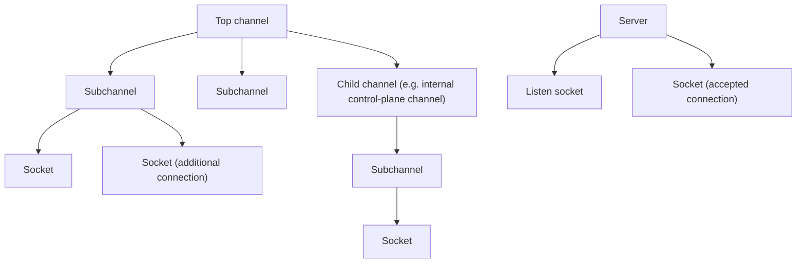

> [!WARNING]
> This document is part of a new, experimental
> [gRPC specification](../README.md). It was generated primarily by AI and has not
> yet been fully reviewed.

# 8.6 Channelz

<!-- Sources: A14, A3, A105, A17, A51, grpc-proto grpc/channelz/v1/channelz.proto -->

> **Introduced by:** [gRFC A14: gRPC Channelz](https://github.com/grpc/proposal/blob/master/A14-channelz.md)

Channelz is a runtime introspection facility. It exposes the channels,
subchannels, servers, and sockets that exist in a process, together with
per-entity statistics and a bounded log of recent events. Applications and
tools query it remotely through the `grpc.channelz.v1.Channelz` service. The
canonical data model and service definition is
`grpc/channelz/v1/channelz.proto`, which this section refers to as "the
proto".

## 1. Terminology

| Term | Meaning |
| --- | --- |
| **Channel** | An abstraction that can start and complete RPCs. A channel may have child channels and subchannels, or it may have sockets. |
| **Subchannel** | An abstraction that is load balanced over by an owning channel (see [Subchannels](../04-client-channel/07-subchannels.md)). It may have child channels and subchannels, or it may have sockets. |
| **Descendant channel** | A channel or subchannel logically owned by a higher-level channel. |
| **Server** | An entry point for RPCs (see [Server](../05-server/README.md)). It may have listen sockets and connected sockets. Servers are not hierarchical. |
| **Socket** | Roughly a file descriptor: either a connection (transport) to a remote endpoint, or a listening socket. |
| **Top channel** | A channel the application created directly. |

## 2. Identifiers and References

Every channelz entity (channel, subchannel, server, socket) has an **id**:

- The id is a positive `int64`. `0` is never used, because it is the protobuf
  default value.
- Ids MUST be unique across **all** entity types. A server id can never equal
  a channel, subchannel, or socket id.
- Ids MUST NOT be reused during the lifetime of the process.
- Ids MUST be **ordered**: an entity created later MUST have a larger id than
  every entity created earlier. Ids need not be consecutive. Pagination
  depends on this ordering, and so does inferring the relative age of sockets.

An id plus an optional human-readable **name** form a **reference**:
`ChannelRef`, `SubchannelRef`, `ServerRef`, `SocketRef`. Only the id is needed
to query an entity. Names have no format requirements but SHOULD be of
reasonable length. A socket's name SHOULD describe the socket (for example,
its local and remote addresses), because it serves as a breadcrumb when
browsing from a channel or server.

## 3. Entity Graph

Rules:

1. Channels and subchannels together form a **directed acyclic graph**. The
   union of all channels and subchannels MUST NOT contain a cycle. One channel
   or subchannel MAY be referenced from more than one parent, for example a
   subchannel shared between channels.
2. A channel or subchannel MUST NOT have heterogeneous children. It has either
   descendant channels and subchannels, or sockets, but never both. Only leaf
   channels and subchannels have sockets.
3. The graph expresses a "has-a" relationship. Child *channels* are not
   delegated RPCs by their parent in the way subchannels are. An example is a
   channel that a component of the parent uses for its own purposes. Child
   channels need not share the parent's target.
4. A subchannel MAY have several sockets. This happens, for example, when a
   connection that received a GOAWAY stays open for in-flight RPCs while a new
   connection serves new RPCs, or when connection scaling creates additional
   connections (see [Subchannels](../04-client-channel/07-subchannels.md)).
5. A server has listen sockets and connected sockets. A server MAY have no
   listen sockets but still have connected sockets, for example while it is
   shutting down gracefully. Implementations SHOULD keep the two kinds
   separate.
6. Entities contain only **references** to their children, never the full
   child messages.
7. Channelz data MUST be collected even if no server is running, so that a
   Channelz service started later can report earlier activity.

## 4. Channel and Subchannel Data

`Channel` and `Subchannel` share the `ChannelData` message:

| Field | Semantics |
| --- | --- |
| `state` | Connectivity state (`IDLE`, `CONNECTING`, `READY`, `TRANSIENT_FAILURE`, `SHUTDOWN`; `UNKNOWN` only if it cannot be determined). Implementations SHOULD always set it. See [Channel](../04-client-channel/02-channel.md). |
| `target` | The target the channel was created with. MAY be absent, notably for subchannels. A child channel's target may differ from its parent's. |
| `trace` | The channel trace ([Channel Trace](#7-channel-trace)). MAY be absent. |
| `calls_started`, `calls_succeeded`, `calls_failed` | Calls started on this entity, and calls that completed with an `OK` or non-`OK` status. For a channel, these count application calls on that channel. For a subchannel, they count calls (attempts) dispatched to that subchannel. `started − succeeded − failed` is the number of calls in flight. |
| `last_call_started_timestamp` | When the most recent call was started on this entity. |
| `max_connections_per_subchannel` | **Subchannels only.** The maximum number of connections that connection scaling currently allows for this subchannel (see [Subchannels](../04-client-channel/07-subchannels.md)). Unset (0) for channels. |

All data is specific to the entity itself. A parent does **not** aggregate the
data of its descendants: its counters, state, and trace are its own.

`Channel` and `Subchannel` messages contain `ref`, `data`, and repeated
`channel_ref`, `subchannel_ref`, and `socket_ref` fields. At most one of
{`channel_ref` and `subchannel_ref`} and {`socket_ref`} is non-empty ([Entity Graph](#3-entity-graph),
rule 2). Refs within a list are in no particular order.

## 5. Server Data

`Server` contains `ref`, `data` (`ServerData`), and `listen_socket` (refs to
listen sockets, in no particular order, possibly empty). The server's
connected sockets are retrieved with `GetServerSockets` ([Pagination](#9-pagination)).

| `ServerData` field | Semantics |
| --- | --- |
| `trace` | The server's trace ([Channel Trace](#7-channel-trace)). MAY be absent. Typical events include connections accepted, timeouts, protocol violations, and shutdown progress. |
| `calls_started`, `calls_succeeded`, `calls_failed` | Incoming calls started, and calls that completed with an `OK` or non-`OK` status. |
| `last_call_started_timestamp` | When the most recent incoming call started. |

## 6. Socket Data

`Socket` fields:

| Field | Semantics |
| --- | --- |
| `ref` | Socket reference. |
| `data` | `SocketData` (below). |
| `local` | The locally bound address. MAY be absent: for example, a Unix domain socket may have only a remote address. |
| `remote` | The remote address. MAY be absent: for example, a listen socket has only a local address. |
| `security` | Security details ([Security](#64-security)). Absent if not available, or if the socket has no security. |
| `remote_name` | The name of the remote endpoint, if it differs from the original target name. Optional. |

All socket data is reported from the perspective of the **transport**, not of
the owning subchannel or server.

### 6.1 `SocketData`

| Field | Semantics |
| --- | --- |
| `streams_started` | Streams started on this socket. |
| `streams_succeeded` | Streams that ended successfully. **Client side:** a frame with the end-of-stream bit was received. **Server side:** a frame with the end-of-stream bit was sent. Cleanup frames sent or received afterwards (such as RST_STREAM) do not affect success. |
| `streams_failed` | All other stream terminations. Client: ended without receiving end-of-stream. Server: ended without sending end-of-stream. |
| `messages_sent`, `messages_received` | gRPC messages successfully sent and received on this socket. A call may send or receive any number of messages, including zero. |
| `keep_alives_sent` | Keepalive pings sent by the local endpoint (see [HTTP/2 Client Transport: Keepalive](../04-client-channel/08-transports/02-http2.md#61-keepalive) and [HTTP/2 Server Transport: Keepalive](../05-server/02-transports/02-http2.md#71-keepalive)). MUST NOT count ping ACKs, or pings sent for reasons other than keepalive (for example, bandwidth or RTT estimation). |
| `last_local_stream_created_timestamp` | When this endpoint last created a stream. Normally unset for servers, which do not create streams. |
| `last_remote_stream_created_timestamp` | When the remote endpoint last created a stream. Normally unset for clients. |
| `last_message_sent_timestamp`, `last_message_received_timestamp` | When the last message was sent and received. |
| `local_flow_control_window` | Connection-level flow-control window that the remote endpoint has granted to the local endpoint. Excludes stream-level and TCP-level flow control. Unset if the transport has no flow control or the value is unknown. |
| `remote_flow_control_window` | Connection-level flow-control window that the local endpoint has granted to the remote endpoint, with the same rules. |
| `option` | Socket options ([Socket Options](#62-socket-options)). MAY be omitted when `GetSocketRequest.summary` is true. |
| `received_goaway_error` | Set if and only if a GOAWAY has been received on this connection. Its value is the HTTP/2 error code from the GOAWAY. |
| `peer_max_concurrent_streams` | The peer's current `SETTINGS_MAX_CONCURRENT_STREAMS`. Populated on the client side only. |

**Stream vs. call counting.** Stream counts are not call counts:

- A call may be started before any socket is available, or may fail before
  reaching one. Stream counts can therefore be lower than call counts.
- A retried call creates more than one stream. Stream counts can therefore be
  higher than call counts.
- A stream can succeed while its call fails, for example when the stream ends
  normally but the trailers are invalid.

### 6.2 Socket Options

Each `SocketOption` has a `name` (the full option name, typically uppercase,
such as `SO_REUSEPORT`), a human-readable `value` string, and/or an
`additional` `google.protobuf.Any` with structured data. At least one of
`value` and `additional` MUST be set. The proto defines these structured
messages:

| Message | Used for |
| --- | --- |
| `SocketOptionTimeout` (`duration`) | `SO_RCVTIMEO`, `SO_SNDTIMEO` |
| `SocketOptionLinger` (`active`, `duration`) | `SO_LINGER` (`l_onoff`, `l_linger`) |
| `SocketOptionTcpInfo` (`tcpi_*` fields) | `TCP_INFO` |

Implementations SHOULD include as many options as are practical. An error
while reading one option MUST NOT fail the query. The option is skipped and
the rest are still reported. Implementations MAY skip option collection when
it would be impractical.

### 6.3 Addresses

`Address` is a oneof:

| Variant | Fields |
| --- | --- |
| `tcpip_address` | `ip_address`: 4 bytes (IPv4) or 16 bytes (IPv6), in network byte order. `port`: 0–65535, or −1 if not applicable. |
| `uds_address` | `filename`: the Unix domain socket path. |
| `other_address` | `name`: a human-readable form, which SHOULD be set. `value`: a `google.protobuf.Any` with type-specific details. |

### 6.4 Security

`Security` is a oneof:

| Variant | Fields |
| --- | --- |
| `tls` | `cipher_suite`: either `standard_name` (the RFC 4346 name) or `other_name` (if no standard name is available). `local_certificate` and `remote_certificate`: the DER-encoded certificates used by each endpoint. |
| `other` | `name`: human-readable. `value`: a `google.protobuf.Any` with mechanism-specific details. |

See [TLS credentials](../06-security/02-tls.md).

## 7. Channel Trace

> **Introduced by:** [gRFC A3: Channel Tracing](https://github.com/grpc/proposal/blob/master/A3-channel-tracing.md)

Channels, subchannels, and servers each have a **trace**: a bounded log of
infrequent, interesting events. The trace belongs to its own entity and does
not aggregate descendant traces.

### 7.1 Format

`ChannelTrace`:

| Field | Semantics |
| --- | --- |
| `num_events_logged` | Total number of events ever logged to this trace, including events that have since been evicted. |
| `creation_timestamp` | When the entity was created. |
| `events` | The retained events, oldest first. |

`ChannelTraceEvent`:

| Field | Semantics |
| --- | --- |
| `description` | Human-readable description. |
| `severity` | `CT_INFO`, `CT_WARNING`, or `CT_ERROR`. `CT_UNKNOWN` (0) SHOULD NOT be used. |
| `timestamp` | When the event occurred. |
| `child_ref` (oneof `channel_ref` / `subchannel_ref`) | Set when the event concerns a child entity, such as the creation of a subchannel. The referenced entity may be outside the current entity's subgraph. |

### 7.2 Memory Bound

Implementations MUST bound the memory used by trace events, for example with
a maximum number of events per entity or a maximum total byte size. When
adding an event would exceed the bound, the **oldest** events are evicted
until the bound holds again. Implementations MUST provide a way to
control the bound.

An entity referenced by a `child_ref` in a retained trace event MUST remain
queryable (for example, through `GetSubchannel`) as long as any retained event
refers to it, even after the entity itself has been destroyed. Once no
retained event refers to it, it MAY be removed.

### 7.3 Required Events

Events MUST be logged at a rate well below once per RPC. At least the
following MUST be logged:

| Entity | Event |
| --- | --- |
| Channel | Creation and destruction |
| Channel | Connectivity state changes |
| Channel | Name resolution that changes the service config |
| Channel | Name resolution that changes the number of addresses from zero to non-zero |
| Channel | Name resolution that changes the number of addresses from non-zero to zero |
| Channel | Name resolution that causes a new LB policy to be created |
| Channel (parent) | Creation and destruction of child subchannels (with `subchannel_ref`) |
| Subchannel | Creation and destruction |
| Subchannel | Connectivity state changes |
| Subchannel | Health-checking `Watch` call failed with `UNIMPLEMENTED` (health checking disabled; see [Health checking](../04-client-channel/10-health-checking.md)) |
| Subchannel | Out-of-band backend metrics stream failed with `UNIMPLEMENTED` (see [ORCA](../07-services/03-orca.md)) |

Implementations MAY log additional events that are useful and infrequent.

## 8. The Channelz Service

The service is `grpc.channelz.v1.Channelz`:

| Method | Request | Response | Behavior |
| --- | --- | --- | --- |
| `GetTopChannels` | `start_channel_id`, `max_results` | `channel[]`, `end` | Lists top channels only. Subchannels and child channels are not included. Paginated ([Pagination](#9-pagination)). |
| `GetServers` | `start_server_id`, `max_results` | `server[]`, `end` | Lists all servers. Paginated. |
| `GetServer` | `server_id` | `server` | Returns one server, or `NOT_FOUND`. |
| `GetServerSockets` | `server_id`, `start_socket_id`, `max_results` | `socket_ref[]`, `end` | Lists references to the server's connected sockets. Paginated. `NOT_FOUND` if the server does not exist. |
| `GetChannel` | `channel_id` | `channel` | Returns one channel (top or child), or `NOT_FOUND`. |
| `GetSubchannel` | `subchannel_id` | `subchannel` | Returns one subchannel, or `NOT_FOUND`. |
| `GetSocket` | `socket_id`, `summary` | `socket` | Returns one socket, or `NOT_FOUND`. If `summary` is true, the response contains only information that is cheap to obtain. Fields documented as omissible (such as `SocketData.option`) MAY be left out. |

The `Get<Entity>` methods MUST return `NOT_FOUND` when no entity of the
requested type has the given id. This includes ids that belong to an entity of
a different type. A successful response MUST set the entity field.

## 9. Pagination

`GetTopChannels`, `GetServers`, and `GetServerSockets` use the id as a
continuation token:

- The request's `start_*_id` selects entities whose id is **greater than or
  equal to** that value. Any value is a valid start point, including zero and
  negative numbers. The first page is requested with `0`.
- Results MUST be sorted by ascending id.
- `max_results`: if positive, the response MUST contain at most that many
  items. If zero, the server picks a reasonable page size (RECOMMENDED: 100).
  The server MAY return fewer items than requested, for example under load.
  Negative values are invalid.
- `end`: true if there are no more entities after the last one returned.
  Later requests can return more only for entities created after this
  response. A response with no items MUST set `end` to true.
- To get the next page, the client sends the **highest id it received plus
  one** as the new start id.

Because ids are never reused and are ordered, every entity that exists for the
whole duration of a scan is visited exactly once. Entities created during the
scan may or may not be seen. Example (C = client, S = Channelz server):

1. C → `GetTopChannels(start_channel_id=0)`
2. S → channels 1, 5, 9 (12, 13, 17, and 18 also exist), `end=false`
3. C → `GetTopChannels(start_channel_id=10)`
4. S → channels 12, 13, 17, `end=false`
5. C → `GetTopChannels(start_channel_id=18)`
6. S → channel 18, `end=true`

## 10. API Requirements

- gRPC MUST provide a way for applications to register the
  `grpc.channelz.v1.Channelz` service on a server, either directly or through
  the admin interface (see [Admin interface](../07-services/04-admin.md)).
- Channelz data collection MUST be on by default. The channel and server APIs
  MUST provide a way to disable Channelz tracking for an individual channel or
  server.
- The channel and server APIs MUST provide a way to configure the channel
  trace memory bound ([Memory Bound](#72-memory-bound)).
- Internal component APIs (resolver, LB policy helper, subchannel, transport)
  MUST give components a way to add channel trace events with a severity to
  the owning channel or subchannel. LB policies use this, for example, to log
  policy-specific events.
