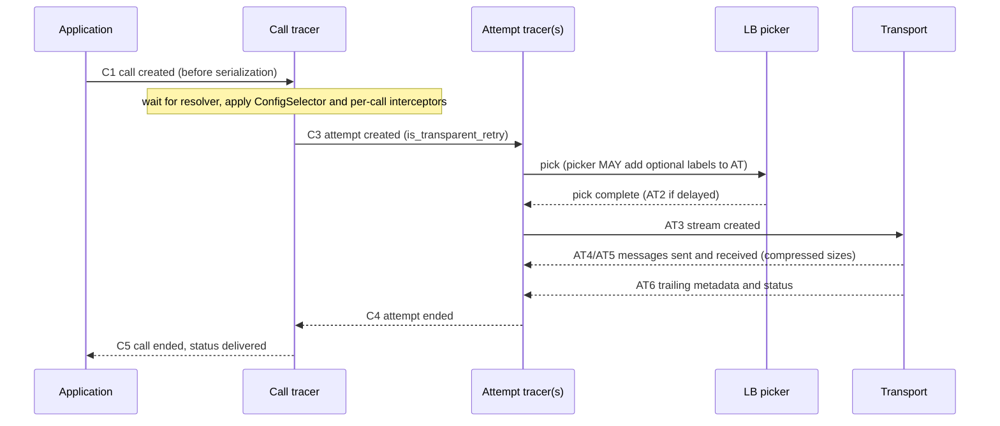

> [!WARNING]
> This document is part of a new, experimental
> [gRPC specification](../README.md). It was generated primarily by AI and has not
> yet been fully reviewed.

# 8.1 Instrumentation Architecture

<!-- Sources: A66, A45, A6 (attempt concepts), A72, A78, A89, A96, A108 -->

This section defines the per-call instrumentation hooks, called **tracers**,
through which gRPC reports call lifecycle events to stats and tracing plugins.
The per-call metrics ([Metric Catalog](metrics.md)) and OpenTelemetry tracing
([Tracing](tracing.md)) are defined in terms of these hooks. Non-per-call
metrics use the separate mechanism in [Metrics Framework and OpenTelemetry Plugin](metrics-framework.md).

Implementations MAY name and structure these objects however they choose
(for example as stream tracers, stats handlers, or interceptors) as long as
the capabilities and the event points described here are equivalent.

## 1. Concepts

- **Call.** One RPC from the application's point of view, from the moment the
  application starts it until its final status is delivered to the
  application. See [Core RPC Semantics](../02-rpc-semantics/README.md).
- **Attempt.** One try at sending a call on a transport stream. A call has one
  or more attempts. Additional attempts are created by retries, hedging, and
  transparent retries (see [Retries and hedging](../04-client-channel/retries.md)).
  Every attempt counts as an attempt for instrumentation purposes, including
  transparent retries and every hedged attempt.
- **Server call.** One incoming RPC on a server. Servers have no concept of
  attempts. Each incoming stream is an independent server call.

There are three tracer types:

| Tracer | Lifetime | Created by |
| --- | --- | --- |
| **Call tracer** (client) | One per client call | The plugin's per-channel call tracer factory, when the call is created |
| **Call-attempt tracer** (client) | One per attempt | The call tracer, when the attempt is created |
| **Server call tracer** | One per server call | The plugin's per-server tracer factory, when the call's initial metadata is received |

A stats or tracing plugin configures call tracer factories on channels and
server call tracer factories on servers. Which plugins apply to which channels
and servers is specified in [Metrics Framework and OpenTelemetry Plugin](metrics-framework.md).

## 2. Information Available to Tracers

- A client call tracer MUST have access to:
  - the channel's canonical target (see [Channel](../04-client-channel/channel.md)),
    used for the `grpc.target` attribute;
  - the fully-qualified method name (`<service>/<method>`);
  - whether the method is *registered* (known in advance) or *generic*. This
    determines how `grpc.method` is recorded (see [Metrics Framework and OpenTelemetry Plugin](metrics-framework.md));
  - the call's custom telemetry label, if any (see [Custom Per-Call Label](#7-custom-per-call-label));
  - the call's context, so that tracing plugins can find the parent span.
- A server call tracer MUST have access to the method name of the incoming
  call and whether it matches a method registered with the server. The method
  MAY be obtained from the incoming initial metadata (`:path`).

## 3. Client Call Tracer Event Points

The client call tracer MUST receive the following call-outs, in this order
relative to the call:

| # | Event | Exact point | Notes |
| --- | --- | --- | --- |
| C1 | **Call created** | When the application starts the call, *before* the first request message is serialized | Start time of `grpc.client.call.duration`. If instrumentation is implemented as an interceptor, the exact point depends on interceptor ordering. Otherwise the call-out MUST be as close as possible to the top of the gRPC stack, so that payload serialization is included in the measurement. |
| C2 | **Name resolution delay complete** | When a call that had to wait for the first resolver result (see [Name resolution](../04-client-channel/name-resolution.md)) stops waiting | Used by tracing ([Tracing](tracing.md)). Not reported if the call did not wait. |
| C3 | **Attempt created** (with an `is_transparent_retry` flag) | For each attempt: *after* name resolution, *after* the per-call configuration (ConfigSelector) has been applied, and *after* any per-call interceptors installed by the channel (including xDS HTTP filter behavior), but *before* the first LB pick for that attempt | The call tracer creates and returns a call-attempt tracer here. The flag is true if and only if the attempt is a transparent retry. |
| C4 | **Attempt ended** | When an attempt finishes, for any reason | MAY be delivered through the call-attempt tracer if it holds a reference to its call tracer. |
| C5 | **Call ended** (with final status) | Immediately before the final status is delivered to the application | End time of `grpc.client.call.duration`. Per-call retry metrics are recorded here. |

See [Per-call configuration and call flow](../04-client-channel/call-dispatch.md)
for the client call pipeline in which these points sit.

## 4. Call-Attempt Tracer Event Points

The call-attempt tracer MUST receive the following call-outs:

| # | Event | Exact point | Notes |
| --- | --- | --- | --- |
| AT1 | **Attempt started** | Creation of the tracer (C3) | Start time of `grpc.client.attempt.duration`. `grpc.client.attempt.started` is incremented here. The duration therefore includes the time spent in LB picks. |
| AT2 | **LB pick delay complete** | When an attempt whose first pick was queued finally gets a stream on a transport | Used by tracing. Not reported if the first pick completed immediately. |
| AT3 | **Stream created** | When the attempt's stream is created on a transport | The tracer MAY inspect and modify the outgoing initial metadata here, for example to inject trace context (see [Tracing](tracing.md)). Such changes go to the wire but are not seen by interceptors or the application. |
| AT4 | **Message sent** | For each outbound message on the attempt | MUST report the message size *after compression* (when compression applies), excluding gRPC and transport framing and excluding encryption. MAY also report the uncompressed size. |
| AT5 | **Message received** | For each inbound message on the attempt | MUST report the received (compressed) size, with the same rules as AT4. MAY also report the decompressed size. |
| AT6 | **Trailing metadata / status received** | When the attempt's final status is known: trailers received from the server, or a status synthesized locally (pick failure, transport failure, cancellation, or deadline) | Marks the end of the attempt. Implementations MAY have the call-attempt tracer deliver C4 to the call tracer at this point. |
| AT7 | **Optional label supplied** | Any time during an LB pick for the attempt (see [Picker-Supplied Optional Labels](#6-picker-supplied-optional-labels)) | |

Headers sent and received MAY also be reported to the call-attempt tracer.

If a call fails before any attempt is created (for example, a
non-wait-for-ready call fails because the resolver reports an error), no
attempt events are generated. Only C1 and C5 occur, and only call-level
metrics are recorded.
<!-- REVIEW(divergence) [METRICS-1]: Java: increments grpc.client.attempt.started when the call is created and, if no stream was ever created, records a synthetic attempt at call end (attempt.duration = elapsed time, sizes 0, call status) (OpenTelemetryMetricsModule.CallAttemptsTracerFactory.recordFinishedCall); Go: no attempt events, only grpc.client.call.duration (stats/opentelemetry/client_metrics.go); C++: attempt tracer is created only with the LB call after resolution, so no attempt events (client_channel_filter.cc CreateCallAttemptTracer); spec says: no attempt events, only C1/C5 and call-level metrics (Go/C++ majority). -->

## 5. Server Call Tracer Event Points

| # | Event | Exact point | Notes |
| --- | --- | --- | --- |
| S1 | **Initial metadata received** | When the transport learns of a new stream: for HTTP/2, after the first HEADERS frame of the stream has been received and decoded. Whether this is before or after HPACK decoding is implementation-defined. | Start of the server call. `grpc.server.call.started` is incremented, and the start time of `grpc.server.call.duration` is taken. The incoming initial metadata is available here, so trace context can be extracted. |
| S2 | **Message received** | For each inbound message | Compressed size, as in AT5. |
| S3 | **Message sent** | For each outbound message | Compressed size, as in AT4. |
| S4 | **Trailing metadata / status sent** | As close to the transport as possible: the first point at which the transport considers the stream done. For HTTP/2 that is when a trailing HEADERS frame with END_STREAM is scheduled to be written, when RST_STREAM is sent or received, or when the connection is aborted. The bytes need not have been handed to the OS yet. | End of the server call. The server's per-call metrics are recorded here. |

A call that is rejected (for example, with `UNIMPLEMENTED` for an unknown
method) still produces S1 and S4.

## 6. Picker-Supplied Optional Labels

The LB picker (see [Load balancing](../04-client-channel/load-balancing.md))
MUST be able to attach optional label values to the call-attempt tracer of the
attempt being picked. The pick arguments MUST give the picker access to the
attempt's tracer, or to an equivalent mechanism.

- A picker that has a value for a label MUST supply it on every pick for which
  the value is available, *regardless of the pick result* (complete, queue, or
  fail). This lets attempts that end with `DEADLINE_EXCEEDED` or `UNAVAILABLE`
  while waiting for a pick still carry the label.
- A single attempt may be picked several times, and later picks may supply a
  different value. **The value supplied by the last pick wins.**
- Labels that are never supplied are recorded as the empty string when the
  plugin is configured to record them.

The labels supplied this way are:

| Label | Supplied by | Value |
| --- | --- | --- |
| `grpc.lb.locality` | The `xds_cluster_impl` policy's picker, from the locality attribute of the endpoint that the child picker returned | See [Metric Catalog](metrics.md) |
| `grpc.lb.backend_service` | The `cds` policy, for non-aggregate clusters | The cluster name in its LB config (`cluster` key) |

See [xDS LB policies](../09-xds/lb-policies.md). Other LB policies MAY supply
these or other optional labels.

## 7. Custom Per-Call Label

> **Experimental:** the custom per-call label and the `grpc.client.call.custom`
> metric label.

Applications MAY attach a single string value, the **custom telemetry label**,
to a call when starting it. The default is the empty string.

- The value MUST be visible to client interceptors, to the client call tracer
  and call-attempt tracers, and to the LB picker (as part of the pick
  arguments).
- gRPC's metrics plugins record it as the optional `grpc.client.call.custom`
  label on all client per-call and per-attempt instruments, including the retry
  instruments (see [Metric Catalog](metrics.md)). Other per-call instruments, such as those
  recorded by LB policies during picks, are encouraged to support it.
- The label is never recorded unless the application explicitly enables the
  optional label in the plugin. This remains true once the label is stable.

## 8. Multiple Tracers per Call

Several plugins may be registered on the same channel or server, for example
several OpenTelemetry plugins with different MeterProviders, or a metrics
plugin and a separate tracing plugin. Therefore:

- Implementations MUST allow multiple call tracer factories per channel and
  multiple server call tracer factories per server.
- Each call MUST have one call tracer per applicable factory, and every
  call-out MUST be delivered to each of them. Each call tracer creates its own
  call-attempt tracers.
- A picker-supplied optional label ([Picker-Supplied Optional Labels](#6-picker-supplied-optional-labels)) MUST be delivered to every
  call-attempt tracer of the attempt.
- Tracers MUST be independent: one tracer's behavior MUST NOT affect what
  another tracer observes, except through deliberate metadata modification at
  AT3, such as trace-context injection.

## 9. Per-Attempt vs. Per-Call Accounting

| Quantity | Accounted on | Rule |
| --- | --- | --- |
| Attempt count, attempt duration, attempt message sizes, attempt status | Each attempt | Every attempt counts: the original attempt, each retry, each hedged attempt, and each transparent retry. Each is recorded as if it were a distinct RPC. Message sizes count only bytes sent or received on that attempt. |
| Call duration and final status | The call | Measured from C1 to C5, independent of how many attempts were made. |
| Retries, hedges, transparent retries, retry delay | The call | Computed by the call tracer from C3 and C4 and recorded at C5. See [Metric Catalog](metrics.md) for the exact definitions. |

For an attempt:

- `previous-rpc-attempts` (used in tracing) is the number of earlier attempts
  on the same call, *not* counting transparent retries.
- The status of the attempt is the status at AT6. For example, a hedged attempt
  that is cancelled because another attempt was committed ends with
  `CANCELLED`.

## 10. API Requirements

- The channel API MUST provide a way to install one or more call tracer
  factories (directly, or by configuring a stats or tracing plugin) on a
  channel. The server API MUST provide the same for server call tracer
  factories on a server.
- The call-start API MUST provide a way to set the custom telemetry label for
  a call.
- The LB picker API MUST provide a way for a picker to set optional label
  values on the call-attempt tracer of the attempt being picked. It MUST also
  expose the call's custom telemetry label to the picker.
- The tracer interfaces MUST expose all event points in [Client Call Tracer Event Points](#3-client-call-tracer-event-points) through [Server Call Tracer Event Points](#5-server-call-tracer-event-points),
  including the transparent-retry flag at attempt creation and compressed
  message sizes.
