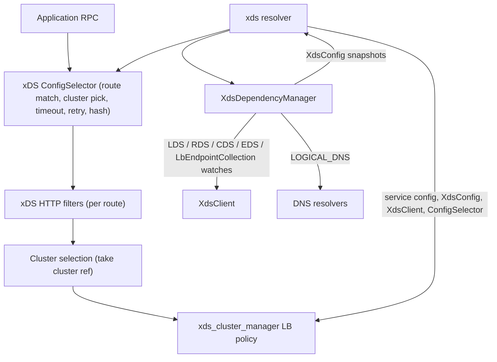

> [!WARNING]
> This document is part of a new, experimental
> [gRPC specification](../README.md). It was generated primarily by AI and has not
> yet been fully reviewed.

# 9.4 Client Data Plane

<!-- Sources: A27, A28, A31, A37, A39, A42, A44, A47, A55, A60, A61, A74, A75, A76, A81, A83, A86, A88, A95, doc/grpc_xds_features.md -->

This section specifies how an xDS-enabled gRPC client channel turns xDS
resources into channel behavior:

- the `xds` resolver and how it computes the Listener resource name
  ([The `xds` Resolver](#1-the-xds-resolver));
- the **XdsDependencyManager**, which watches all resources a channel needs and
  produces consistent `XdsConfig` snapshots
  ([XdsDependencyManager](#2-xdsdependencymanager), [XdsConfig](#3-xdsconfig));
- the result the resolver returns to the channel
  ([Resolver Result](#4-resolver-result));
- the **xDS ConfigSelector**, which routes each RPC and computes its per-call
  configuration ([xDS ConfigSelector](#5-xds-configselector)).

The LB policies that consume the `XdsConfig` are specified in
[xDS LB Policies](05-lb-policies.md). Validation of the xDS resources
themselves is specified in [Resources](03-resources/01-common-types.md). The
generic resolver, ConfigSelector, and LB policy APIs are specified in
[Name Resolution](../04-client-channel/02-name-resolution.md),
[Per-call Configuration](../04-client-channel/04-call-dispatch.md), and
[Load Balancing](../04-client-channel/05-load-balancing.md).



## 1. The `xds` Resolver

> **Introduced by:** [gRFC A27: xDS-Based Global Load Balancing](https://github.com/grpc/proposal/blob/master/A27-xds-global-load-balancing.md)

### 1.1 Target URI syntax

An application enables xDS on a channel by creating it with a target URI whose
scheme is `xds` (see [Channel](../04-client-channel/01-channel.md) for URI
parsing):

```
xds:[//authority/]host[:port]
```

Examples: `xds:example.com:443`, `xds:///example.com:443`,
`xds://xds.authority.com/example.com`.

- The **path** of the URI, with any leading `/` removed, is the *service
  name*. It is normally in `host` or `host:port` form, but gRPC does not
  interpret it. In particular, gRPC MUST NOT add a default port; the xDS
  server decides what a missing port means.
- The resolver MUST reject a URI whose path is empty or ends with `/`. Such a
  target is invalid, and the resolver is not created.
- The **authority** of the URI is optional. If present, it names an entry in
  the bootstrap `authorities` map (see [Bootstrap](01-bootstrap.md)).

### 1.2 Listener resource name

> **Introduced by:** [gRFC A47: xDS Federation](https://github.com/grpc/proposal/blob/master/A47-xds-federation.md)

The resolver computes the name of the Listener resource to watch as follows
(`PercentEncodePath` percent-encodes every character that RFC 3986
§3.3 does not allow in a URI path; `/` is allowed and is not encoded.
`PercentEncodeAuthority` does the same for the authority component):

```
service_name = StripLeadingSlash(target_uri.path)
if target_uri.authority is set:
  authority_config = bootstrap.authorities[target_uri.authority]
  if authority_config not found:
    fail: UNAVAILABLE "Invalid target URI -- authority not found for <authority>"
  template = authority_config.client_listener_resource_name_template
  if template is unset or empty:
    template = "xdstp://" + PercentEncodeAuthority(target_uri.authority) +
               "/envoy.config.listener.v3.Listener/%s"
  lds_name = ReplaceAll(template, "%s", PercentEncodePath(service_name))
else:
  template = bootstrap.client_default_listener_resource_name_template
  if template is unset or empty:
    template = "%s"
  if template starts with "xdstp:":
    service_name = PercentEncodePath(service_name)
  lds_name = ReplaceAll(template, "%s", service_name)
```

Which xDS server (and so which ADS stream) is used for `lds_name` is
determined by the XdsClient from the resource name (see
[XdsClient](02-xds-client.md)).

When the target names an authority that is not in the bootstrap `authorities`
map, the resolver MUST NOT start any watches. It MUST instead report a result
whose service config is an error with status UNAVAILABLE and the message above.
The channel then goes to TRANSIENT_FAILURE (see
[Name Resolution](../04-client-channel/02-name-resolution.md)).

### 1.3 XdsClient instance

When started, the resolver obtains the shared XdsClient for the channel's
target (see [XdsClient](02-xds-client.md)). If the XdsClient cannot be created
(for example, because the bootstrap configuration is missing or invalid), the
resolver MUST report a result whose service config is an error with status
UNAVAILABLE and a message that includes the reason (for example
`Failed to create XdsClient: <reason>`).

### 1.4 Data-plane authority

The **data-plane authority** is the channel's default authority (see
[Authority](../04-client-channel/01-channel.md)):

- If the application set the channel's default-authority override option,
  that value (percent-encoded as for an authority) is used.
- Otherwise it is the service name (the URI path without its leading `/`),
  with any characters that are not allowed in a URI authority, including any
  remaining `/`, percent-encoded.

The data-plane authority is used to select the virtual host from the
RouteConfiguration ([Watch graph](#22-watch-graph)). It is also the default
`:authority` of RPCs. It does not depend on the URI authority or on the
Listener resource name.

### 1.5 Resolver operations

- **Start**: obtain the XdsClient, compute the Listener name, and create an
  XdsDependencyManager for that Listener name and the data-plane authority.
- **Re-resolution request** (from the LB policy tree, via the channel): the
  resolver MUST ask the XdsDependencyManager to request re-resolution on the
  DNS resolver of **every** LOGICAL_DNS cluster in the current config. xDS
  resources are watched, so re-resolution has no other effect.
- **Reset backoff**: the resolver MUST reset the XdsClient's backoff and the
  backoff of every LOGICAL_DNS DNS resolver.
- **Shutdown**: destroy the XdsDependencyManager, which cancels all of its
  watches and DNS resolvers, and release the XdsClient.

## 2. XdsDependencyManager

> **Introduced by:** [gRFC A74: xDS Config Tears](https://github.com/grpc/proposal/blob/master/A74-xds-config-tears.md)

The XdsDependencyManager sits between the resolver and the XdsClient. It
watches every resource the channel needs, resolves the dependencies between
them, and returns a complete configuration to the resolver only once all
needed dependencies have been obtained. This makes each config change
atomic: the channel never uses a route that points to a cluster whose
resources have not yet been obtained.

### 2.1 Watcher interface

The XdsDependencyManager is created with the Listener resource name, the
data-plane authority, and a watcher. The watcher has one method:

- **OnUpdate(StatusOr\<XdsConfig\>)**: called with a new complete `XdsConfig`,
  or with an error that requires the resolver to stop using the previously
  delivered config (see [Error handling](#25-error-handling)).

### 2.2 Watch graph

The XdsDependencyManager MUST maintain the following watches. Each watch is
registered with the XdsClient (see [XdsClient](02-xds-client.md)) and
receives `OnResourceChanged(StatusOr<resource>)` and `OnAmbientError(status)`
notifications.

1. **Listener (LDS).** Watched for the Listener resource name from the moment
   the XdsDependencyManager is created. The Listener MUST be an HTTP API
   listener (see [Listener (Client Side)](03-resources/02-listener.md)).
2. **RouteConfiguration (RDS).** If the Listener's HttpConnectionManager
   names an RDS resource, that resource is watched. If the Listener contains
   an inline RouteConfiguration, no RDS watch exists, and the inline
   RouteConfiguration is used. When a new Listener changes the RDS name, the
   old RDS watch MUST be cancelled and a watch for the new name started. When a
   new Listener switches between inline and RDS, the watch is cancelled or
   started accordingly. An RDS update for a name other than the current one
   MUST be ignored.
3. **Virtual host selection.** From the RouteConfiguration, the
   XdsDependencyManager selects the virtual host whose `domains` best match the
   data-plane authority, using the domain matching rules in
   [RouteConfiguration](03-resources/03-route-configuration.md). This
   virtual host is used until the next Listener or RouteConfiguration update.
4. **Clusters (CDS).** The set of *root clusters* is the union of:
   - every cluster named by a route in the selected virtual host whose action
     is `route`, either as `cluster` or as an entry in `weighted_clusters`
     (a route that uses a cluster specifier plugin names no cluster; its
     clusters are chosen at run time and subscribed to dynamically); and
   - every cluster that has an active *dynamic subscription*
     ([Dynamic cluster subscriptions](#26-dynamic-cluster-subscriptions)).

   Each root cluster is watched. Each cluster is then expanded according to
   its type:
   - **EDS cluster**: the endpoint resource named by the cluster's
     `eds_service_name` is watched, or the cluster name if
     `eds_service_name` is empty.
   - **LOGICAL_DNS cluster**: a DNS resolver is created for the cluster's
     `host:port` name ([LOGICAL_DNS clusters](#24-logical_dns-clusters)).
   - **Aggregate cluster**: each underlying cluster in the aggregate's
     prioritized cluster list is watched and expanded recursively
     ([Aggregate cluster graph](#23-aggregate-cluster-graph)).
5. **Endpoints (EDS).** Each needed ClusterLoadAssignment resource is watched.
   Two clusters that use the same EDS resource name share one watch.
6. **LbEndpointCollection.** For each locality in an EDS resource that names
   an `LbEndpointCollection` resource instead of listing its endpoints inline
   (see [ClusterLoadAssignment and LbEndpointCollection](03-resources/05-endpoint.md)), that
   `LbEndpointCollection` resource is watched. Each distinct resource name is
   watched once.

After processing each update, the XdsDependencyManager MUST recompute the set
of needed resources by traversing the whole graph, even when some resources
are not yet available. It MUST start watches for newly needed resources and
MUST cancel watches (and shut down DNS resolvers) for resources that are no
longer needed. A cluster stays needed as long as it is reachable from a root
cluster.

### 2.3 Aggregate cluster graph

> **Introduced by:** [gRFC A37: xDS Aggregate and Logical DNS Clusters](https://github.com/grpc/proposal/blob/master/A37-xds-aggregate-and-logical-dns-clusters.md)

An aggregate cluster's underlying clusters may themselves be aggregate
clusters, so the graph is expanded recursively, depth first, in the order of
each aggregate's prioritized cluster list:

```
# Returns true if all resources needed for `name` are available.
def Expand(name, depth, leaf_list, notes):
  if depth == 16:
    leaf_list = UNAVAILABLE("aggregate cluster graph exceeds max depth")
    return true
  if name already visited in this traversal:
    return true          # Each cluster is expanded at most once.
  mark name visited; ensure CDS watch for name
  if CDS resource for name not yet received: return false
  if CDS watch reported an error: record error for name; append error to notes
                                  return true
  switch cluster type:
    EDS / LOGICAL_DNS:
      ensure endpoint watch or DNS resolver
      if no endpoint data and no endpoint error yet: return false
      append name to leaf_list
      return true
    AGGREGATE:
      child_leaves = []; child_notes = []; all = true
      for child in prioritized_cluster_names:
        all &= Expand(child, depth + 1, child_leaves, child_notes)
        if child_leaves is an error: break
      if child_leaves is an error:
        record child_leaves error for name, and propagate it to the parent
        return true
      append child_leaves to leaf_list; append child_notes to notes
      if all and child_leaves is empty:
        record UNAVAILABLE("aggregate cluster dependency graph for <name>
                            has no leaf clusters") for name
        return true
      record AggregateConfig(leaf_clusters = child_leaves,
                             resolution_note = Join(child_notes, "; ")) for name
      return all
```

Rules:

- The maximum depth is 16. The root cluster is at depth 0. If expansion
  reaches depth 16, the aggregate cluster at the root of that branch, and
  every aggregate cluster above it, gets the error
  `aggregate cluster graph exceeds max depth` with status UNAVAILABLE.
- A leaf cluster appears at most once in an aggregate's leaf list, at the
  first position where depth-first traversal reaches it. Cycles therefore end
  the traversal and do not loop.
- An underlying cluster whose CDS resource does not exist, or has an error
  with no cached resource, MUST be **skipped**. It does not fail the
  aggregate cluster. Its error is added to the aggregate cluster's resolution
  note. If, after all resources are obtained, an aggregate cluster has no leaf
  clusters, its entry in the `XdsConfig` MUST be an UNAVAILABLE error, so that
  RPCs routed to it fail.
- Every cluster visited (aggregate, leaf, or failed) MUST have an entry in the
  `XdsConfig` cluster map. This includes aggregate clusters that are not
  roots.

### 2.4 LOGICAL_DNS clusters

> **Introduced by:** [gRFC A37: xDS Aggregate and Logical DNS Clusters](https://github.com/grpc/proposal/blob/master/A37-xds-aggregate-and-logical-dns-clusters.md)

For each LOGICAL_DNS cluster, the XdsDependencyManager creates a DNS resolver
(see [Name Resolution](../04-client-channel/02-name-resolution.md)) for the
target `dns:<host>:<port>`, where `host:port` comes from the cluster resource.
Clusters that use the same DNS name share one resolver. The resolver MUST NOT
fetch a service config; only addresses are used.

Each DNS result is converted to endpoint data equivalent to an EDS resource:

- one priority, containing one locality whose region, zone, and sub-zone are
  all empty, with locality weight 1;
- one endpoint that contains **all** addresses returned by DNS, in order (so
  that the cluster connects to only one of them at a time, through a single
  `pick_first`, whatever LB policy the cluster uses);
- a `hostname` endpoint attribute set to the cluster's `host:port` name (used
  for authority rewriting; see [`xds_cluster_impl`](lb-policies/xds_cluster_impl.md)).

If DNS resolution fails, the endpoint data is unchanged if a previous result
exists. If no previous result exists, the endpoint data is an empty endpoint
list. In both cases the resolution note is set to the DNS resolver's
resolution note, or to `DNS resolution failed for <host:port>: <status>`. If
the DNS resolver cannot be created, the cluster gets an empty endpoint list and
the note `failed to create DNS resolver for <host:port>`.

### 2.5 Error handling

Errors are handled at three levels.

**(a) Errors that fail the whole config.** The XdsDependencyManager MUST call
`OnUpdate()` with an error (status UNAVAILABLE, and a message of the form
`<LDS|RDS> resource <name>: <detail>`) in exactly these cases:

- The Listener or RouteConfiguration watcher receives
  `OnResourceChanged()` with an error. Per [XdsClient](02-xds-client.md),
  this happens when the resource does not exist, or when an error occurs and no
  usable resource is cached.
- The Listener is not an HTTP API listener (detail: `not an API listener`).
- The RouteConfiguration has no virtual host that matches the data-plane
  authority (detail:
  `could not find VirtualHost for <authority> in RouteConfiguration`). For an
  inline RouteConfiguration, the resource type and name are those of the
  Listener.

After such an error, the XdsDependencyManager discards the Listener and/or
virtual host. It sends no further `XdsConfig` until a valid Listener and
virtual host are available again. Watches for clusters and endpoints stay in
place until the next traversal.

**(b) Per-cluster errors.** A cluster's entry in the `XdsConfig` cluster map
MUST be a non-OK status (UNAVAILABLE, message `CDS resource <name>: <detail>`)
when its CDS watcher reports `OnResourceChanged()` with an error (the resource
does not exist, or there is an error and no cached resource). Aggregate cluster
errors (max depth, no leaf clusters) are also per-cluster errors. A per-cluster
error affects only RPCs routed to that cluster.

**(c) Endpoint errors and ambient errors: the resolution note.** Endpoint
problems never fail the config or the cluster entry. Instead, they are
reported in the cluster's `resolution_note`:

- If the EDS watcher reports `OnResourceChanged()` with an error, the
  cluster's endpoint data is cleared (no endpoints) and the note is
  `EDS resource <name>: <detail>`.
- If a valid EDS resource has no localities, the note is
  `EDS resource <name>: contains no localities`. If some localities have no
  endpoints, the note is
  `EDS resource <name>: contains empty localities: [<locality>; ...]`.
- DNS problems for LOGICAL_DNS clusters are reported as described in
  [LOGICAL_DNS clusters](#24-logical_dns-clusters).
- An `OnAmbientError()` on any watcher records the error for that resource
  (`<LDS|RDS|CDS|EDS> resource <name>: <detail>`). An ambient error with OK
  status, or a later `OnResourceChanged()`, clears it. An ambient error never
  changes the resource in use.

The `resolution_note` for each EDS or LOGICAL_DNS cluster is built by joining
the following non-empty strings with `"; "`, in this order:

1. the ambient error for the Listener;
2. the ambient error for the RouteConfiguration;
3. the ambient error for this cluster's CDS resource;
4. the endpoint note for this cluster (EDS error, ambient EDS error, empty
   localities, or DNS note).

The resolution note therefore covers the top-level LDS and RDS resources for
every cluster, but covers only that cluster's own CDS and endpoint resources.
If all of these are empty, the resolution note MUST instead be
`xDS node ID:<node id>` (from the bootstrap), so that error messages identify
the client to the operator. LB policies include the resolution note in the
errors of failed picks (see [Load Balancing](../04-client-channel/05-load-balancing.md)).

An aggregate cluster's `resolution_note` is the `"; "`-joined list of errors
for the underlying clusters that were skipped.

The XdsDependencyManager MUST NOT propagate status codes from the XdsClient to
data-plane RPCs as-is. Errors it produces use UNAVAILABLE (see
[Status codes](README.md)).

How errors for an `LbEndpointCollection` watch are reported is not yet
specified. It will be defined by a future specification for
`LbEndpointCollection` (LEDS) resources.

### 2.6 Dynamic cluster subscriptions

An LB policy config can name a cluster that does not appear in the route
configuration (for example, a `cds` config with `isDynamic` set; see
[`cds`](lb-policies/cds.md)). This happens for clusters returned by the
lookup server of the RLS cluster specifier plugin
([RLS Cluster Specifier Plugin](03-resources/03-route-configuration.md#53-rls-cluster-specifier-plugin)).
To support this, the XdsDependencyManager
MUST provide an API to **subscribe to a cluster by name**:

- Subscribing returns a handle. While at least one handle for a name exists,
  that cluster is a root cluster ([Watch graph](#22-watch-graph)).
- Releasing the last handle for a name removes it from the root set. If the
  cluster is still not named by the route configuration, its watches are
  cancelled in the next traversal.
- Subscribing to, or releasing, a cluster that the route configuration does
  not already name MUST trigger a new traversal, and therefore a new
  `XdsConfig` when all resources are available.

The resolver passes this API to the LB policies as a resolver attribute
([Resolver Result](#4-resolver-result)). The xDS ConfigSelector's cluster references
also hold subscriptions ([Cluster references and two-phase removal](#54-cluster-references-and-two-phase-removal)),
so that a cluster's resources stay watched until the cluster has been removed
from the LB policy config.

### 2.7 When a config is delivered

After every event (resource update, ambient error, DNS result, subscription
change), the XdsDependencyManager MUST call `OnUpdate()` with a new
`XdsConfig` if and only if all of the following are true:

- a valid Listener and a selected virtual host are available; and
- for every cluster reachable from the root set, the CDS watcher has delivered
  either a resource or an error; and
- for every reachable EDS or LOGICAL_DNS cluster, endpoint data or an endpoint
  error is available (for EDS: the EDS resource and every
  `LbEndpointCollection` it names; for LOGICAL_DNS: a DNS result).

If any needed resource is still pending, no config is delivered. The previous
config, if any, remains in use. Ambient errors cause a new config to be
delivered (with updated resolution notes) as long as the conditions above hold.

## 3. XdsConfig

The `XdsConfig` is an immutable snapshot. It is passed by reference to the LB
policies and to xDS HTTP filters. Its logical structure is:

```
XdsConfig {
  listener:      Listener resource (parsed)
  route_config:  RouteConfiguration (parsed). Set whether the
                 RouteConfiguration is inline or from RDS.
  virtual_host:  the selected VirtualHost within route_config (never null)
  clusters:      map<cluster name, StatusOr<ClusterConfig>>
}

ClusterConfig {
  cluster:  Cluster resource (parsed)
  children: one of
    EndpointConfig {                       # EDS and LOGICAL_DNS clusters
      endpoints:  endpoint resource (parsed), or null if unavailable
      lb_endpoint_collections: map<resource name, LbEndpointCollection>
      resolution_note: string
    }
    AggregateConfig {                      # aggregate clusters
      leaf_clusters:   ordered list of leaf cluster names
      resolution_note: string
    }
}
```

- The cluster map contains an entry for every cluster that is named by a
  route in the selected virtual host, that is reachable through an aggregate
  cluster, or that has a dynamic subscription.
- An entry is a non-OK status exactly in the cases in
  [Error handling](#25-error-handling) (b).
- For an EDS cluster, a locality that names an `LbEndpointCollection` gets its
  endpoints from `lb_endpoint_collections`. For a LOGICAL_DNS cluster,
  `endpoints` holds the converted DNS result.
- `leaf_clusters` is the flattened, de-duplicated list of the aggregate's EDS
  and LOGICAL_DNS clusters, in priority order. Each leaf has its own entry in
  the map.

## 4. Resolver Result

When the XdsDependencyManager delivers a new `XdsConfig`, and whenever the set
of referenced clusters changes ([Cluster references and two-phase removal](#54-cluster-references-and-two-phase-removal)),
the resolver MUST return a result to the channel containing:

- **Endpoints**: an empty list. Endpoint addresses reach the LB policies
  through the `XdsConfig`.
- **Service config**: a generated service config
  ([Generated service config](#41-generated-service-config)).
- **Attributes** (top-level resolver attributes):
  - the **XdsClient** (used by `xds_cluster_impl` for load reporting and
    security);
  - the **XdsConfig**;
  - a **cluster subscription interface** to the XdsDependencyManager
    ([Dynamic cluster subscriptions](#26-dynamic-cluster-subscriptions));
  - the **xDS ConfigSelector** ([xDS ConfigSelector](#5-xds-configselector)).
- **Resolution note**: empty.

When `OnUpdate()` reports an error ([Error handling](#25-error-handling) (a)), the
resolver MUST discard its current `XdsConfig` and return a result with an
empty endpoint list, an empty service config (`{}`), no ConfigSelector, and
the error message as the resolution note. The channel then uses its default LB
policy with no endpoints, reports TRANSIENT_FAILURE, and fails RPCs that are
not wait_for_ready with UNAVAILABLE and a message that includes the error.
<!-- REVIEW(divergence) [XDS_RESOLVER-2]: Java: returns an empty service config plus a ConfigSelector that fails every RPC with the error, so wait_for_ready RPCs fail too (XdsNameResolver.cleanUpRoutes, RoutingConfig.errorStatus). Go: returns an empty service config with no ConfigSelector, then reports the error as a resolver error (internal/xds/resolver/xds_resolver.go sendNewServiceConfig; its erroringConfigSelector is not passed to the channel). C++: empty service config, error as resolution note, no ConfigSelector (XdsResolver::GenerateErrorResult). Spec says: empty config (C++, Go majority). -->

### 4.1 Generated service config

The generated service config contains only a `loadBalancingConfig` that
selects `xds_cluster_manager_experimental`, with one child per entry in the
resolver's cluster reference map
([Cluster references and two-phase removal](#54-cluster-references-and-two-phase-removal)). The child for
cluster `C` is named `cluster:C`, and its child policy is a `cds_experimental`
policy for `C`:

```json
{
  "loadBalancingConfig": [ {
    "xds_cluster_manager_experimental": {
      "children": {
        "cluster:cluster_a": {
          "childPolicy": [ { "cds_experimental": { "cluster": "cluster_a" } } ]
        },
        "cluster:cluster_b": {
          "childPolicy": [ { "cds_experimental": { "cluster": "cluster_b" } } ]
        }
      }
    }
  } ]
}
```

For a route that uses a cluster specifier plugin `P`, the child is named
`cluster_specifier_plugin:P`, and its `childPolicy` is the LB policy config
that the plugin produced
([Cluster Specifier Plugins](03-resources/03-route-configuration.md#52-cluster-specifier-plugins)).
For the RLS plugin, that is an `rls_experimental` config whose children are
`cds_experimental` policies with `isDynamic` set:

```json
"cluster_specifier_plugin:rls_plugin": {
  "childPolicy": [ { "rls_experimental": {
    "routeLookupConfig": { ... },
    "childPolicy": [ { "cds_experimental": { "isDynamic": true } } ],
    "childPolicyConfigTargetFieldName": "cluster"
  } } ]
}
```

The service config does not contain `methodConfig` entries. Per-method
settings (timeout and retry policy) come from the ConfigSelector.

> **Experimental:** The LB policy names `xds_cluster_manager_experimental` and
> `cds_experimental` still carry the `_experimental` suffix.

## 5. xDS ConfigSelector

> **Introduced by:** [gRFC A31: gRPC xDS Timeout Support and Config Selector Design](https://github.com/grpc/proposal/blob/master/A31-xds-timeout-support-and-config-selector.md)

The resolver returns a ConfigSelector (see
[Per-call Configuration](../04-client-channel/04-call-dispatch.md)). The
ConfigSelector is built from one `XdsConfig`: its virtual host, the
HttpConnectionManager's xDS HTTP filters, and per-route data that is
precomputed when the ConfigSelector is built. It is invoked once at the start
of each RPC, with the RPC's method path and initial metadata, and it produces:

1. the per-call method configuration (timeout, retry policy);
2. call attributes for the LB policies and xDS HTTP filters;
3. the xDS HTTP filter chain for the RPC;
4. a callback that is invoked when the call is committed, to release the
   call's cluster reference;
5. or an error status that fails the RPC.

Two ConfigSelectors are equal if their Listener and RouteConfiguration are
equal, since all other ConfigSelector state is derived from those.

### 5.1 Route matching

> **Introduced by:** [gRFC A28: gRPC xDS traffic splitting and routing](https://github.com/grpc/proposal/blob/master/A28-xds-traffic-splitting-and-routing.md)

For each RPC:

1. The ConfigSelector evaluates the routes of the selected virtual host in
   order, and the **first** route whose match criteria all match is selected.
   Path and runtime-fraction matching are defined in
   [RouteConfiguration](03-resources/03-route-configuration.md).
   Header matching semantics (including the handling of `content-type` and
   `-bin` headers) are defined in
   [Common Types](03-resources/01-common-types.md).
2. If no route matches, the RPC MUST fail with status UNAVAILABLE (message:
   `No matching route found in xDS route config`).
3. If the matched route's action is not `route` (for example,
   `non_forwarding_action`, which is meant for servers), the RPC MUST fail with
   status UNAVAILABLE (message: `Matching route has inappropriate action`).
   The ConfigSelector fails the RPC immediately, so no xDS HTTP filter runs
   for it.

### 5.2 Cluster selection

> **Introduced by:** [gRFC A28: gRPC xDS traffic splitting and routing](https://github.com/grpc/proposal/blob/master/A28-xds-traffic-splitting-and-routing.md)

For a route whose action is `route`:

- **`cluster`**: the named cluster is selected.
- **`weighted_clusters`**: one cluster is chosen at random, with probability
  proportional to its weight. Implementations MUST use this algorithm or an
  equivalent one:

  ```
  # Precomputed when the ConfigSelector is built:
  #   entries[i].range_end = sum of weights of clusters 0..i
  total = entries[last].range_end
  key = uniform random integer in [0, total)
  selected = first entry with entries[i].range_end > key
  ```

  The choice MUST NOT depend on the connectivity state of the clusters. Once a
  cluster is chosen for an RPC, all retry attempts of that RPC MUST use the
  same cluster.
- **`cluster_specifier_plugin`**: the plugin's `xds_cluster_manager` child,
  `cluster_specifier_plugin:<plugin name>`, is selected. The plugin's LB
  policy (for RLS, the [`rls`](../04-client-channel/lb-policies/rls.md)
  policy) chooses the actual cluster for each pick.

The selected `xds_cluster_manager` child name (`cluster:<name>` or
`cluster_specifier_plugin:<name>`) is placed in the **cluster call attribute**. xDS HTTP filters
MAY change it before cluster selection completes; for example, stateful session
affinity can override it with a cluster from a session cookie (see
[xDS HTTP Filters](06-http-filters.md)). An xDS HTTP filter MUST only set it to a
cluster that the matched route references. The **route call attribute** exposes a
"does the route reference cluster X" check for this purpose. For a route that
uses a cluster specifier plugin, the check is false for every cluster.

### 5.3 Call attributes

The ConfigSelector MUST make the following available to the xDS HTTP filters
and to the LB policy pickers for the RPC:

| Attribute | Contents | Consumers |
| --- | --- | --- |
| Cluster | `xds_cluster_manager` child name of the selected cluster (`cluster:<name>`) or plugin (`cluster_specifier_plugin:<name>`) | `xds_cluster_manager` picker; stateful session xDS HTTP filter |
| Request hash | 64-bit hash for the RPC ([Request hash](#55-request-hash)) | `ring_hash` picker (see [ring_hash](../04-client-channel/lb-policies/ring_hash.md)) |
| Route | The matched route, including its `auto_host_rewrite` flag, and a check for whether the route references a given cluster | `xds_cluster_impl` picker (authority rewriting); stateful session xDS HTTP filter |
| XdsConfig | The `XdsConfig` the ConfigSelector was built from | xDS HTTP filters that need cluster data, e.g. cluster metadata for GCP authentication (see [xDS HTTP Filters](06-http-filters.md)) |

The route attribute also holds a reference to the ConfigSelector's
route/cluster table until cluster selection completes
([Cluster references and two-phase removal](#54-cluster-references-and-two-phase-removal)).

### 5.4 Cluster references and two-phase removal

The ConfigSelector, the service config, and in-flight RPCs MUST be coordinated
so that the `xds_cluster_manager` policy never lacks a child for a cluster that
an RPC was routed to.

- The resolver keeps a **cluster reference map**, from `xds_cluster_manager`
  child name to a weakly-held, reference-counted *cluster reference*. Each
  cluster reference holds a dynamic cluster subscription
  ([Dynamic cluster subscriptions](#26-dynamic-cluster-subscriptions)) for its cluster.
  A cluster reference for a cluster specifier plugin child holds no
  subscription (the plugin's children subscribe to their own clusters). It
  holds the plugin's LB policy config instead: the config from the most
  recent RouteConfiguration that defined the plugin. The generated service
  config uses that config, even after the plugin has been removed from the
  RouteConfiguration, until the reference is released.
- When a ConfigSelector is built, it takes a strong reference to the cluster
  reference of every cluster its routes name, creating map entries as needed.
  The generated service config ([Generated service config](#41-generated-service-config))
  has one child per map entry.
- For each RPC, after the xDS HTTP filters run (so after any filter has
  changed the cluster attribute), a final cluster-selection step takes a strong
  reference to the selected cluster's reference from the ConfigSelector's
  table. It then releases the call's reference to the table. The call holds
  the cluster reference until the call is **committed**, which means it will
  make no more LB picks (see [Retries](../04-client-channel/10-retries.md)).
  The call then releases it.
- When the last strong reference to a cluster reference is released (the
  ConfigSelector that named it has been replaced and destroyed, and no call
  still holds it), the resolver removes the entry from the map. It then
  returns a new result whose service config no longer contains that cluster.

Removing a cluster is therefore a two-phase process:

1. An xDS update produces a new ConfigSelector that cannot select the removed
   cluster. The service config returned at the same time still contains the
   cluster, because the old ConfigSelector and in-flight calls still
   reference it.
2. When nothing references the cluster any more, a new service config without
   it is returned.

A call that waits in the channel's pick queue still holds its cluster
reference. For this reason, the `cds` policy for a cluster whose `XdsConfig`
entry is an error drops RPCs (failing them with UNAVAILABLE even if they are
wait_for_ready) instead of letting them queue (see [`cds`](lb-policies/cds.md)).

Adding a cluster is done in one step: the new ConfigSelector and a service
config that contains the cluster are returned in the same result.

**Ordering guarantee.** When a resolver result contains both a new service
config and a new ConfigSelector, the channel MUST pass the new config to the LB
policy, and the LB policy MUST report a new picker, **before** the channel
starts using the new ConfigSelector for new RPCs. This ensures that any cluster
the new ConfigSelector can select already has a child in the
`xds_cluster_manager` picker.

### 5.5 Request hash

> **Introduced by:** [gRFC A42: xDS Ring Hash LB Policy](https://github.com/grpc/proposal/blob/master/A42-xds-ring-hash-lb-policy.md)

The ConfigSelector computes a 64-bit request hash from the matched route's
`hash_policy` list, once per RPC, using the algorithm defined in
[RouteConfiguration](03-resources/03-route-configuration.md)
([Hash Policy](03-resources/03-route-configuration.md#7-hash-policy)). The `io.grpc.channel_id` value used by `filter_state` hash
policies is a random 64-bit value from a uniform distribution, chosen once per
channel (when the resolver is created). If no policy produces a hash, a
uniform random 64-bit value is used. All picks for the same RPC use the same
hash.

The hash is passed to the LB policy in the request hash call attribute.

### 5.6 Timeout

> **Introduced by:** [gRFC A31: gRPC xDS Timeout Support and Config Selector Design](https://github.com/grpc/proposal/blob/master/A31-xds-timeout-support-and-config-selector.md)

The ConfigSelector sets the method config's `timeout` from the matched route
and the HttpConnectionManager:

- Let `max_stream_duration` be the route's
  `max_stream_duration.max_stream_duration` if set. Otherwise, it is the
  HttpConnectionManager's `common_http_protocol_options.max_stream_duration`
  (see [Listener (Client Side)](03-resources/02-listener.md)).
- If the route's `max_stream_duration.grpc_timeout_header_max` is set, it
  takes the place of `max_stream_duration`, which is then ignored.
- The selected value is the timeout. A value of zero, or no value, means no
  timeout.

The channel applies the timeout as it applies a service config timeout: the
RPC's effective deadline is the earlier of the application's deadline and
now + timeout. xDS configuration MUST never extend the application's deadline.

| Application deadline | `grpc_timeout_header_max` | `max_stream_duration` (route, else HCM) | Effective timeout |
| --- | --- | --- | --- |
| unset | unset | unset | infinite |
| unset | unset | 0 | infinite |
| unset | unset | 10s | 10s |
| unset | 0s | any | infinite |
| unset | 10s | any | 10s |
| 20s | unset | unset | 20s |
| 20s | unset | 0 | 20s |
| 20s | unset | 10s | 10s |
| 20s | 0s | any | 20s |
| 20s | 10s | any | 10s |

`RouteAction.timeout` and `grpc_timeout_header_offset` are not used.

### 5.7 Retry policy

> **Introduced by:** [gRFC A44: gRPC xDS Retry Support](https://github.com/grpc/proposal/blob/master/A44-xds-retry.md)

The ConfigSelector sets the method config's `retryPolicy` (see
[Retries and Hedging](../04-client-channel/10-retries.md)) from the matched
route's parsed retry policy, which is the route's own `retry_policy` if
present, else the virtual host's. Validation and the conversion from the xDS
`RetryPolicy` to a gRPC `retryPolicy` (`retryableStatusCodes`, `maxAttempts`,
`initialBackoff`, `maxBackoff`, `backoffMultiplier`) are defined in
[RouteConfiguration](03-resources/03-route-configuration.md)
([Retry Policy](03-resources/03-route-configuration.md#8-retry-policy)). If the resulting `retryableStatusCodes` is empty, the method config
has no retry policy. If the application has disabled retries on the channel,
the converted policy is not used. Each retry attempt makes a new LB pick in
the same cluster, using the latest picker.

### 5.8 xDS HTTP filters

> **Introduced by:** [gRFC A39: xDS HTTP Filter Support](https://github.com/grpc/proposal/blob/master/A39-xds-http-filters.md)

For each route, the ConfigSelector builds the xDS HTTP filter chain from the
HttpConnectionManager's `http_filters` list. Each xDS HTTP filter's configuration is
overridden by the most specific per-route override (virtual host, then route,
then the selected `weighted_clusters` entry). For a route that uses
`weighted_clusters`, a separate chain is built for each cluster entry. The
chain for the RPC is the one for the matched route, or for the chosen cluster
entry. gRPC applies the xDS HTTP filters' behavior to each RPC (for example, as
interceptors) after the ConfigSelector runs and before cluster selection
completes. The framework, the override rules, and the supported xDS HTTP filters are
specified in [xDS HTTP Filters](06-http-filters.md).

### 5.9 Authority rewriting

> **Introduced by:** [gRFC A81: xDS Authority Rewriting](https://github.com/grpc/proposal/blob/master/A81-xds-authority-rewriting.md)

The route attribute carries the route's `auto_host_rewrite` flag. That flag is
set only when the RouteConfiguration came from an xDS server with the
`trusted_xds_server` server feature (see [Bootstrap](01-bootstrap.md) and
[RouteConfiguration](03-resources/03-route-configuration.md)). The
`xds_cluster_impl` picker uses it to rewrite `:authority` (see
[`xds_cluster_impl`](lb-policies/xds_cluster_impl.md)).

## 6. API Requirements

- The channel API MUST accept targets with the `xds` scheme in the syntax of
  [Target URI syntax](#11-target-uri-syntax).
- The channel API MUST let the application override the channel's default
  authority. With xDS, this also changes the data-plane authority used to
  select the virtual host.
- The resolver API MUST let a resolver return, together with a result: a
  ConfigSelector, top-level attributes (XdsClient, XdsConfig, cluster
  subscription interface), and a resolution note. It MUST let the channel ask
  the resolver to re-resolve and to reset backoff.
- The ConfigSelector API MUST let a ConfigSelector, for each RPC: return a
  method config; attach call attributes that xDS HTTP filters and LB pickers
  can read (and filters can modify); supply the per-RPC xDS HTTP filter chain;
  register a callback that runs when the call is committed; and fail the RPC
  with a status.
- The channel MUST apply an LB policy update, and get the resulting picker,
  before it uses a ConfigSelector delivered in the same resolver result
  ([Cluster references and two-phase removal](#54-cluster-references-and-two-phase-removal)).
- The LB picker API MUST let a picker read the RPC's call attributes and set
  an `:authority` override for the RPC (see
  [Load Balancing](../04-client-channel/05-load-balancing.md)).
