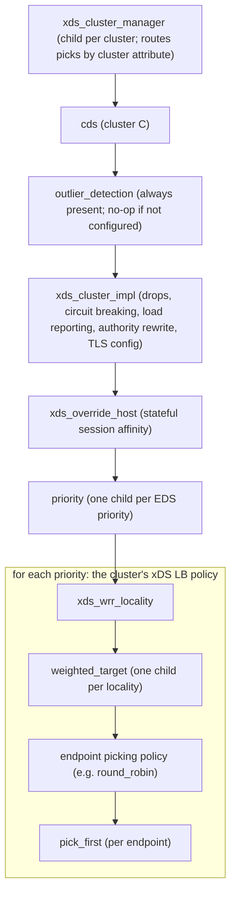
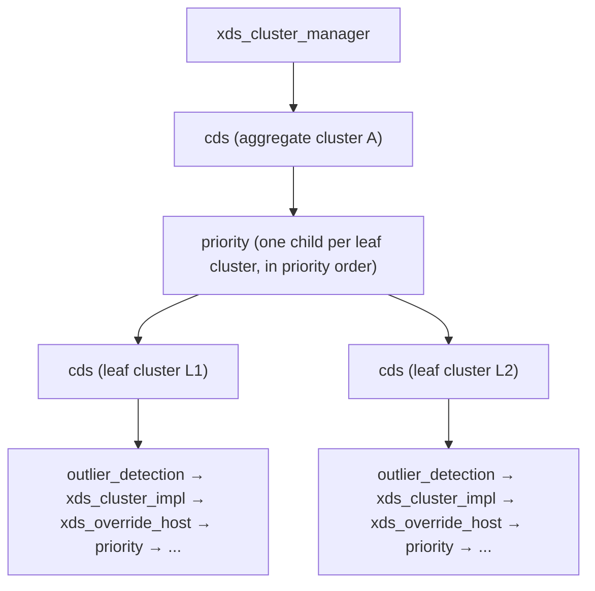
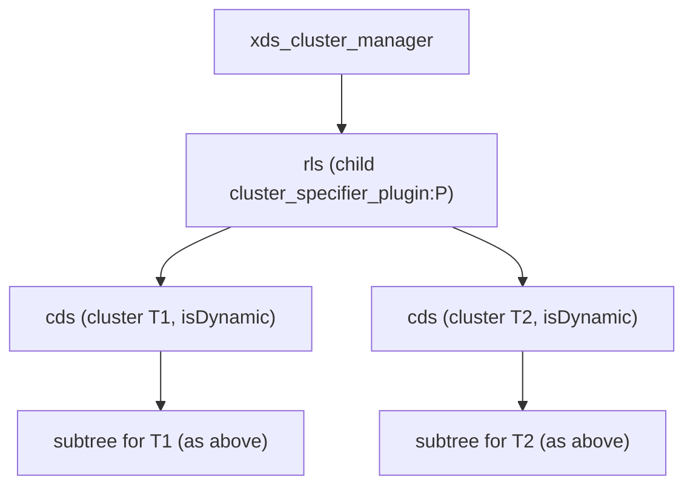

> [!WARNING]
> This document is part of a new, experimental
> [gRPC specification](../README.md). It was generated primarily by AI and has not
> yet been fully reviewed.

# 9.6 xDS LB Policies

<!-- Sources: A27, A31, A37, A42, A48, A52, A58, A62, A68, A74, A75, grpc-proto grpc/service_config/service_config.proto -->

This section specifies the LB policies that implement xDS clusters on the
client, and the **xDS LB policy registry**, which converts a Cluster
resource's load balancing configuration into a gRPC LB policy config.

General-purpose policies used in the xDS tree are specified in [Client Channel](../04-client-channel/README.md):
[`priority`](../04-client-channel/lb-policies/priority.md),
[`weighted_target`](../04-client-channel/lb-policies/weighted_target.md),
[`outlier_detection`](../04-client-channel/lb-policies/outlier_detection.md),
[`round_robin`](../04-client-channel/lb-policies/round_robin.md),
[`pick_first`](../04-client-channel/lb-policies/pick_first.md),
[`ring_hash`](../04-client-channel/lb-policies/ring_hash.md),
[`least_request`](../04-client-channel/lb-policies/least_request.md),
[`weighted_round_robin`](../04-client-channel/lb-policies/weighted_round_robin.md), and
[`random_subsetting`](../04-client-channel/lb-policies/random_subsetting.md).
The generic LB policy, helper, picker, and subchannel APIs are in
[Load Balancing](../04-client-channel/06-load-balancing.md).

Every policy in this section gets its cluster data from the `XdsConfig`
resolver attribute (see [XdsConfig](05-client.md)) and not from its JSON
config. The JSON configs contain only what is needed to find that data.

> **Experimental:** All policies in this section are registered under names
> with the `_experimental` suffix (`xds_cluster_manager_experimental`,
> `cds_experimental`, `xds_cluster_impl_experimental`,
> `xds_override_host_experimental`, `xds_wrr_locality_experimental`). The same
> is true of `priority_experimental`, `weighted_target_experimental`,
> `outlier_detection_experimental`, `ring_hash_experimental`,
> `least_request_experimental`, and `random_subsetting_experimental`.

## 1. LB Policy Tree

The resolver's service config selects `xds_cluster_manager` as the top-level
policy, with one `cds` child per cluster and one child per cluster specifier
plugin (see [Generated service config](05-client.md)). Each `cds` policy builds
the subtree for its cluster from the `XdsConfig`.

The complete tree, with a link to each policy's document (each xDS LB policy
document shows the same tree with its own position highlighted):

<!-- XDS-LB-TREE: generated; identical in every xDS LB policy document except for the highlighted policy -->
<pre>
<a href="lb-policies/xds_cluster_manager.md">xds_cluster_manager</a>  (one child per cluster and per cluster specifier plugin)
├── <a href="lb-policies/cds.md">cds</a>  (one per cluster)
│   ├── non-aggregate cluster (EDS or LOGICAL_DNS):
│   │   └── <a href="../04-client-channel/lb-policies/outlier_detection.md">outlier_detection</a>
│   │       └── <a href="lb-policies/xds_cluster_impl.md">xds_cluster_impl</a>
│   │           └── <a href="lb-policies/xds_override_host.md">xds_override_host</a>
│   │               └── <a href="../04-client-channel/lb-policies/priority.md">priority</a>  (one child per EDS priority)
│   │                   ├── <a href="lb-policies/xds_wrr_locality.md">xds_wrr_locality</a>  (default; see <a href="#2-xds-lb-policy-registry">xDS LB Policy Registry</a>)
│   │                   │   └── <a href="../04-client-channel/lb-policies/weighted_target.md">weighted_target</a>  (one child per locality)
│   │                   │       └── endpoint-picking policy (e.g. <a href="../04-client-channel/lb-policies/round_robin.md">round_robin</a>)
│   │                   │           └── <a href="../04-client-channel/lb-policies/pick_first.md">pick_first</a>  (one per endpoint)
│   │                   └── or another converted policy: <a href="../04-client-channel/lb-policies/ring_hash.md">ring_hash</a> | <a href="../04-client-channel/lb-policies/random_subsetting.md">random_subsetting</a> | ...
│   └── aggregate cluster:
│       └── <a href="../04-client-channel/lb-policies/priority.md">priority</a>  (one child per leaf cluster)
│           └── <a href="lb-policies/cds.md">cds</a>  (one per leaf cluster; non-aggregate subtree above)
└── <a href="../04-client-channel/lb-policies/rls.md">rls</a>  (one per RLS cluster specifier plugin)
    └── <a href="lb-policies/cds.md">cds</a>  (one per target cluster returned by the lookup server)
</pre>
<!-- /XDS-LB-TREE -->

### 1.1 Non-aggregate cluster (EDS or LOGICAL_DNS)



The child of each priority is the cluster's converted LB policy
([xDS LB Policy Registry](#2-xds-lb-policy-registry)). The default is
`xds_wrr_locality` → `weighted_target` → `round_robin`. Policies that
handle locality and endpoint picking in one layer, such as `ring_hash`, sit
directly under `priority`.

Because `outlier_detection`, `xds_cluster_impl`, and `xds_override_host` sit
above `priority`, outlier detection, circuit breaking, load reporting, and
session affinity apply across all priorities of a cluster.

### 1.2 Aggregate cluster

> **Introduced by:** [gRFC A37: xDS Aggregate and Logical DNS Clusters](https://github.com/grpc/proposal/blob/master/A37-xds-aggregate-and-logical-dns-clusters.md)



An aggregate cluster is a `priority` policy whose children are `cds` policies
for the aggregate's leaf clusters (the flattened list in the `XdsConfig`; see
[Aggregate cluster graph](05-client.md)). Each leaf `cds` builds the non-aggregate subtree, using
the **leaf** cluster's own configuration. The aggregate cluster's own LB policy
configuration (`lb_policy` / `load_balancing_policy`) is ignored: it is
neither validated nor used (see [Cluster](04-resources/04-cluster.md)). Nested
aggregate clusters are flattened into a single `priority` level; they are not
represented as nested `priority` policies.

### 1.3 Cluster specifier plugin (RLS)



For a route that uses a cluster specifier plugin, the `xds_cluster_manager`
child is the LB policy that the plugin produced (see
[Cluster Specifier Plugins](04-resources/03-route-configuration.md#52-cluster-specifier-plugins)).
For the RLS plugin, that is an [`rls`](../04-client-channel/lb-policies/rls.md)
policy. It creates one `cds` child per cluster name that its lookup server
returns, with `isDynamic` set. Each such `cds` subscribes to its cluster
dynamically ([Dynamic cluster subscriptions](05-client.md#26-dynamic-cluster-subscriptions))
and then builds the same subtree as any other cluster. The `rls` policy
passes the `XdsConfig` and other resolver attributes through to its
children unchanged.

## 2. xDS LB Policy Registry

> **Introduced by:** [gRFC A52: gRPC xDS Custom Load Balancer Configuration](https://github.com/grpc/proposal/blob/master/A52-xds-custom-lb-policies.md)

The XdsClient converts each Cluster resource's LB configuration to a gRPC
`loadBalancingConfig` list (JSON). It does this when it validates the resource
(see [Cluster](04-resources/04-cluster.md)). The result is the
`<xds_lb_policy>` that `cds` places under `priority`
([Child config for a non-aggregate cluster](lb-policies/cds.md#child-config-for-a-non-aggregate-cluster)).

### 2.1 `load_balancing_policy`

If `Cluster.load_balancing_policy` is set, it is used, and `lb_policy` and
`lb_config` are ignored. Conversion is recursive:

```
def Convert(load_balancing_policy, depth = 0):
  if depth >= 16: error "exceeded max recursion depth of 16"
  for policy in load_balancing_policy.policies:
    if policy.typed_extension_config is unset: error
    type, value = policy.typed_extension_config.typed_config
    if type has a registered converter:
      return [ converter(value, depth) ]       # errors propagate
    if type is xds.type.v3.TypedStruct or udpa.type.v1.TypedStruct:
      name = part of value.type_url after the last "/"
      if name is registered in the gRPC LB policy registry:
        return [ { name: value.value (the Struct as a JSON object) } ]
    # Unsupported entry: skip it.
  error "no supported load balancing policy config found"
```

- Conversion stops at the **first supported** entry. Entries that are not
  supported are skipped.
- If a supported entry cannot be converted, the conversion fails. It does
  not move on to the next entry.
- Recursion deeper than 16 levels is an error.
- After conversion, the result MUST be parsed by the gRPC LB policy registry.
  If conversion or parsing fails, the Cluster resource is invalid (NACKed).

Converters. Each entry gives the message name, the full `typed_config`
type (all are in the `envoy.extensions.load_balancing_policies` package
hierarchy), and the gRPC config produced:

- **`RoundRobin`** (`envoy.extensions.load_balancing_policies.round_robin.v3.RoundRobin`) →
  `{"round_robin": {}}`.
- **`WrrLocality`** (`envoy.extensions.load_balancing_policies.wrr_locality.v3.WrrLocality`) →
  `{"xds_wrr_locality_experimental": {"childPolicy": Convert(endpoint_picking_policy, depth + 1)}}`.
  `endpoint_picking_policy` is required.
- **`RingHash`** (`envoy.extensions.load_balancing_policies.ring_hash.v3.RingHash`) →
  `{"ring_hash_experimental": {"minRingSize": m, "maxRingSize": M}}`.
  - `m` = `minimum_ring_size`, default 1024. `M` = `maximum_ring_size`,
    default 8388608.
  - Both MUST be in [1, 8388608], and `m` ≤ `M`.
  - `hash_function` MUST be `XX_HASH` or `DEFAULT_HASH`.
  - `maxRingSize` MUST always be set explicitly, so that the xDS default
    applies (it is still limited by the client-side ring size cap; see
    [ring_hash](../04-client-channel/lb-policies/ring_hash.md)).
- **`LeastRequest`** (`envoy.extensions.load_balancing_policies.least_request.v3.LeastRequest`) →
  `{"least_request_experimental": {"choiceCount": c}}`. `c` = `choice_count`,
  default 2. `active_request_bias` and `slow_start_config` are ignored.
- **`ClientSideWeightedRoundRobin`**
  (`envoy.extensions.load_balancing_policies.client_side_weighted_round_robin.v3.ClientSideWeightedRoundRobin`) →
  `{"weighted_round_robin": {...}}` with each field that is set, as follows.
  Durations MUST be valid.
  - `enable_oob_load_report` → `enableOobLoadReport`
  - `oob_reporting_period` → `oobReportingPeriod`
  - `blackout_period` → `blackoutPeriod`
  - `weight_update_period` → `weightUpdatePeriod`
  - `weight_expiration_period` → `weightExpirationPeriod`
  - `error_utilization_penalty` → `errorUtilizationPenalty` (MUST be ≥ 0)
- **`PickFirst`** (`envoy.extensions.load_balancing_policies.pick_first.v3.PickFirst`) →
  `{"pick_first": {"shuffleAddressList": shuffle_address_list}}`.
- **`RandomSubsetting`** (`envoy.extensions.load_balancing_policies.random_subsetting.v3.RandomSubsetting`) →
  `{"random_subsetting_experimental": {"subsetSize": subset_size, "childPolicy": Convert(child_policy, depth + 1)}}`.
  `subset_size` MUST be > 0, and `child_policy` is required.

The meaning of each gRPC config field is in that policy's [Client Channel](../04-client-channel/README.md) document.
Applications can register custom LB policies in the gRPC LB policy registry
and select them via `TypedStruct`. Custom policy names SHOULD follow protobuf
message naming conventions in the application's own package (for example
`myorg.MyCustomLb`).

> **Experimental:** `ring_hash_experimental`, `least_request_experimental`,
> `random_subsetting_experimental`, and `xds_wrr_locality_experimental` are
> experimental policy names.

### 2.2 Legacy `lb_policy`

If `load_balancing_policy` is not set, the `lb_policy` enum and its config
field are converted:

| `lb_policy` | gRPC config produced |
| --- | --- |
| `ROUND_ROBIN` (default) | `[{"xds_wrr_locality_experimental": {"childPolicy": [{"round_robin": {}}]}}]` |
| `LEAST_REQUEST` | `[{"xds_wrr_locality_experimental": {"childPolicy": [{"least_request_experimental": {"choiceCount": c}}]}}]`. `c` is from `least_request_lb_config.choice_count`, default 2. |
| `RING_HASH` | `[{"ring_hash_experimental": {"minRingSize": m, "maxRingSize": M}}]` from `ring_hash_lb_config`, with the defaults and validation of the `RingHash` converter. `hash_function` MUST be `XX_HASH`. |
| any other value | The Cluster resource is invalid (NACKed). |

## 3. API Requirements

These are requirements on gRPC's internal LB policy API (see
[Load Balancing](../04-client-channel/06-load-balancing.md)) and on its public
API:

- The LB policy API MUST pass top-level resolver attributes (the `XdsConfig`,
  the XdsClient, the cluster subscription interface, and the backend service
  name) to child policies, and MUST support per-endpoint attributes
  (hierarchical path, locality, locality weight, backend service, endpoint
  weight, health status, hostname, `hash_key`, proxy settings).
- The picker API MUST give pickers access to the RPC's call attributes, and
  MUST let a picker: return COMPLETE, QUEUE, FAIL, or DROP; set an
  `:authority` override; attach a call tracker that is told when the call
  ends, with its status and per-request backend metrics; and set optional
  labels on the call attempt for metrics.
- The helper API MUST let a parent policy wrap subchannels created by its
  child and replace the wrapper with the real subchannel in pick results. It
  MUST let a policy set per-subchannel connection scaling and security
  configuration.
- The public API MUST let applications register custom LB policies in the LB
  policy registry, so that xDS can select them through `TypedStruct`
  ([`load_balancing_policy`](#21-load_balancing_policy)).

## 4. Provided xDS LB Policies

Each xDS-specific policy is specified in its own document:

| Policy | Role |
| --- | --- |
| [`xds_cluster_manager`](lb-policies/xds_cluster_manager.md) | Top-level policy; routes each pick to the child for the cluster chosen by the ConfigSelector. |
| [`cds`](lb-policies/cds.md) | Builds the subtree for one cluster from the `XdsConfig`, including aggregate clusters. |
| [`xds_cluster_impl`](lb-policies/xds_cluster_impl.md) | Per-cluster drops, circuit breaking, load reporting, labels, authority rewriting, and transport security. |
| [`xds_override_host`](lb-policies/xds_override_host.md) | Stateful session affinity: honors the override-host call attribute. |
| [`xds_wrr_locality`](lb-policies/xds_wrr_locality.md) | Weights localities and delegates endpoint picking to a configured child policy. |
