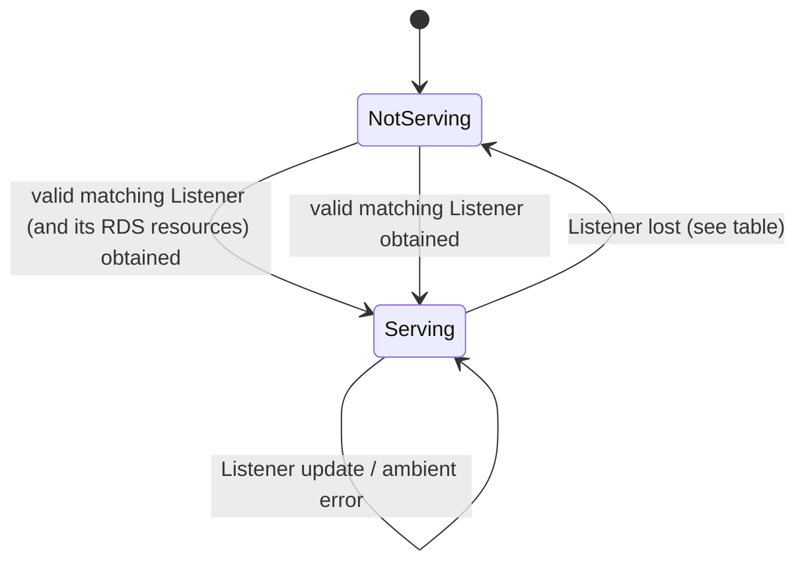

> [!WARNING]
> This document is part of a new, experimental
> [gRPC specification](../README.md). It was generated primarily by AI and has not
> yet been fully reviewed.

# 9.7 xDS-Enabled Servers

<!-- Sources: A36, A47, A41, A88, A29, A39, A71, A78, doc/grpc_xds_bootstrap_format.md -->

> **Introduced by:** [gRFC A36: xDS-Enabled Servers](https://github.com/grpc/proposal/blob/master/A36-xds-for-servers.md)

An *xDS-enabled server* is a gRPC server whose per-connection and per-RPC
behavior (transport security, authorization, and other xDS HTTP filter
behaviors) is configured by an xDS control plane. Applications opt in with a
small code change (constructing the server through the xDS-enabled server
API); from then on, features configured via xDS take effect without further
code changes.

The server obtains its configuration as an xDS Listener resource (a *TCP
Listener*, as opposed to the API Listener used by clients) and any
RouteConfiguration resources it references, via an XdsClient
([XdsClient](02-xds-client.md)) configured by the bootstrap
([Bootstrap](01-bootstrap.md)). Generic server behavior is specified in
[5. Server](../05-server/README.md).

## 1. Server API

The xDS-enabled server wraps a regular gRPC server. It exposes the same
capabilities as a regular server (service registration, adding listening
addresses, start, graceful and immediate shutdown) and additionally:

- **Serving-status notifications.** The application MAY register a
  serving-status callback. The callback is invoked, per listening address,
  when the server starts serving on that address and when it transitions to
  not serving. A not-serving notification MUST carry error information
  (a status code and message) suitable for debugging by developers; the error
  need not be machine-interpretable. Duplicate notifications MAY occur.
  If no callback is registered, the server MUST log each not-serving error and
  each resumption of serving after an error at a log level that is visible by
  default.
- **Drain grace time.** The application MAY configure the *drain grace time*
  used when connections are drained because of a Listener update
  ([Configuration Updates and Draining](#8-configuration-updates-and-draining)). Default: 10 minutes.
- **Credentials.** Any server credentials MAY be used. To use transport
  security configured by the control plane, the application uses
  XdsServerCredentials, which wrap fallback credentials
  ([xDS Security](08-security.md)). Authorization (RBAC) and other xDS HTTP filter
  behaviors apply regardless of the credentials used.

Listening on an ephemeral port (port 0) is not supported by xDS-enabled
servers, since the port is part of the Listener resource name.

<!-- REVIEW(divergence) [XDS_SERVER-1]: No implementation rejects port 0. Java (XdsServerBuilder/XdsServerWrapper) builds the Listener name with ":0" and requires the Listener's port to be exactly 0; the delegate binds an ephemeral port later. Go (xds/server.go Serve) takes an app-bound net.Listener, so the name uses the real port; a Listener with port 0 matches any port. C++ (chttp2_server.cc, xds_server_config_fetcher.cc) names it ":0", treats Listener port 0 as a wildcard, binds after config, and AddListeningPort reports -1, so the app cannot learn the port. Spec says: not supported (A36). -->

### 1.1 Start-up

- If the bootstrap is missing or invalid, or lacks
  `server_listener_resource_name_template`, creating or starting the
  xDS-enabled server MUST fail. The server MUST NOT fall back to running as
  a server without xDS configuration.
- Start MUST NOT fail because of transient xDS conditions such as not yet
  having received configuration from the control plane. Start MAY block until
  configuration is received; in that case the serving-status callback is how
  the application learns of problems preventing progress.
- Before a valid configuration is received for a listening address, that
  address is not serving ([Serving State](#2-serving-state)).

### 1.2 XdsClient

The xDS-enabled server uses an XdsClient
([XdsClient](02-xds-client.md)). All xDS-enabled servers in a process share
one XdsClient, identified by the special key `#server` (the "target" used for
XdsClient metrics and CSDS `client_scope`; see [Client Status Discovery Service (CSDS)](10-csds.md)). The
server releases its reference to the XdsClient when it shuts down.

The server starts one Listener watch per listening address and RDS watches
for referenced RouteConfigurations; it cancels them on shutdown.

## 2. Serving State

Each listening address is independently in one of two states: **not serving**
or **serving**.

**Not serving.** The address MUST NOT serve connections. The server SHOULD
achieve this by not listening on the port. If that is impractical (e.g., after
having started serving), the server MUST accept and immediately close each
connection without sending any bytes (no TLS ServerHello, no HTTP/2
SETTINGS). Either way, clients fail fast and move on to other addresses.
(Accept-and-close is seen as liveness by TCP health checks, so not listening
is preferred.)

**Serving.** Connections are accepted and processed using the current
Listener ([Listener Validation](#4-listener-validation)–[xDS HTTP Filters on the Server](#7-xds-http-filters-on-the-server)).

**Transition to not serving after serving.** Existing connections MUST be
closed, but RPCs already started SHOULD NOT fail: the server SHOULD send a
two-phase GOAWAY and MAY continue to use the previous configuration for RPCs
on those connections during draining. A one-phase GOAWAY (which may fail
racing RPCs in a way the client can transparently retry) is also permitted.
The listening port MAY remain open using accept-and-close.

**Server credentials.** The server need not wait for certificates from
certificate providers before serving; it MAY load credentials lazily. Once
loaded, it SHOULD keep them current.

### 2.1 Events

The Listener watch delivers events as specified in
[XdsClient](02-xds-client.md). The server reacts as follows:

| Event | Effect |
|---|---|
| Valid Listener received whose address matches ([Address Matching](#41-address-matching)) | Apply it ([Configuration Updates and Draining](#8-configuration-updates-and-draining)). If not serving, become serving once applied, and notify. |
| Valid Listener received whose address does not match the listening address | Not serving; notify with an error. |
| Valid Listener received that is not a TCP Listener (e.g., has `api_listener`) | Not serving; notify with an error. |
| Resource-changed notification carrying an error (no usable resource: does not exist, timed out, NACKed with no prior valid version, or a cached resource was dropped because of a data error under the `fail_on_data_errors` server feature) | Not serving; notify with an error. |
| Ambient error (e.g., loss of contact with the control plane, NACK of an update or deletion while a valid resource is cached without `fail_on_data_errors`) | Keep serving with the last valid configuration; log the error. |

Thus, loss of connectivity to the control plane never affects a serving
server: it continues using its most recent configuration until connectivity
is restored. Data errors (NACKs, Listener deletion) affect a serving server
only when the bootstrap enables `fail_on_data_errors`
([Bootstrap](01-bootstrap.md), [XdsClient](02-xds-client.md)).

Status codes received from the XdsClient MUST NOT be propagated to RPCs; RPCs
failed because of xDS configuration problems use `UNAVAILABLE`.

### 2.2 Port Binding Failures

This section applies when gRPC binds the listening port. Where the API has the
application bind the port itself (for example, by passing an already-bound
listener to the server), bind failures happen before gRPC is involved and are
the application's to handle.

If the server cannot bind a listening port (e.g., it is in use by another
process): if this is detected during start, start MAY fail; otherwise the
address MUST enter (or remain in) not serving, notify, and retry binding
periodically (RECOMMENDED: every minute) until it succeeds or the server shuts
down. A bind failure MUST NOT terminate the process.

## 3. Listener Resource Name

The Listener resource name for a listening address is derived from the
bootstrap field `server_listener_resource_name_template`
([Bootstrap](01-bootstrap.md)), which has no default:

1. Let `addr` be the listening address in `IP:port` form, with IPv6 addresses
   in brackets (e.g., `0.0.0.0:8080`, `[::]:8080`).
2. If the template starts with `xdstp:`, percent-encode `addr` so that it
   contains only characters allowed in a URI path (RFC 3986 §3.3, which
   permits `/`); all other characters are percent-encoded. Otherwise, `addr`
   is used verbatim (no special character handling).
3. Replace every occurrence of `%s` in the template with `addr`. If the
   template has no `%s`, it is used as is.

If the resulting name starts with `xdstp:`, its authority selects the entry in
the bootstrap `authorities` map (and thus the xDS servers to use); otherwise
the top-level `xds_servers` are used ([XdsClient](02-xds-client.md)).

Examples: template `grpc/server?xds.resource.listening_address=%s` and address
`[::]:80` → `grpc/server?xds.resource.listening_address=[::]:80`. Template
`xdstp://xds.authority.com/envoy.config.listener.v3.Listener/grpc/server/%s`
and address `0.0.0.0:8080` →
`xdstp://xds.authority.com/envoy.config.listener.v3.Listener/grpc/server/0.0.0.0:8080`.

## 4. Listener Validation

The server watches for an `envoy.config.listener.v3.Listener` resource. General
Listener and HttpConnectionManager validation is in
[Listener (Client Side)](03-resources/02-listener.md). For a TCP Listener the
following rules apply; violations NACK the resource. In the table,
`HttpConnectionManager` is
`envoy.extensions.filters.network.http_connection_manager.v3.HttpConnectionManager`.

| Field | Rule |
|---|---|
| `address` | Required. MUST contain `socket_address` with `protocol` `TCP` and `port_value` ≤ 65535. |
| `listener_filters` | MUST be empty. |
| `use_original_dst` | MUST NOT be `true`. |
| `filter_chains` / `default_filter_chain` | At least one of them MUST be present. Every entry, including `default_filter_chain`, MUST be valid (below). |
| `FilterChain.filter_chain_match` | Valid per [Filter Chain Selection](#5-filter-chain-selection) (CIDR `address_prefix` values MUST be valid IP addresses; `source_type` MUST be a defined enum value). |
| `FilterChain.filters` (network filters) | MUST contain exactly one entry: an `HttpConnectionManager`. (It must be the last entry and names must be unique; since HCM is the only supported network filter, this means exactly one entry.) The type is taken from `Filter.typed_config`, unwrapping `TypedStruct` (a `TypedStruct`-wrapped HCM is then rejected, since the HCM accepts only the serialized protobuf form; see [Listener (Client Side)](03-resources/02-listener.md)); the `envoy.config.route.v3.FilterConfig` wrapper does not apply to network filters. |
| HttpConnectionManager | Valid per [Listener (Client Side)](03-resources/02-listener.md), with `http_filters` validated against the **server** registry ([xDS HTTP Filters](06-http-filters.md)). MUST contain `route_config` or `rds`. |
| `FilterChain.transport_socket` | Valid per [xDS Security](08-security.md). |
| FilterChainMatch uniqueness | After normalization, no two filter chains may have identical matchers ([Normalization and Uniqueness](#52-normalization-and-uniqueness)). |

### 4.1 Address Matching

A Listener matches the listening address if `socket_address.address` equals
the listening IP and `socket_address.port_value` equals the listening port, or
`port_value` is 0 (matches any port). A non-matching Listener is not NACKed,
but the address is not serving ([Events](#21-events)).

## 5. Filter Chain Selection

Each accepted connection is assigned a filter chain from the Listener, which
supplies its transport security configuration and its HCM.

### 5.1 Matching Algorithm

The connection is matched against the `filter_chain_match` of each entry of
`filter_chains`, selecting the **most specific** match using the xDS
algorithm: the criteria below are considered in order; at each step, only
candidates that match the connection on that criterion are retained, and among
those only the ones with the most specific match. A chain that leaves the
criterion unset matches with the lowest specificity.

| Step | `FilterChainMatch` field | Connection property / rule |
|---|---|---|
| 1 | `destination_port` | Requires `use_original_dst`, which is unsupported: a chain that sets it **never matches**. |
| 2 | `prefix_ranges` | Local (destination) IP. Most specific = longest matching prefix. |
| 3 | `server_names` | Requires listener filters (unsupported): a chain that sets it **never matches**. |
| 4 | `transport_protocol` | `"raw_buffer"` matches (more specific than unset); any other non-empty value **never matches**. |
| 5 | `application_protocols` | Requires listener filters: a chain that sets it **never matches**. |
| 6 | `source_type` | `SAME_IP_OR_LOOPBACK` matches if the peer IP is a loopback address or equals the local IP; `EXTERNAL` matches otherwise; `ANY` (default) matches all, with lower specificity. |
| 7 | `source_prefix_ranges` | Peer IP. Most specific = longest matching prefix. |
| 8 | `source_ports` | Peer port. A chain listing the port is more specific than one with no ports. |

CIDR matching: a range matches only addresses of its own family (IPv4 vs.
IPv6). A `prefix_len` of 0 matches all addresses of that family, which is more
specific than an unset field.

If no entry of `filter_chains` matches, `default_filter_chain` is used if
present. If there is no match and no `default_filter_chain`, the connection is
closed without sending any bytes.

Chains with always-failing criteria MAY be pruned when matching connections,
but MUST still be considered in the uniqueness check below.

### 5.2 Normalization and Uniqueness

Because the algorithm must produce a unique result, the Listener is NACKed if
two filter chains have duplicate matchers after normalization. Normalization:

- Replace each matcher by the Cartesian product of the values of its repeated
  fields (`prefix_ranges`, `source_prefix_ranges`, `source_ports`,
  `server_names`, `application_protocols`), producing single-valued matchers
  (disjunctive normal form). For example, two `prefix_ranges` × two
  `source_prefix_ranges` with one `source_type` yields four matchers.
- Normalize each CIDR range: clamp `prefix_len` to [0, 32] for IPv4 and
  [0, 128] for IPv6; treat an absent `prefix_len` as 0; zero the bits of
  `address_prefix` beyond `prefix_len`.
- Two normalized matchers are duplicates if all fields are equal (an unset
  field is distinct from any set value, including a CIDR with `prefix_len` 0).

## 6. Routing on the Server

The HCM of the selected filter chain provides a RouteConfiguration either
inline (`route_config`) or by reference (`rds`, with `config_source` `ads` or
`self`; see [Listener (Client Side)](03-resources/02-listener.md)). Server-side
RouteConfigurations are validated exactly as on the client
([RouteConfiguration](03-resources/03-route-configuration.md)).
Validation does not depend on the route action: routes with
`non_forwarding_action`, `route`, or an unsupported action are all kept in
the parsed resource, and the action is checked per RPC (step 3).

For each RPC:

1. Select the virtual host by matching the RPC's `:authority` against virtual
   host `domains`, using the same algorithm as the client. If none matches,
   fail the RPC with `UNAVAILABLE`.
2. Select the first route whose match criteria match the RPC, using the same
   route-matching semantics as the client (path, headers, runtime fraction).
   If none matches, fail the RPC with `UNAVAILABLE`.
3. If the route's action is not `non_forwarding_action` (e.g., `route`, which
   is expected only on clients, or an unsupported action), fail the RPC with
   `UNAVAILABLE`. No xDS HTTP filter behavior runs.
4. Apply the HCM's xDS HTTP filter behaviors with their effective
   configuration for this virtual host and route
   ([xDS HTTP Filters](06-http-filters.md)), then dispatch the RPC to the
   application.

If the HCM references an RDS resource that is not usable — not yet received
and timed out, does not exist, NACKed with no previous valid version, failed
because of control-plane errors with no cached version, or dropped because of a
data error under `fail_on_data_errors` — every RPC processed by that HCM fails
with `UNAVAILABLE`. The address remains serving.

## 7. xDS HTTP Filters on the Server

> **Introduced by:** [gRFC A39: xDS HTTP Filter Support](https://github.com/grpc/proposal/blob/master/A39-xds-http-filters.md)

The server applies xDS HTTP filters as specified in
[xDS HTTP Filters](06-http-filters.md), using the server registry. Server-side
xDS HTTP filter state MAY be retained across updates, per filter chain, per
Listener, or server-wide ([Filter State Retention Across Updates](06-http-filters.md#6-filter-state-retention-across-updates)). The router is required to be the last
xDS HTTP filter, so every valid HCM ends with it.

## 8. Configuration Updates and Draining

**Applying a Listener.** When a new Listener version is received, the server
first starts watches for the RouteConfigurations it references and waits until
each has been received or has failed (including by resource timer expiry in
the XdsClient, which bounds the wait). Only then is the new Listener applied.
A Listener update identical to the current one is ignored.

**Draining.** Applying a new Listener (including a change only to an inline
`route_config`, which is part of the Listener) affects connections as follows:

- New connections use the new Listener.
- Every connection accepted under the previous Listener is drained gracefully:
  the server sends GOAWAY so clients reconnect (and pick up the new
  configuration), allows in-flight RPCs to continue, and forcibly closes the
  connection after the drain grace time (default 10 minutes, configurable;
  [Server API](#1-server-api)).
- Draining MUST NOT cause spurious RPC or connection failures; in particular,
  the listening port MUST NOT be closed as part of draining.

An update to a RouteConfiguration obtained via `rds` does **not** drain
connections; it takes effect for subsequent RPCs on existing connections.

## 9. Configuration Error Logging

When the server applies configuration it can tell will cause RPC failures, it
SHOULD log a warning each time it receives an update while in that state, and
SHOULD log a single message once no such error remains. This applies to:

- an unusable RDS resource ([Routing on the Server](#6-routing-on-the-server)), and
- a route whose action is not `non_forwarding_action`.

## 10. API Requirements

- The server API MUST provide a way to create an xDS-enabled server that
  supports all the capabilities of a regular server (service registration,
  listening addresses, start, shutdown).
- The xDS-enabled server API MUST provide a way to register a serving-status
  callback that receives, per listening address, serving and not-serving
  notifications, with error information on not-serving.
- The xDS-enabled server API MUST provide a way to configure the drain grace
  time.
- The server credentials API MUST provide XdsServerCredentials that take
  fallback server credentials ([xDS Security](08-security.md)), and the
  xDS-enabled server MUST accept any server credentials.
- Start of an xDS-enabled server MUST NOT fail due to transient xDS conditions.
