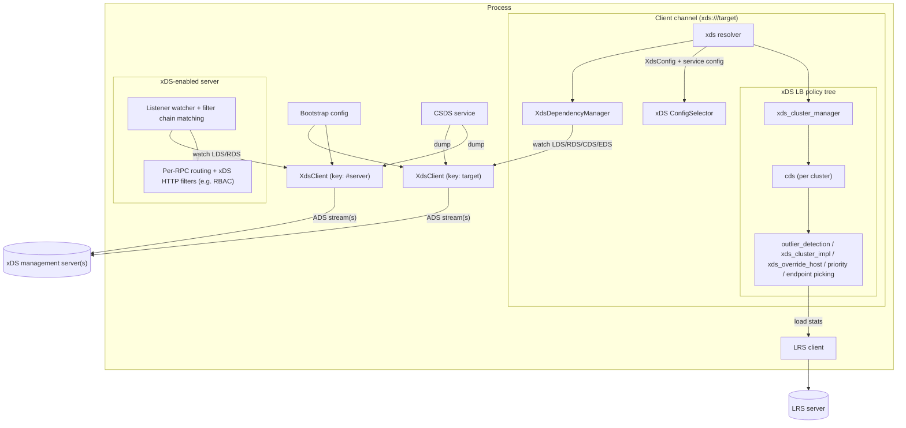

> [!WARNING]
> This document is part of a new, experimental
> [gRPC specification](../README.md). It was generated primarily by AI and has not
> yet been fully reviewed.

# 9. xDS / Proxyless Service Mesh Support

<!-- Sources: A27, A28, A30, A36, A40, A46, A47, A53, A57, A71, A74, A81, A88, A95, doc/grpc_xds_features.md, doc/grpc_xds_bootstrap_format.md -->

gRPC can obtain its configuration from an xDS management server (also called a
*control plane*) using the xDS APIs. This lets gRPC clients and servers take
part in a service mesh without a sidecar proxy ("proxyless service mesh"). The
xDS APIs are a family of publish/subscribe APIs named "*x* Discovery Service".
gRPC uses the following resource types:

| API | Resource type (type URL suffix) | Purpose in gRPC |
| --- | --- | --- |
| LDS | `envoy.config.listener.v3.Listener` | Client: root of the channel's config (an HTTP API listener). Server: the listener for a serving address. |
| RDS | `envoy.config.route.v3.RouteConfiguration` | Virtual hosts and routes, used for per-RPC routing. |
| CDS | `envoy.config.cluster.v3.Cluster` | Cluster config: discovery type, LB policy, security, circuit breaking, outlier detection, load reporting. |
| EDS | `envoy.config.endpoint.v3.ClusterLoadAssignment` | Endpoints grouped by locality and priority; drop config. |
| (EDS list collection) | `envoy.config.endpoint.v3.LbEndpointCollection` | Endpoints for one locality, fetched separately from the EDS resource. |

Full type URLs have the form `type.googleapis.com/<resource type>`.

This section specifies how gRPC uses xDS. The xDS transport protocol itself is
defined by the Envoy and CNCF xDS documentation
(https://www.envoyproxy.io/docs/envoy/latest/api-docs/xds_protocol). This
section describes only gRPC's use of it and where gRPC differs from Envoy.

## 1. Architecture

### 1.1 Common component: the XdsClient

Every xDS-enabled component in gRPC talks to the management server through an
internal **XdsClient** object (see [XdsClient](xds-client.md)). The
XdsClient is configured by the **bootstrap configuration** (see
[Bootstrap](bootstrap.md)). It keeps the ADS streams to the xDS servers,
manages subscriptions, validates and caches resources, and notifies
*watchers* when resources change or errors occur. The XdsClient is not part of
gRPC's public API.

There is one XdsClient instance per data-plane target. All channels created for
the same target share an instance. All xDS-enabled servers in the process share
one instance, keyed by the reserved key `#server`.

### 1.2 Client side

An application turns on xDS for a channel by creating it with a target URI that
uses the `xds` scheme (for example, `xds:///myservice.example.com:8080`). The
client-side components are:

- **xds resolver** (`xds` URI scheme): gets the XdsClient for the target and
  works out the Listener resource name (see [Client](client.md)).
- **XdsDependencyManager**: owned by the resolver. It watches the Listener,
  the RouteConfiguration, every Cluster that the routes reference (following
  aggregate clusters recursively), and the endpoint resources (EDS resources,
  `LbEndpointCollection` resources, or DNS resolution for LOGICAL_DNS
  clusters). When it has a complete, consistent set of resources, it produces
  an `XdsConfig` snapshot. The resolver returns this snapshot to the channel
  as a resolver attribute, together with a generated service config.
- **xDS ConfigSelector**: returned by the resolver. For each RPC, it matches
  the RPC against the virtual host's routes, picks a cluster (applying
  weighted cluster selection), and applies per-route config: timeouts, retry
  policy, hash policies, and xDS HTTP filter config. See
  [Client](client.md) and [xDS HTTP Filters](http-filters.md).
- **xDS LB policy tree**: the generated service config selects
  `xds_cluster_manager` at the top. It has one `cds` child per cluster. Each
  `cds` policy builds its subtree from the `XdsConfig`: for an aggregate
  cluster, a `priority` policy over child `cds` policies; for a leaf cluster,
  `outlier_detection` → `xds_cluster_impl` → `xds_override_host` → `priority`
  (one child per xDS priority) → the cluster's configured endpoint-picking
  policy (by default `xds_wrr_locality` → `weighted_target` →
  `round_robin`). See [xDS LB Policies](lb-policies.md).
- **LRS client**: reports load to the LRS server when a cluster enables it.
  See [Load Reporting](load-reporting.md).

### 1.3 Server side

An **xDS-enabled server** (see [xDS-Enabled Servers](server.md)) gets the
XdsClient instance keyed by `#server`. For each listening address, it builds a
Listener resource name from the bootstrap
`server_listener_resource_name_template` and watches that Listener. The
Listener's filter chains choose the per-connection security config (see
[xDS Security](security.md)) and the HTTP connection manager config. That
config includes RouteConfiguration (inline or via RDS) and xDS HTTP filters
such as RBAC. The server is *serving* or *not serving* depending on whether it
has a valid Listener.

### 1.4 Component diagram

## 2. Design Principles

### 2.1 Transport protocol variant

- gRPC MUST use **xDS v3** only. The ADS method is
  `/envoy.service.discovery.v3.AggregatedDiscoveryService/StreamAggregatedResources`,
  and gRPC requests and accepts only the v3 resource type URLs listed above.
- gRPC MUST use the **Aggregated Discovery Service (ADS)**, where all resource
  types share one bidirectional stream per xDS server.
- gRPC MUST use the **state-of-the-world (SotW)** protocol variant. The
  incremental (delta) variants, non-aggregated (per-type) xDS services, and
  REST or filesystem subscriptions are not used.
- Every `ConfigSource` in a resource that tells gRPC where to fetch another
  resource MUST say to use the same xDS server: `ads` or `self` for RDS and
  EDS references, and `self` for `LbEndpointCollection` references and for
  the Cluster `lrs_server`. The rules are in
  [Common Types](resources/common-types.md).

### 2.2 Handling of unknown and unsupported configuration

The xDS APIs contain many fields that gRPC does not support. To stay
compatible with management servers and newer API versions:

1. **Unknown or unsupported fields MUST be ignored.** gRPC does not log when
   it ignores a field.
2. **NACK when a supported field has an unsupported value.** If gRPC
   supports a field but the resource sets it to a value that gRPC does not
   support (for example, an LB policy that gRPC does not implement in a
   field that requires one), the resource is invalid and the response is
   NACKed.
3. **NACK when ignoring a field would be unsafe.** If ignoring a field would
   weaken security (for example, a security-related setting that gRPC cannot
   honor) or would change how other, supported fields are interpreted, then
   gRPC MUST treat the resource as invalid rather than ignore the field.
4. NACKs work per resource. Valid resources in a NACKed response are still
   accepted and used. Only the invalid resources are rejected. See
   [XdsClient](xds-client.md).
5. Resource-specific validation rules appear in
   [Resources](resources/common-types.md) and in the documents for each
   feature.

Because unsupported field values cause NACKs, operators MUST make sure that
every client supports a feature before configuring it in a way older clients
would reject.

Unknown fields in the bootstrap configuration are also ignored (see
[Bootstrap](bootstrap.md)).

### 2.3 Status codes

The XdsClient passes status codes to its watchers that describe xDS-level
conditions, such as NOT_FOUND for a resource that does not exist. These codes
MUST NOT be passed through to data-plane RPCs. When an xDS condition causes a
data-plane RPC to fail, gRPC MUST use one of the codes that gRPC itself is
allowed to generate, normally UNAVAILABLE (see
[Core RPC Semantics](../02-rpc-semantics/README.md)).

### 2.4 Configuration from a single server

A channel or server listener SHOULD use a set of resources that all come from
the same xDS server. Fallback (see [XdsClient](xds-client.md)) is
therefore decided per authority and per XdsClient instance, not per resource.

## 3. Client Features

gRPC advertises its capabilities to the management server by listing
*client features* in the `client_features` field of the xDS `Node` message.
The `Node` message is sent in the first request on each ADS stream (and on
each LRS stream). gRPC MUST list exactly the features that it supports:

| Client feature | Sent on | Meaning |
| --- | --- | --- |
| `envoy.lb.does_not_support_overprovisioning` | ADS, LRS | gRPC ignores the EDS `overprovisioning_factor` and does not do graceful (overprovisioning-based) failover between priorities or localities. The management server is expected to shift traffic itself when that is needed. |
| `xds.config.resource-in-sotw` | ADS | The client accepts resources wrapped in `envoy.service.discovery.v3.Resource` messages in SotW responses. |
| `xds.endpoint.supports_lb_endpoint_collection` | ADS | The client supports EDS localities that reference `LbEndpointCollection` list-collection resources (see [EDS](resources/endpoint.md)). |
| `envoy.lrs.supports_send_all_clusters` | LRS | The client supports the LRS `send_all_clusters` field (see [Load Reporting](load-reporting.md)). |

gRPC also fills in `user_agent_name` and `user_agent_version` in the `Node`
(see [Bootstrap](bootstrap.md)).

## 4. Server Features

*Server features* are strings in the `server_features` list of an xDS server
entry in the bootstrap configuration. They describe a property of that one
server. gRPC MUST ignore server features that it does not recognize. Full
semantics are in [Bootstrap](bootstrap.md).

| Server feature | Effect |
| --- | --- |
| `fail_on_data_errors` | On a data error (NACK, LDS/CDS deletion, or a server-reported NOT_FOUND or PERMISSION_DENIED) for a resource that is already cached, drop the cached resource and fail. Without it, keep using the cached resource. |
| `resource_timer_is_transient_error` | The does-not-exist timer is 30 s instead of 15 s. When it fires, the result is a transient error (UNAVAILABLE, cache state `TIMEOUT`) rather than does-not-exist. |
| `trusted_xds_server` | The server is trusted for security-sensitive features. This enables authority rewriting (`RouteAction.auto_host_rewrite`). |
| `ignore_resource_deletion` | Recognized but has no effect. |
| `xds_v3` | Recognized but has no effect (v3 is always used). |

## 5. Contents

| Document | Content |
| --- | --- |
| [Bootstrap](bootstrap.md) | Bootstrap configuration |
| [XdsClient](xds-client.md) | Transport, subscriptions, resource naming and federation, watchers, caching, error handling, fallback |
| [Common Types](resources/common-types.md) | Matchers, metadata, and other shared resource types |
| [Listener](resources/listener.md) | LDS: Listener (client side) |
| [RouteConfiguration](resources/route-configuration.md) | RDS: RouteConfiguration |
| [Cluster](resources/cluster.md) | CDS: Cluster |
| [ClusterLoadAssignment and LbEndpointCollection](resources/endpoint.md) | EDS: ClusterLoadAssignment and LbEndpointCollection |
| [Client Data Plane](client.md) | `xds` resolver, XdsDependencyManager, XdsConfig, routing |
| [xDS LB Policies](lb-policies.md) | LB policy tree, xDS LB policy registry, list of xDS LB policies |
| [xDS HTTP Filters](http-filters.md) | Filter framework and the supported filters |
| [xDS-Enabled Servers](server.md) | Serving state, Listener handling, filter chain matching |
| [xDS Security](security.md) | xDS credentials and TLS configuration |
| [Load Reporting (LRS)](load-reporting.md) | Load reporting to the control plane |
| [Client Status Discovery Service (CSDS)](csds.md) | Exposing xDS configuration for debugging |

## 6. API Requirements

- The channel API MUST let an application create an xDS-enabled channel by
  using a target URI with the `xds` scheme (see [Client](client.md)).
- The server API MUST provide a way to create an xDS-enabled server (see
  [xDS-Enabled Servers](server.md)).
- gRPC MUST provide a way to supply the bootstrap configuration (see
  [Bootstrap](bootstrap.md)).
- gRPC MUST provide the CSDS service so that applications can register it on
  a server (see [CSDS](csds.md) and
  [Admin Interface](../07-services/admin.md)).
